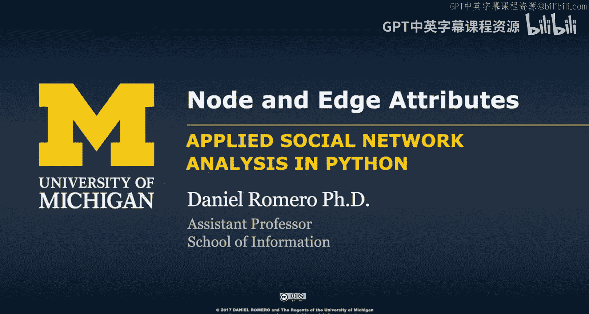
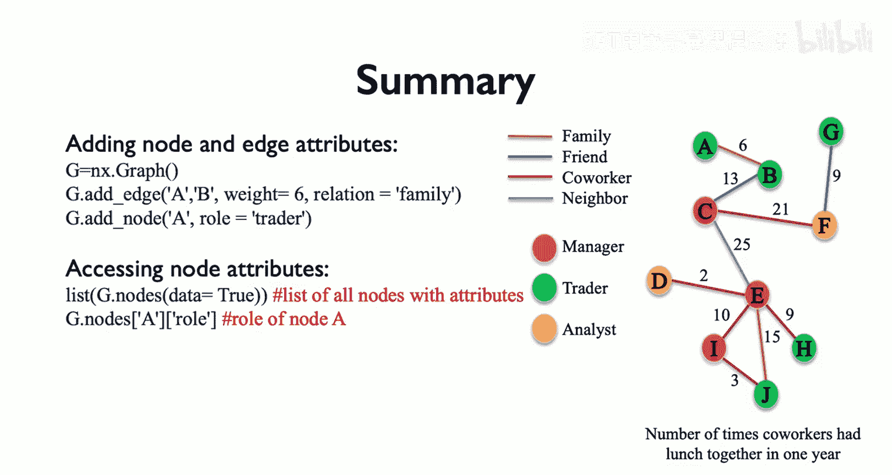

# 密歇根大学《Python用于数据科学实践（4-5课）｜Applied Data Science with Python 》中英deepseek翻译 p23 2_节点与边属性.zh_en -BV1DTtueTEwf_p23-

Last time we saw how we can add attributes to the edges on network X in order to represent different values that they might have on the network。

 so here we have an example of a network where the color of the edges represents the relationship between the nodes。

And there's a number on the edges that represent how many times they had lunch together。

In the previous video we saw that to construct this graph。

 we can add attributes to the edges when we create them。

So here we're adding the edge AB with the attribute weight of six。

And the attribute relation of family。And same thing for other edges。

 we'll also add the edge B and C with weight 13 and relation friend。In this video。

 we're going to look at how to add and access attributes of both edges and nodes in different types of graphs。

So let's say you have a network and the edges have multiple attributes。

 how do we access these attributes？Well let's start with the edges。

 let's say you just want a list of all of the edges for that you can use the function edges without any input and this will give us a list of all of the edges in the network without any of the attributes。

Since we only have two edges in this network that we've added， our list is pretty short。Now。

 if you wanted to get a little more data on these edges， then you would use the same function。

 but now you would say data equals true， and now you get all of the edges and their attributes。

For each edge， you would get triplets with the notes A and B as the first two entries。

 those are the endpoints of the edge。And then you get a dictionary as the third entry。

The dictionary has the attribute names as the keys， so in this case we have weight and relation。

And the corresponding value， so in this case， we have weight of six and relation family。

And same thing for all of the other edges。Now， let's say that we're only interested in a particular attribute。

Then you can say data equals relation， for example。

 and now you get triplets that will have the two nodes and the value of the attribute for the two nodes。

 so we have the node A and B and then the relation is family。

But what if we want to access the attributes of a specific edge without listing all of the attributes of all of the edges。

 this could be useful in particular if you're working with a very large network。

 think of a network with millions and millions of edges。

 you wouldn't want to list all of those edges。But maybe you want to access a particular one。

You can do that by passing the two notes you are interested in to edges。

 and this returns a dictionary with each of the attributes as keys and their value。

And if you are only interested in a specific attribute。

 you can of course access its value in the dictionary for example。

 you can access the weight of the edge BCC and get the value 13。

Notice that because this graph is undirected， the order in which we place the endpoints of the edge does not matter。

So if you were to ask for the weight of the edge C instead of BC， the answer is still 13。

But what if we have a directed network， let's change our network so that the edges now have direction。

We would now construct the network using the directed graph class that we saw before。

And then we would add the edges and their attributes in the exact same way we did before。Like this？

But now we have to pay attention to the direction， so when we're adding the edge A B。

 we have to add it in this specific order， AB and not BA， since the edge goes in this direction。

We could also access the attributes of the edges in the same way。

 so here we're asking for the weight of the edge B， which is 13。

But if we switch the order and ask for the weight of the edge BC。

 you would get an error because this edge doesn't exist。So when we're using a directed graph。

 the order really matters because the edges have a very specific direction。

So now let's see how this works for multigraphs， as we saw before。

 the way you would represent a network that has multiple edges between the same pair of nodes is by using the multigraph class。

And now we can add multiple edges connecting the same pair of node multiple times。

 and you can give them different attributes。So here we're going to be adding an edge that connects the endpoints A and B。

 and it's going to have a weight of six in a relation family。

And now we're going to be adding another edge connecting the same endpoints。

 but now its going to have weight of 18 and relation friend。

And we're also going to add a third edge BC。Now how do we access the attributes of these edges？Well。

 if we ask for the attributes of the edge AB， we will get a dictionary of the attributes for each of the edges that connect the endpoint A and B。

Here is a dictionary for the first edge which is labeled zero because that's the first one we entered。

And this one has relation， family， and weight of six。

And then we get another entry with a dictionary that contains information for the second edge that we entered。

 which has the weight of 18 and relation friend。If we're interested in a specific attribute for a specific edge。

 let's say the first one that we added， then we can access it directly like this。

Here we're asking for the weight of the first edge between notes A and B， which is6。

And the zero here indicates that we're asking for the first edge， if we were to change the0 to a1。

 then we would get the weight for the other edge， which is 18。

Note that because this is an undirected graph， the order in which we enter the endpoints doesn't matter。

So now let's consider a multigraph that is both weighted and also directed。For this kind of graph。

 we'll actually use a class we haven't seen before。

 it is the multiD graph which stands for multidirected graph。

 and of course now the edges have direction and there can be multiple edges between any two pair of nodes。

Let's add the edges in the same way we did before， but now we have to be careful about how do we add them。

 we have to make sure we add them in the right direction， so here we're adding the edge AB。

 another edge AB as we did before and then the edge CB。

And we can access the attributes of these edges in the same way we did before。

 but now the order matters， so if we ask for the weight of the first edge， we get6。

And if we were to ask for the weight of the edge B。

 then we'll get an error because this edge doesn't exist again。

 order matters now that the graph is directed。So far。

 we have talked about how to add and access attributes of edges。

 but we could also imagine having attributes stored on the notes。

Let's go back to this example of how many times coworkers had lunch together and what kind of relationship they have。

We could imagine that the notes can also have attributes of interest， for example。

 imagine that they are colored by their role in the company。

 let's say this is a hedge fund in some of the notes are managers。

 or there are traders and or there are analysts。And so this adds a little bit more information that we may want to capture when we construct their network。

 so how can we do this？Well， we can begin to construct the network by adding the edges as we did before。

And now we also want to add attributes on the nodes， and to do this we can use the function add node。

 so here we're adding node A， and we're giving it the role trader。

Note that even though this node A is already in the graph because we already added the edge AB。

 we can sort of add it again to set the attribute of the node without interfering with the edge。

 so the edges are still going to be there， even though you're adding this node A again。

And now let's add the role of node B， who's a trader and the role of node C， who's a manager。

And then to access these attributes， we do it in the following way first。

 if we just want a list of all of the nodes without any of the attributes。

 we can use the function nodes with no input and we get our three notes that we've added。

But if we wanted the attributes of the nodes， then just like we did for edges。

 we would say data equals true。And now we get a dictionary with the attributes of each of the notes。

We can also access the role of a specific node without generating a list of all of them， for example。

 here we're accessing the role of Note C who's a manager。And so we get that value of manager。

In summary， in this lecture， we looked at how we can add and access attributes for notes in the edges。

And depending on what we're doing in the size of the network。

 sometimes we want to list all of the nodes and all of the edges with and without their attributes。

 but sometimes we want to access the attributes of a specific node in a specific edge。

Thank you for listening to this video and I hope to see you in the next one。

