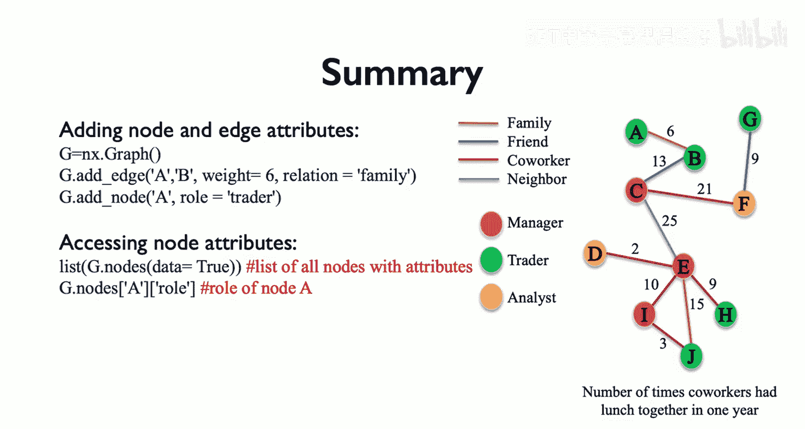

# Python用于数据科学实践：4-5课：节点与边属性


在本节课中，我们将学习如何在NetworkX库中为网络图中的节点和边添加属性，以及如何访问这些属性。属性可以存储额外的信息，例如边的权重、关系类型，或节点的角色。

上一节我们介绍了如何创建基本的网络图。本节中我们来看看如何为图中的元素（节点和边）添加和访问额外的信息，即属性。

## 添加边属性

我们可以通过在创建边时指定属性来为边添加信息。例如，可以添加表示“权重”和“关系”的属性。

以下是添加带属性边的代码示例：

```python
import networkx as nx

# 创建一个无向图
G = nx.Graph()
# 添加边及其属性
G.add_edge('A', 'B', weight=6, relation='family')
G.add_edge('B', 'C', weight=13, relation='friend')
```

## 访问边属性

有多种方法可以访问边的属性，具体取决于你需要获取所有边的信息还是特定边的信息。

以下是访问边属性的几种方法：

1.  **获取所有边（无属性）**：使用 `G.edges()` 可以获取所有边的列表，但不包含属性。
2.  **获取所有边及其属性**：使用 `G.edges(data=True)` 会返回一个列表，其中每个元素是一个三元组 `(节点A, 节点B, 属性字典)`。
3.  **获取特定边的所有属性**：使用 `G.edges[('A', 'B')]` 会返回连接节点A和B的边的属性字典。
4.  **获取特定边的特定属性**：在获取属性字典后，可以通过键名访问具体属性值，例如 `G.edges[('B', 'C')]['weight']`。

## 有向图中的边属性

对于有向图，边的方向至关重要。添加和访问属性的方法与无向图类似，但必须注意边的顺序。

以下是创建和访问有向图边属性的代码：

```python
# 创建一个有向图
DG = nx.DiGraph()
DG.add_edge('A', 'B', weight=6, relation='family')
DG.add_edge('B', 'C', weight=13, relation='friend')

# 访问属性时顺序必须正确
print(DG.edges[('B', 'C')]['weight'])  # 输出：13
# print(DG.edges[('C', 'B')]['weight'])  # 这会报错，因为边不存在
```

## 多重图中的边属性

多重图允许同一对节点之间存在多条边。每条边都可以拥有独立的属性。

以下是创建和访问多重图边属性的代码：

```python
# 创建一个无向多重图
MG = nx.MultiGraph()
MG.add_edge('A', 'B', weight=6, relation='family')
MG.add_edge('A', 'B', weight=18, relation='friend')  # 第二条A-B边
MG.add_edge('B', 'C', weight=13, relation='friend')

# 访问一对节点之间的所有边及其属性
print(MG.edges[('A', 'B')])
# 输出类似：{0: {'weight': 6, 'relation': 'family'}, 1: {'weight': 18, 'relation': 'friend'}}

# 访问特定边的特定属性（通过键索引）
print(MG.edges[('A', 'B')][0]['weight'])  # 输出：6
print(MG.edges[('A', 'B')][1]['weight'])  # 输出：18
```

## 有向多重图中的边属性

有向多重图结合了有向边和多重边的特性。需要使用 `MultiDiGraph` 类。

以下是创建和访问有向多重图边属性的代码：

```python
# 创建一个有向多重图
MDG = nx.MultiDiGraph()
MDG.add_edge('A', 'B', weight=6, relation='family')
MDG.add_edge('A', 'B', weight=18, relation='friend')
MDG.add_edge('C', 'B', weight=13, relation='friend')  # 注意方向是C->B

# 访问属性
print(MDG.edges[('A', 'B')][0]['weight'])  # 输出：6
# 顺序至关重要
# print(MDG.edges[('B', 'A')][0]['weight'])  # 这会报错
```

## 添加与访问节点属性

除了边，节点也可以拥有属性。可以在添加节点时或之后为其设置属性。

以下是添加和访问节点属性的代码：

```python
# 创建一个图并添加带属性的边
G = nx.Graph()
G.add_edge('A', 'B', weight=6, relation='family')
G.add_edge('B', 'C', weight=13, relation='friend')

# 为节点添加属性（即使节点已存在）
G.add_node('A', role='trader')
G.add_node('B', role='trader')
G.add_node('C', role='manager')

# 访问节点属性
print(G.nodes(data=True))
# 输出类似：[('A', {'role': 'trader'}), ('B', {'role': 'trader'}), ('C', {'role': 'manager'})]

# 访问特定节点的属性
print(G.nodes['C']['role'])  # 输出：manager
```

## 总结

本节课中我们一起学习了如何在NetworkX中处理节点和边的属性。我们掌握了以下核心操作：
*   为边和节点添加自定义属性。
*   使用 `edges()` 和 `nodes()` 方法，配合 `data` 参数，来列出所有元素及其属性。
*   通过指定节点对或单个节点来访问特定边或节点的属性。
*   理解了在处理有向图、多重图和有向多重图时，边的方向和索引的重要性。



根据网络的大小和分析需求，你可以选择一次性获取所有属性，或是高效地查询特定元素的属性。