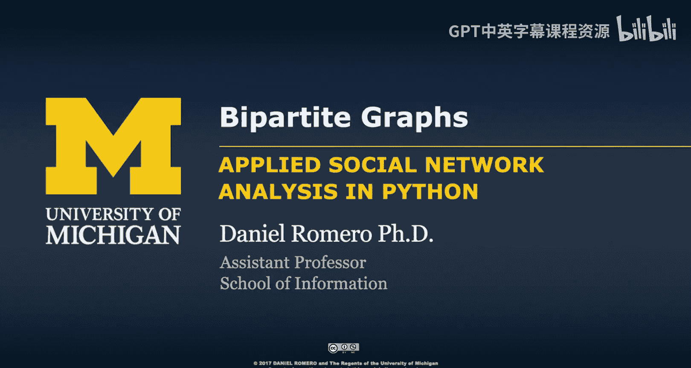
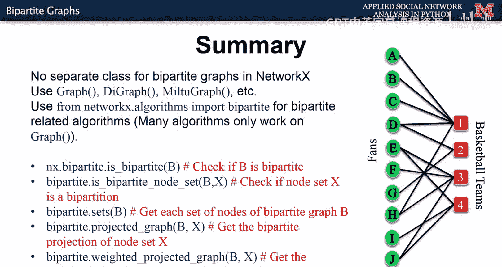
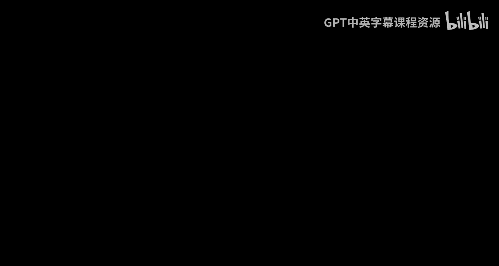

# 密歇根大学《Python用于数据科学实践（4-5课）｜Applied Data Science with Python 》中英deepseek翻译 p24 3_二分图结构.zh_en -BV1DTtueTEwf_p24-

So in the past videos we've looked at different types of graphs， we've looked at undirected graphs。

 directed graphs， multigraphs， signed graphs， weighted graphs， and so on。

We haven't looked at a particular type ofgraph that is very interesting and useful for certain types of applications and these are called bipartite graphs so before I tell you what the actual definition of a bypartite graph。

 let me give you a little sense for in what kinds of cases they're important or just a particular example of what describes a bipartid graph so here's an example of fans of specific basketball teams so the notes on green ABC。

 D and E are people who are fans of basketball teams one，2， three and four。And here。

 the edges represent the fact that a particular fan is a fan of a particular team。

So one aspect of this graph is that you couldn't imagine that it would make sense to add an edge between the fans。

 because fans are not fans of other fans， they're fans of teams or edges between the basketball teams because basketball teams have fans they're not really fans of other teams。

So this graph has the particular structure that all the edges go from one set of nodes to another set of nodes。

 in this case， one set of notes is fans and the other set of notes is basketball teams。

And that's exactly what a bipartite graph is， so just to be a little bit more specific。

 a graph is a bipartite graph。If it has two sets of nodes。

 which we call L and R and every single edge connects a node from L to R。

 so no edge connects a node from L to another node in L and no edge connects a node in R to another node in R。

And so in this particular example， the two sets would be the sets of fans， this will be L。

And the set of basketball teams， which would be R。Network X does not have a separate class for bipartite graph。

 but it does have a set of algorithms that allow us to study them and to analyze them and to do things with them and so for that we would import bipartite to get that set of algorithms so to construct these bipartite graph what I'm going to do is I'm going to use the class graph like I said there's no separate class for bipartite graphs。

And now the first thing I'm going to do is I'm going to add the notes and to add the notes I'm going to use the function add notess from rather than add node and what this allows me to do is to add a set of nodes from a list so rather than adding one by one I can add all of the notes all at once。

 and then I'm going to give these set of notes an attribute called bipartite and I'm going to give that value zero and what I'm basically doing here is I'm telling network X that these set of node are going to be one side of my bipartite graph。

And in this case will be the left side。And then I'll add the notes from the other side。

 so I'll add notes1 through four， and this will have value one for the bipartheid attribute。

And then I can add the edges and same thing here， you can apply these to other cases not only when you're using this to construct bipart graphs。

 but if you use the function add edges from， it allows you to add a list of edges rather than adding one edge at a time。

Which is very useful sometimes。Okay， so now we've added， we've constructed these bipartite graph。

 notice that I gave it the name B rather than G just so it stands for bipartite。Okay。

 so what kinds of things can we do in network X with biparte graphs？

So first thing we can check if a particular graph is bipartite。

 so for this would use the function is bipartite and this would say yes， it is bipartite。

Now notice that if we were to add the edge AB， so these would add like this right here。

Then now the graph b is no longer bipartid because。

There aren't two sets that are such that all the edges go from one set to the other。

 I'm breaking that rule when I add this edge right here。 And so then when I ask if B is byid。

 I would it would say false because it's no longer apartpartid。

Let's remove edge AB to keep our graph by part。What else can you do？

You can also check if a set of nodes。It's a bipartition of the graph and by that I mean is this set of node one of the two sets of nodes such that all the edges go from one set to the other？

And so for example， if I construct a set x to be the nodes1 through4。

 I can ask if this set of nodes x is a bipartition of the graph B by using this function here。

 and then it would tell me yes， it's a this is a bipartition of this graph B。

Same thing if I were to add the nodes A through E。He would say that it is a bi partition。

If I construct the set 1，2，3，4 and the node A， and I ask whether that's a bipartition of the graph。

 then it would say， no， it's false because it's not true that all the edges go from this set on 12，3。

4 a to the rest of the nodes， and so this would be false。

The other thing we can do is if we don't know which two sets are the two bipartitions of the graph。

 then we can ask network X to output those two sets， so if we say sets of B。

 then it would output the two sets that are bipartitions of the graph。

Notice that if we again add the edge AB here， then B is no longer bipartid。

 and so what would happen if we ask for the two bipartitions of this graph B。

 which is no longer bipartidite， well we'll get an error that says graph is not bipartid so it's not possible to find the two sets。

Let's remove again edge A B to keep our graph bypartite Let's look at this slightly larger example of a bipartite graph that has the same meaning so on one side we have fans and on the other side we have basketball teams。

Now imagine that you were interested in creating a network among the fans。

And have the edges represent some type of affinity in terms of what teams they follow。

 whether they kind of tend to follow the same teams or not。

This kind of network could be important for viral marketing。

 so if two people tend to follow the same teams， they might also like the same。

other type of product and so you would be interested in knowing who is likely to impact whom in terms of that other product and the fact that they follow the same kinds of teams might give you that hint and so this kind of network could be useful for certain things。

 but let's you say that you're interested in constructing that network。Well。

 you can do this in what it's called it's called the L bipartite graph projection of thepartite graph。

 and what it is is a network among the nodes in one side of the group， in this case， the L side。

 in this case the fans， where each pair of nodes is connected if they have a common neighbor in the R side of the bipartite graph。

So in this case， there would be exactly a network between the fans such that they're connected if they have at least one team in common。

You would have a similar definition for the R bipartite graph so that would be a network among the basketball teams that in two teams would be connected if they have at least one fan in common。

So why would that network look like for the fans？So again。

 it's a network of fans who have at least one team in common。This looks something like this。

So in this network， the edge AH appears in the projection because both A and H are fans of team1。

And the edgedge JE appears in this network because they're both fancy team four。Okay。

 so you can actually get network X to give you this projected network and the way you do it is again you define the graph。

 you add all the edges， so we're constructing in this case the bipartid graph B。

 and now we want to get we defined X to be the set of fans。

And then we use the function projected graph and it takes input a B， which is the bipartite graph。

 and then x which is the set of notes that you want the projected graph on。

 and then you get this network， so now this is the network P。

Now what if you wanted the projected graph for the teams so in this case you would now say x is the set of basketball teams？

And then P will be the projector graph using that set。

 And then this is the network that would come out。 So in this network。

 the nodes1 and2 are connected because they both have at least one fan in common。

 They have C in common。 But in fact， as you can see here， they have also B and E in common。 So B。

 C and D are all fans of one and 2。Now let's compare that with the edge1 and three and edge1 and 3 appears here in the projected graph because both teams one and three have H SF n in common。

But notice that it's only one fan， so E13 has one fan in common， whereas12 has three。

This suggests that we actually probably would want to have weights on these edges so we would want to know that actually one and two yes they have at least one in common but in this case is three whereas one and three they have only one fan in common so that's something we would like to capture and indeed that's something you can capture so this is called the L bipartite weighted graph projection and what it is is well just like we saw rather than just defining an edge in the projected graph to be connect any two nodes that have at least one connection in cominging on the other side now we're going to add weights on these edges and their weights are going to be proportional to the number of common neighbors that they have。

So the weighted projected graph for the basketball teams would look like this now where now we have the edges and we also have a number next to them that。

Says how many common neighbors they have and here I have the size of the edges be also proportional to that weight just to show you visually the difference。

And in Network X， you can use the weighted projected graph to now output not just the projected graph。

 but the weighted projected graph in this case of the basketball teams。

 you could do the same thing for the set of fans。So in summary。

 in this video we've looked at bipartan graphs， the main thing is that， well the definition。

 right what it means， so two sets of nodes and all the edges go from one set to the other and no edge goes from the set to itself。

And then to construct them on network X， we're not going to use a separate class。

 we use the same classes that we already know。But rather we use a set of algorithms that allow us to do certain things for bipartitegraphs。

 now I will note that many of the algorithms that are available only work for the graph class。

 and so that's something you have to kind of be careful with。

The kinds of things we looked at here that you can do is you can check if a graph is bipartite。

 you can check if a set of nodes is a bipartition of the graph。

 you can actually try to get the two bipartitions of the graph if the graph is bipartite， if not。

 then you'll get an error。And we talked also about the projected graphs， which can be useful。

 like in the case of the fans and basketball teams。

 it would be useful to see what teams have fans in common and what fans have teams in common and you can get these projections using a network X with the projected graph and then the weighted projected graph which now adds not only an edge if the two teams have at least one fan in common but it actually captures how many。

And this is the end of this lecture， and I hope to see you in the next one。

