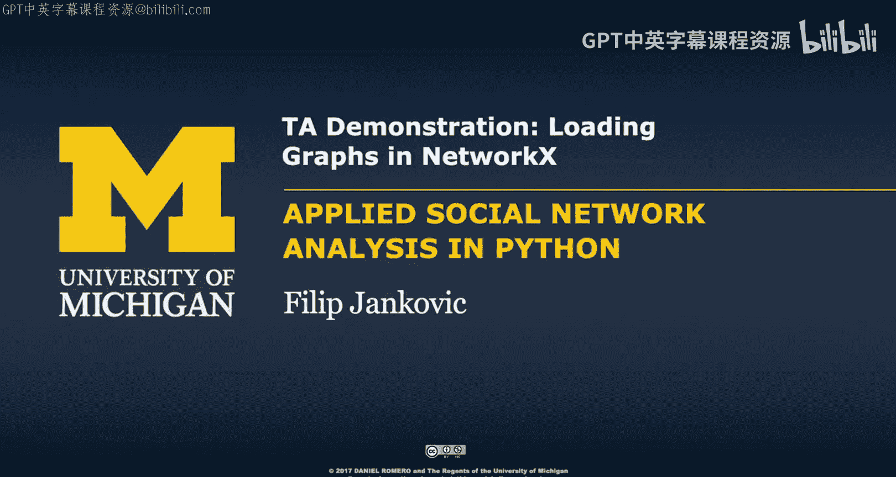
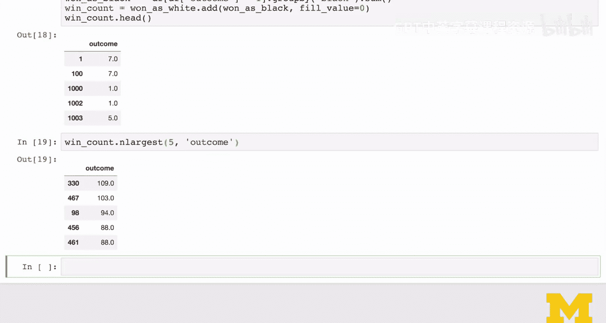

# 密歇根大学《Python用于数据科学实践（4-5课）｜Applied Data Science with Python 》中英deepseek翻译 p25 4_助教演示：NetworkX图数据加载.zh_en -BV1DTtueTEwf_p25-

Hi， everyone。Today we'll be looking at loading graphs using Network X。

Graphs can come in a variety of different formats， it can be a little tricky to know just how to read them into a network X graph。

First， let's take a look at this graph I created G1， which will be loading in from various formats。

Network X has some built in functions for plotting graphs that we can use to visualize them if they aren't too large。

Let's use one of them， draw network X， to quickly visualize our new graph。

Now let's take a look at how this graph looks like in a few different file formats and how to read each of these。

The first format we're going to look at is called the adjacency list。

The adjacency list format is useful for graphs without nodes or edge attributes。

Let's take a look at what the file Gaglist。txt looks like。

This format consists of lines with node labels。The first label in each line is the source node。

 While subsequent labels correspond to connected target nodes。For example。

 looking at the first line of GAlist。 TxT， we can see nodes1， 2， 3， and 5 are all connected to node0。

Note that each line only adds nodes that weren't in previous lines as source nodes， For instance。

 in the second line of G Alist do TXT， node 0 is not included because the connection between nodes 0 and 1 has already been accounted for。

We can read in a graph in this format using Network X's Read A list function。

We can also pass int to node type to make sure the nodes are read in as integers instead of this function's default strings。

Looking at the edges， we can see that these match up with our initialization of G1 above。

The next format is called an adjacency matrix， each element in the matrix indicates whether pairs of vertices are adjacent。

For example， looking at the Numpier A GMmat。Noode0 corresponding to the first row of the array。

 is adjacent to nodes 1， 2，3， and 5。If this were a multigraph。

 we would see numbers larger than one in this matrix。

 indicating the number of edges between a pair of nodes。

To convert an adjacency matrix into our network graph， just pass it into anX do graph。

Looking at the edges， we can see these also match up with our previous graphs。Next。

 let's take a look at the E list format。The edge list format is useful for graphs with simple edge attributes and without node attributes。

This format is not good for networks with isolated nodes。Looking at the G Edge list file。

 the first two columns might look familiar。Those are the node pairs corresponding to edges of the graph from above。

But notice in this format， we can have additional columns for edge attributes。For example。

We can see the edge from node 0 to node 1 has a weight of  four。To load this graph in。

 we can use the read E list function。The data parameter expects a list of tus with names and types for edge data。

Looking at this graph's edges， we can see that we've successfully loaded this graph。

 including the weights。Note the type of the node in this example。

 the node is of type string instead of integer。Be careful as this might be different than what you are expecting。

 as each of these functions may have different defaults。

Network X also lets you create graphs from Pada's data frames。

This can be very useful if you need to perform any analysis or data muing on your network data。

Our data frame will need to have a similar structure to the E list format。

Then we can use the from pandas data frame function， passing in the data frame， the source nodes。

 target nodes， and edge attributes。And taking a look at the edges looks like we've successfully loaded up that graph from the data frame。

In addition to these formats， Network X also has built in functions to easily read in more structured formats such as GML or JSON。

Now let's look at a step by step example of reading in a more complex network and analyzing it。

We'll be working with a network of chess games in Elist format。

Let's look at the first five lines of chessgra。txt。

Each node corresponds to a chess player and a directed edge represents a game。

With the white player in the first column having an outgoing edge and the black player in the second column。

 having an incoming edge。The weight of the edge in the third column represents the outcome。

 one for white win，0 for draw， a negative one for black one。

The data file also includes a column of approximate times stamps in the fourth column for when the games were played。

To read in this network， we use the function， read Edge list， passing in the name of the file。

 and the list of tuples with the edge attributes。We're also going to tell the function that we want to create the network using a multi directed graph。

This is important because otherwise the function will use the default undirected graph and direction and additional edges will be lost。

Let's check to make sure our new graph is a directed multigraph。Good。

 now let's look at the edges with attributes。Looks like we've successfully imported our chess network。

Now let's find out which player played the most games in our network by looking at the degree or number of edges of each node。

The degree function returns a dictionary of the number of edges connected to each node。

Note that this is a directed network， and the degree function returns the sum of both in degree。

 the number of incoming edges and out degree， the number of outgoing edges。

We can then use this dictionary to find the maximum value in the dictionary。

Find the key that corresponds to the player with the max value by using a list comprehension。

You can see that the player with the most games is player 461 and has played 280 games。

Let's do one more example using pandas to find the players that won the most games。First。

 we create a data frame using our graph's edge data。Looking at the data frame created。

 the outcome column has dictionaries with the edge attributes。

Let's use map and a Lambda function to pull out the outcome value from those dictionaries。

Now let's find the number of times a player one is white by finding where outcome is one。

Grouping by white and sming all of those values。Similarly。

 to find the number of times a player won is black。We look at where outcome is negative one。

 group by black， some the values， and multipplied by negative one。To find the win count。

 we add up the number of times a player one is white and is black。

We can use the add function and pass in a fill value of 0。

 which will set missing values to 0 to let us find the number of games one for players that happen to only play as black or as white。

Using N largest on our Win count data frame。We find the players that won the most games with playerer 330。

 having won the most games at 109。

That wraps it up for this tutorial。Hopefully， this has given you some insight on the different ways a graph can be represented。

 as well as how to load different formats into network X。 Thanks for watching。

