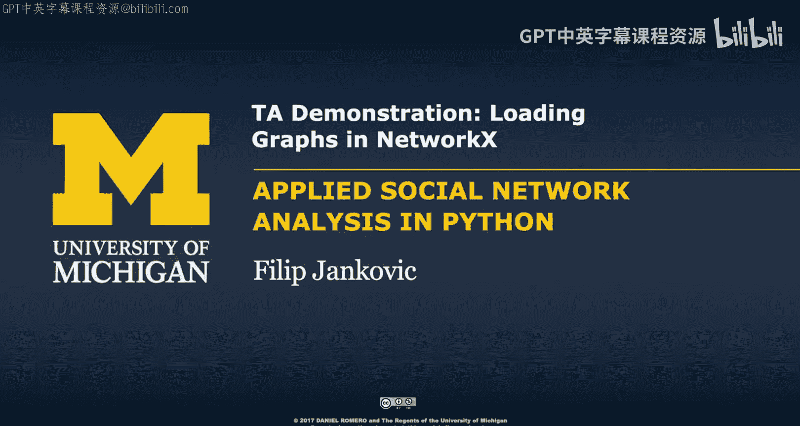
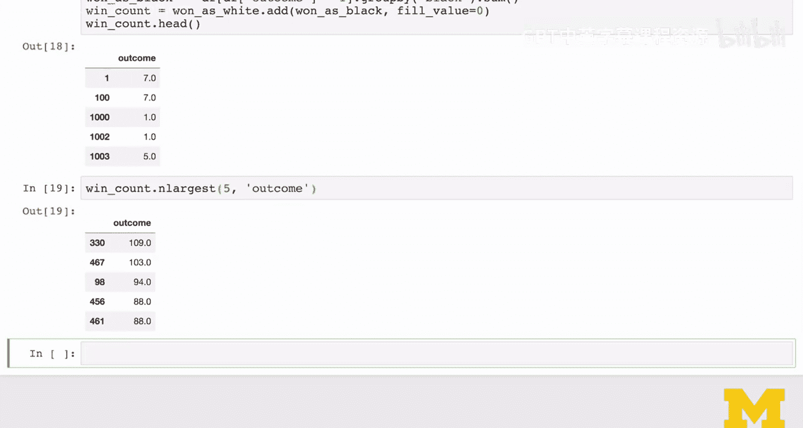

# Python用于数据科学实践：4：NetworkX图数据加载 📊




在本节课中，我们将学习如何使用NetworkX库加载不同格式的图数据。图数据有多种存储格式，了解如何将它们正确读入NetworkX图对象是进行图分析的第一步。

## 概述


我们将首先创建一个示例图，并使用NetworkX的内置函数进行可视化。接着，我们会逐一探讨几种常见的图数据格式，包括邻接表、邻接矩阵和边列表，并演示如何将它们加载到NetworkX中。最后，我们将通过一个国际象棋对弈网络的实例，进行更复杂的分析和数据操作。

## 创建与可视化示例图

首先，我们创建一个名为`G1`的示例图，用于后续的格式加载演示。如果图不是特别大，我们可以使用NetworkX的内置绘图函数来快速可视化它。

以下是使用`draw_networkx`函数可视化图的代码示例：

```python
import networkx as nx
import matplotlib.pyplot as plt

# 假设 G1 已经创建
nx.draw_networkx(G1)
plt.show()
```

现在，让我们看看这个图在不同文件格式下的表现形式，以及如何读取每种格式。

## 加载不同格式的图数据

图数据可以以多种格式存储。以下是几种常见格式及其加载方法。

### 邻接表格式

邻接表格式适用于没有节点或边属性的简单图。它由多行文本组成，每行的第一个标签是源节点，随后的标签是与该源节点相连的目标节点。

例如，文件`adjlist.txt`的内容可能如下所示：
```
0 1 2 3 5
1 2 4
2 3 5
3 4
4 5
5
```
第一行表示节点0与节点1、2、3、5相连。注意，后续行只添加之前未作为源节点出现过的节点。

我们可以使用NetworkX的`read_adjlist`函数来读取这种格式的图。通过设置`nodetype=int`参数，可以确保节点被读取为整数类型，而不是默认的字符串类型。

```python
G_adjlist = nx.read_adjlist("adjlist.txt", nodetype=int)
```

检查图的边，可以看到它们与之前创建的`G1`图相匹配。

### 邻接矩阵格式

在邻接矩阵中，矩阵的每个元素表示一对顶点是否相邻。例如，一个NumPy数组的第一行对应节点0，如果该行在列1、2、3、5处的值为1，则表示节点0与这些节点相邻。如果是多重图，矩阵中的值可能大于1，表示节点对之间的边数。

将邻接矩阵转换为NetworkX图，只需将其传递给`nx.Graph`构造函数（对于无向图）或`nx.DiGraph`（对于有向图）。

```python
import numpy as np
adj_matrix = np.array([[0,1,1,1,0,1],
                       [1,0,1,0,1,0],
                       [1,1,0,1,0,1],
                       [1,0,1,0,1,0],
                       [0,1,0,1,0,1],
                       [1,0,1,0,1,0]])
G_matrix = nx.Graph(adj_matrix)
```

检查其边，同样与之前的图一致。

### 边列表格式

边列表格式适用于具有简单边属性但没有节点属性的图。这种格式不适合包含孤立节点的网络。

文件`edgelist.txt`的内容可能如下：
```
0 1 {'weight': 4}
0 2 {'weight': 1}
0 3 {'weight': 2}
0 5 {'weight': 3}
1 2 {'weight': 5}
```
前两列是构成边的节点对，后续列可以包含边属性，例如权重。

使用`read_edgelist`函数加载此类图。`data`参数需要一个元组列表，来指定边数据的名称和类型。

```python
G_edgelist = nx.read_edgelist("edgelist.txt", data=[('weight', int)], nodetype=int)
```

检查图的边，可以看到我们成功加载了图及其权重属性。请注意，在此示例中，节点的类型是字符串而非整数。不同的读取函数可能有不同的默认设置，使用时需小心。

### 从Pandas DataFrame创建图

如果你的网络数据需要进行任何分析或数据整理，从Pandas DataFrame创建图会非常有用。

DataFrame的结构需要类似于边列表格式。然后，我们可以使用`from_pandas_edgelist`函数，传入DataFrame、源节点列名、目标节点列名和边属性列名。

```python
import pandas as pd
df = pd.DataFrame({
    'source': [0, 0, 0, 0, 1],
    'target': [1, 2, 3, 5, 2],
    'weight': [4, 1, 2, 3, 5]
})
G_df = nx.from_pandas_edgelist(df, 'source', 'target', edge_attr='weight')
```

检查其边，表明我们已成功从DataFrame加载了该图。

除了上述格式，NetworkX还内置了函数来轻松读取更结构化的格式，如GML或JSON。

## 实例分析：国际象棋对弈网络

现在，让我们通过一个分步示例，来学习如何读取和分析一个更复杂的网络。我们将使用边列表格式的国际象棋对弈网络。

首先，查看文件`chess_graph.txt`的前五行：
```
0 1 1 2018.01.01
1 2 -1 2018.01.02
2 0 0 2018.01.03
3 4 1 2018.01.04
4 5 -1 2018.01.05
```
*   每个节点对应一位棋手。
*   一条有向边代表一局对弈：第一列的白棋手有一条出边，第二列的黑棋手有一条入边。
*   第三列的边权重代表结果：1表示白方赢，0表示平局，-1表示黑方赢。
*   第四列包含对弈时间的大致时间戳。

我们使用`read_edgelist`函数读取这个网络，传入文件名和边属性的元组列表。同时，我们指定创建一个`MultiDiGraph`（有向多重图）。这一点很重要，因为如果使用默认的无向图，方向和额外的边信息将会丢失。

```python
chess_graph = nx.read_edgelist("chess_graph.txt",
                               data=[('outcome', int), ('timestamp', str)],
                               create_using=nx.MultiDiGraph())
```

检查确认新图是有向多重图：
```python
print(type(chess_graph))  # 应输出 <class 'networkx.classes.multidigraph.MultiDiGraph'>
```

现在，查看带属性的边，确认已成功导入国际象棋网络。

### 找出对局最多的棋手

通过查看每个节点的度（即连接的边数），我们可以找出网络中参与对局最多的棋手。`degree`函数返回一个字典，包含每个节点连接的边数。注意，这是一个有向网络，`degree`函数返回的是入度和出度之和。

```python
degree_dict = dict(chess_graph.degree())
max_degree = max(degree_dict.values())
player_with_max_degree = [player for player, degree in degree_dict.items() if degree == max_degree]
print(f"对局最多的棋手是 {player_with_max_degree[0]}，对局数为 {max_degree}。")
```

### 使用Pandas找出获胜最多的棋手

我们还可以使用Pandas进行更复杂的分析。首先，从图的边数据创建一个DataFrame。

```python
edge_data = list(chess_graph.edges(data=True))
df_chess = pd.DataFrame(edge_data, columns=['white', 'black', 'attr_dict'])
```

DataFrame的`outcome`列包含边属性的字典。我们使用`map`和`lambda`函数从中提取结果值。

```python
df_chess['outcome'] = df_chess['attr_dict'].map(lambda x: x['outcome'])
```

接下来，找出每位棋手作为白方获胜的次数（`outcome == 1`）和作为黑方获胜的次数（`outcome == -1`）。

```python
# 白方获胜
white_wins = df_chess[df_chess['outcome'] == 1].groupby('white').size()
# 黑方获胜（结果乘以-1后求和，得到正数）
black_wins = df_chess[df_chess['outcome'] == -1].groupby('black').size() * -1
```

为了计算总胜场数，我们将白方胜场和黑方胜场相加。使用`add`函数并设置`fill_value=0`，可以处理那些只作为黑方或白方参赛的棋手数据。

```python
win_count = white_wins.add(black_wins, fill_value=0)
```

最后，使用`nlargest`函数找出获胜最多的棋手。



```python
top_winners = win_count.nlargest(5)
print("获胜最多的棋手：")
print(top_winners)
```

## 总结


本节课中，我们一起学习了如何使用NetworkX加载不同格式的图数据。我们从邻接表、邻接矩阵、边列表等基本格式入手，并演示了如何从Pandas DataFrame创建图。最后，通过一个国际象棋对弈网络的实例，我们实践了读取复杂网络、检查图类型以及使用NetworkX和Pandas进行基本分析（如计算节点度和分析胜率）的完整流程。希望本教程能帮助你理解图的不同表示方法，并掌握将它们加载到NetworkX中的技能。