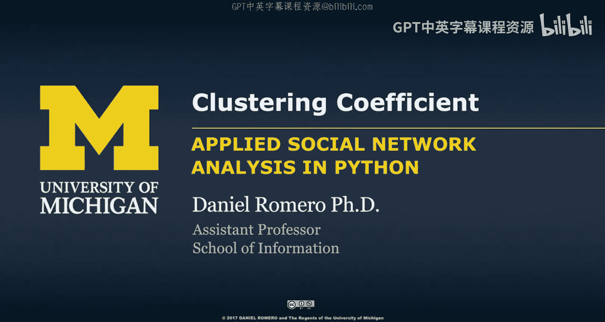
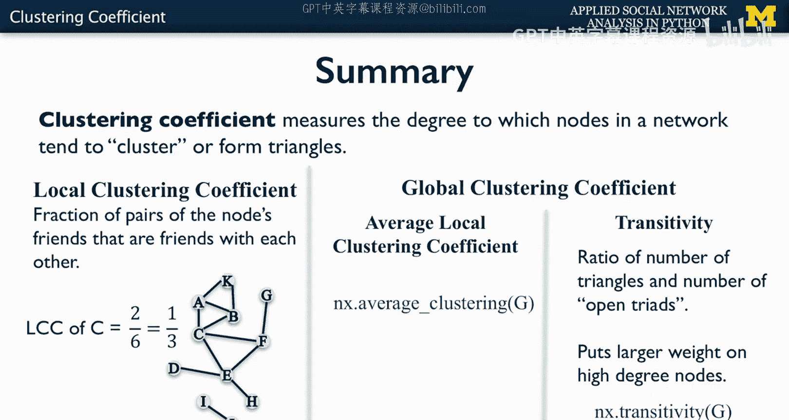
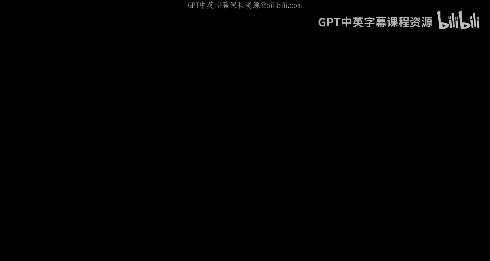

# 密歇根大学《Python用于数据科学实践（4-5课）｜Applied Data Science with Python 》中英deepseek翻译 p26 5_聚类系数分析.zh_en -BV1DTtueTEwf_p26-

Hi， today we're going to be talking about tritic closure。

 Tritic closure is the tendency for people who share lots of connections to form a connection themselves。

 so we come connected。 so people who share lots of friends have an increased likelihood of becoming connected themselves。

 There are many mechanisms that give rise to this process but today we're going to be focusing on figuring out how to measure it in the network。

So let's say you have a network like this and youre asked what edges are likely to come to the network next。

 what edges are likely to arrive？Well， try to closer would say that those edges that close triangles are good candidates for edges that may show up next。

 so here all the red edges form triangles， close triangles。

 and so these are good candidates for edges that may show up。However。

 we don't always have timestamps or we don't always know the ordering in which the edges come into the network。

 sometimes we're just giving a network a static network with no timestamps and sometimes we want to know whether tri closure is present in this network。

 whether it has lots of triangles or not。And so what we're going to be talking about in this video is how can we measure the prevalence of try toclo in the network？

Another way of referring to thritic closure is clustering。

So lots of the definitions that we're going to be covering today are referred to clustering。

So we'll start with a local version of measuring clustering。

 We're going to be measuring clustering from the point of view of a single node and this is called a local clustering coefficient and the way it's defined is is the fraction of pairs of the nodes friends that are friends with each other。

 The best way to show you how local clustering coefficient works is by showing you an example。

 So let's say you wanted to compute the clustering coefficient of node C。

What you would need to do is to take the ratio of the number of pairs of Cs friends who are friends with each other。

And the total number of pairs of C's friends。Okay， so C has four friends in this network。

 that means that C has a degree of four。That's what we refer to as degree is the number of connections that an node has。

 and we refer to it as DC as well。 So DCc here， which is the degree of C is 4。Now。

 how many pairs of seas friends are there， Well there are four。Friends of C。

 and you can easily see that if you have four pairs of four people。

 then there are six total possible pairs of people。

 And so the total number of pairs of C's friends is 6。

 Now this is easy to see because there is only four friends of C。

 but sometimes you know if there are many more and it might be harder to see how many possible pairs of friends you have。

 So what you can do is you can just use this formula here， which tells you how many。

 it's Dc times dc -1 over 2。 In this case， that number is 6。Which is 12 over two。Okay。

 so that will be a denominator。 What are about de numerator。

 the number of pairs of friends of C who are friends with each other。 Well。

 there are only two pairs of friends of C that are friends with each other， A B and EF。

 so that number is 2。So then the local clustering coefficient of note C is two over6 or13。

 that means that one third of all the possible pairs of friends of C who could be friends are actually friends。

Okay， let's do another example， compute the local cluster and coefficient of node F。 again。

 we need to compute the ratio of the number of pairs of F' friends who are friends with each other and the total number of pairs of F's friends。

So we'll do the same thing here。 F has a degree of 3。

 so the number of pairs of F's friends is three times 2 or2， which is 3。

And then there's only one pair of friends of F who are actually friends with each other。

 that's C and E。And so the local clustering coefficient of f is also1 third。All right。

 in one last example， compute the local cluster and coefficient of node J。All right， so node J has。

Only one friend， which is note I。Which means that J actually has zero pairs of friends。

And because that's what we're supposed to put in the denominator。

 we're in trouble because we cannot divide by zero。And so what we're going to do for cases like this。

 where the definition doesn't work for node that have less than two friends。

We're going to assume that nodes that have less than two friends have a local cluster coefficient of zero。

 and this is consistent with what network X does。Al right， so Ton about network X。

 how do you compute the local clustering coefficient using network X？Well。

 let's say we load up this graph in the way that we already know how to do it。

And we compute the clustering， we use the function clustering to compute the local clustering coefficient of node F。

This case， it's 0。33， we have seen。For node A， it is 0。66 and for node J， as we had seen， it is 0。

Okay， so this allows you to compute the local closer in of each node in the graph。

But what we were interested in is trying to figure out whether tri toclo is preval in the whole network and so how do we go from having a local measure of clustering coefficient for each node to a global measure of clustering coefficient for the whole network？

We're going to talk about two different approaches。 The first one。

 which is pretty simple straightforward is to simply take the average local cluster coefficient or all the nodes in the graph。

And you can do this in network X by using the function average clustering of the graph G。

 and in this case， that is 0。29。That's approach， number one。A second approach。It's the following。

We're going to try to measure the percentage of open triads in the network that are triangles。 Okay。

 so what are open triads and what are triangles？Triangles are simply three nodes that are connected by three edges。

And this is called a triangle because it looks like a triangle。

Now open triads are three nodes that are connected by only two edges。

The thing to notice here is that a triangle actually contains three different open tris， right。

 So if we consider this triangle here。You will notice that it contains three different open triads。

 The first open triad considers the three nodes and all the edges that these two edges。

But not this one。That is the first open triad， but you can also consider the three nodes and these two edges in this one。

Or we could consider the three nodes and these two edges， but not this one。So inside each triangle。

 there are three different open tris。So if you go out in the network and count how many triangles it has and then it count how many possible open Tris it has for each time that you see a triangle。

 you're going to count three different open tris。And so what we're going to do for this second approach for measuring clustering coefficient。

 which is actually called a transitivity， is simply that it's going to take the number of close triads。

 which are the triangles multiplied times 3 divided by the number of open triads。

And that is the percentage of open triads that are actually triangles or close tris。

You can use network X to get the transitivity of the network by using the function transitivity。

 and in this case， this network has a transitivity of 0。41。Okay。

 so we have two different ways of measuring the global clustering coefficient。

 Are these two ways the same， Which one is better， are there differences between the two， Well。

 it turns out that there are differences between the two。

They both try to measure the tendency for the edges to form triangles。

 but it turns out that transitivity weights the notes with a larger number of connections higher。

 it weights the notes with a larger degree higher。The best way to see that is by looking at examples。

So here is one this graph that kind of looks like a wheel。If you look at this graph closely。

 you'll find that most nodes actually have a pretty high local clustering coefficient。

 so all the nodes that are on the outside of the wheel have a local clustering coefficient of one because each one of these nodes you see that it has two connections so it has one pair of friends and that pair of friends is connected each so this node here has a local clustering coefficient of one and the same is true for all the nodes on the outside of the wheel So most nodes have a high local clustering coefficient。

However， if you consider the node inside the wheel， the central node there。

 that one has a pretty high degree， but it has a very low clustering coefficient。

That is because it has many， many connections and many pairs of connections。

 and only a few of those are actually connected to each other。 But most of them are not connected。

 for， for example， these two nodes are not connected。 These two nodes are not connected。

 These two nodes are not connected and so on， even though all of them are friends with that central node。

So in this graph。The average clustering coefficient is pretty high it 0。

93 because most nodes have high， a very high local clustering coefficient except for one。However。

 the transitivity of this network is 0。23 and that's because transitivity weights the node with high degree higher。

 and so in this network there's one node of very high degree compared to the others that has a very small local cluster coefficient compared to the others and transitivity penalizes that。

 so you get a much lower transitivity。Okay， can you see an example that goes the other way around。

 Well here is this network。In this network， most nodes have a very low local clustering coefficient。

 So each one of these outer nodes here has a local clustering coefficient of。Of zero。

 because they either have only one friend or they have two friends， but those two are not connected。

 and there are 15 node like that。The nodes inside here， there are only five nodes like that。

 they have high degree and then they have high local clustering coefficient。

 so when you look at the average cluster coefficient and transivity。

 you find that the average local clustering coefficient of these network is pretty low because most nodes。

 the 15 outer nodes have very low local clustering coefficient。

 however the transitivity is high because the node with high degree happen to have high local clustering coefficient。

So these two graphs show you the differences between the local clustering coefficient。

 the average local clustering coefficient and transitivity。

 one weights the nodes with large degree higher。In summary。

 we've learned that cluster and coefficient measures the degree to which node in a network tend to cluster or form triangles。

And there are several ways in which you can measure this。So in the first way。

 we look at the local clustering coefficient and this is measured on a node by node basis and in two other ways we found the global clustering coefficient。

 which measures clustering coefficient on a global scale for the whole network。

For the local clustering coefficient， this one is defined as simply the fraction of pairs of a node's friends who are friends with each other。

And just to remind you， in this case， the local clustering coefficient of node C was one third because one third of the pairs of friends of C are actually friends with each other。

For global clustering coefficient， the first way in which we could measure this was by simply taking the average of the local clustering coefficient over all the node。

 and you could use the function average clustering and networkor X to do it。

And then the second way was trans distinct transitivity。

 which was the ratio of the number of triangles and the number of open triads in a network。

And this one puts a larger weight on high degree nodes compared to the average local clustering coefficient。

 and you can measure it on network X using the function transitivity。

This is all for today， Thank you for watching， and I hope to see you next time。

