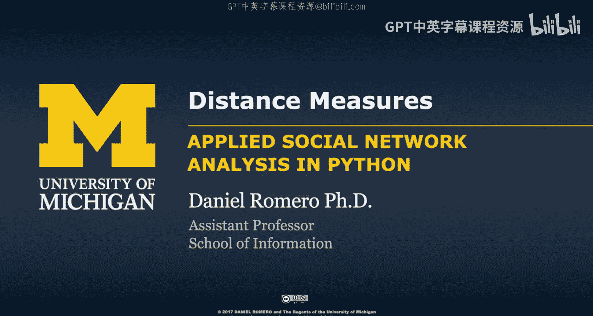
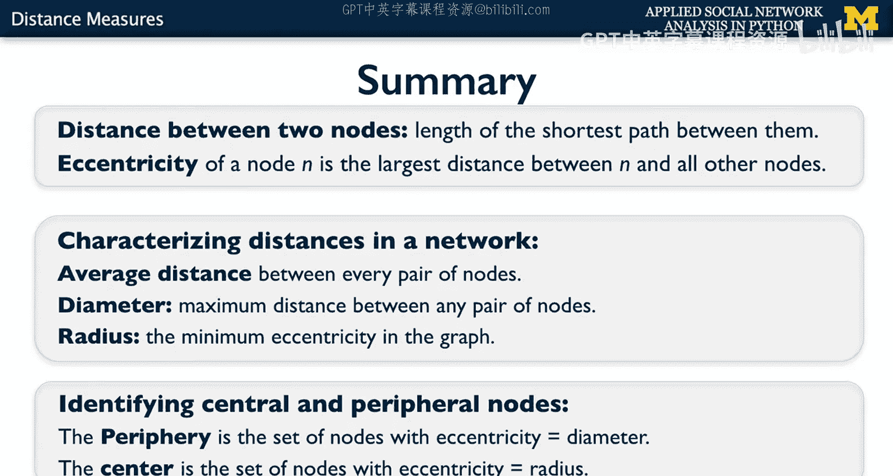

# 密歇根大学《Python用于数据科学实践（4-5课）｜Applied Data Science with Python 》中英deepseek翻译 p27 6_网络距离度量.zh_en -BV1DTtueTEwf_p27-

Hello， today we're going to talk about the concept of distance in social networks。

So the idea here is that sometimes we like to know how far nodes are away from each other。 So。

 for example， in this network that you see here， how far is node A from node H。Or wed like to know。

 for example， are some nodes far away from each other and other node close to each other in general in this network？

And if so， which nodes are the closest and which nodes are the furthest away from each other in the network？

To answer all these questions， we need to develop a concept of distance between nodes。

And that's what we're going to do in this video today。So to answer this question。

 the first concept we need is the concept of a path。

 A path is simply a sequence of nodes that are connected by an edge。 So for example。

 we can find paths that go from the node G to the node C。Here's the path GFC。

And you can find different paths， so for example， here's the path GFEC。

So how far is node A from node H？Well， we will look at different paths that go from A to H。

 so for example， we can find a path A， B， C， E H。And notice that this path it takes four hops to get from A to H。

And there are other paths， so for example， there is the path A， B， C， F， E H， which takes five hopps。

And so for a path， we're going to define the path length to be the number of steps that it contains from the beginning to the end。

 so in this case path1 has length  four and path2 has length 5。

And to define a distance between two nodes， we're going to define it to be the length of the shortest possible path between the two nodes。

So going back to the question of what is the distance between node A to node H。

 the answer is 4 because the shortest path between a and H has four hops or has length  for。

In network X， you can use the function shortest path to find the distance from any node to any other node。

 So here in this example， I'm finding the distance between node A and H in the graph G。

 which is the graph that you see here。 And so here you get the path。

 the shortest path between A and H。If you're interested in just the length of this path。

 then you can use the function's shortest path length and this gives you the length of this path。

 which is four。Okay， so sometimes what wed like to do when we have real social networks is to find a distance from a single node to all the other nodes in the network to figure out how far away are other nodes from this specific root node in this case。

 a， let's say we're interested in figuring out what distance from node A to all the other nodes in the network is。

Well， this is something that you can easily do manually in the network that's very small like this。

 but this could become very tedious to do manually if you have a very large social network。

And so what you can do is you can。Program a computer to do this。

 And so what we're going do is we're going talk about an efficient or one of the efficient ways that we have to compute the distances from a given node to all the other nodes。

 And this one is called breathth first search and what it basically does is that you started a node and you start kind of discovering different nodes。

 a different layers and at each given layer。 you discover the set of nodes that are one distance away from the nodes that were in the previous layer。

 So I'm going to walk you through an example of how breadth first search works。

So here we have the network and we're interested in figuring out the distance from node A to all the other nodes in the network。

 So what we're going to do is we're going to start at a and we're going to start discovering new nodes as we kind of walk through this network and we're going to be writing down all the nodes that we discover So we start at a and we sort of process the node A by looking at who is connected to a in this case can be are connected to a and so those are going to be a distance1 away because they the shortest path from each one of those nodes to a is just one hop a half of length1。

Okay， so now we're going to process each one of the newly discovered nodes and ask which nodes are connected to this newly discovered node that we haven't discovered yet。

 and those nodes are going to be assigned to the next layer。 So let's say we process node B。

Note B is connected to K， A and C， but we've already discovered nodes A and K。

 so the only node that we discover here is node C。Now we're going to process node K。

And node K is connected to node A and B， but we've already discovered both of those。

 So the only newly discovered node is node C， and it's a distance two away from a。

Now we process Note C， which is connected to B， F and E。And here we've already discovered B。

 so the only two node that we discover are F and E。And those are a distance three away from a。Okay。

 now we're going to process note E。Okay， note E has five connections。

And out of those five CF we have already discovered， so the only new ones are the other three。

 which are D I and H。So we assign those to the next layer now we process node F。

 which is connected to three nodes， G， C and E， but the only one we haven't discovered yet out of all those is G。

 so that I want gets assigned to the next layer and all of those nodes are a distance 4 away from a。

Okay， now we have to process each one of those newly discovered notes。

 And by now you can see that we're already almost done here。 So let's。Let's process node D。

 which is only connected to E， but we've already discovered E， so D does not discover any new nodes。

Now let's go with I， I is connected to E and J， and we haven't discovered J yet。

 so this one is assigned to the next layer。Next， we process H， which is only connected to E。

 but we already discovered E， and finally we process G， which is connected to F。

 which you've already discovered， so G is a distance 50 away。Alright， we have to process J。

 but J is only connected to I， which we already discovered。 And now we're done。

 We've processed all the notes There are no new notes to discover。

And so here you can see how we efficiently figure out the distance between a and all the other nodes in the network。

 And this is something that you can。Program using a computer to do this in an efficient way。

You can use network X to run the breathth first search algorithm by using the function B。

 F S underscore3。 And what it does is it gives you the tree that we've built and this graph that we。

buuilt here is called a tree and is the tree of the node that you discover。

 and so with this function you're able to obtain this tree。

 So if you look at the edges of the graph T here you get that these are the edges of that tree。

 so theres AK and AB and Bc and so on。Now if you're interested in not necessarily the tree in the order in which these nodes were discovered。

 but simply the actual distances between a and all the other nodes。

 then you can use shortest path length and you give it the graph which in this case is G and the node。

 the root node in which in this case is A and you get a dictionary of all the distance is from the node to all the other nodes。

 so a is a distance 0 from itself， a distance 1 from B， a distance 2 from C and so on。Okay。

 so we've defined a distance between any two nodes in a network。

 but if we go back to the original questions we had in the beginning。

 we were interested in sort of characterizing the distances between all pair of nodes in the graph。

 Our nodes in general close to each other far away from each other if some are closing and some are far。

 then how can we figure out which are close and which are far and so on。

And so now we're going to try to answer these questions。

 So the first thing you can do is you can simply take the average distance between every pair of nodes in the network。

In network X， you can do that by using the function average shortest path length in G and in this case this graph has an average path length of 2。

53， so that means that on average， any pair of node in this graph are distance than 2。

53 from each other。So that tells you what sort of on average， what happens now。

 what is the maximum possible distance between any two nodes thats sort of like what are the two nodes that are furthest away from each other。

 how long is that， how far away from each other are they。

 This is called a diameter and is you simply the maximum distance between any two pair of nodes。

And in network X， you can use the function diameter to get it。

 and in this case the diameter of the graph is 5， and you can see that by looking at the distance from K to J。

 which has a length of 5。The other thing that is useful to define is the eccentricity of a node。

 the eccentricity of a node is the largest distance between the node and all the other nodes in the network。

 so you take a node， measure the distance from the node to all the other nodes and figure out which one of those instance is the largest one well。

In network X you can use the function eccentricity to get all those distances and here you can see。

 for example， that a has an eccentricity of 5 as we had seen has a distance5 to some node when in this case that's J so that's pretty large that's actually as big as it could get right because the diameter。

 the largest possible distance between two nodes was5。But if you think of a node like， for example。

 node E here， which looks like it's sort of closer to all the other nodes。

 then you see that it has a eccentricity of three， which means that no node in this graph is a distance larger than 3 from node E。

And so now that you have these eccentricities， the radius of the graph is the minimum eccentricity in the network。

 it basically asks which node or not which node， but what is the maximum distance that a node has from all the other nodes？

That's eccentricity and the radioius sticks the smallest one of those。And in network X。

 you can use the function radius to get the radius of the network and as you could see from the dictionary of eccentricities。

 the radius of this network is three。The next question we had was now that we know how to calculate distances and now that we have a sense for what is a large distance in the network。

 like the diameter and what is the short distance like the radius。

 we can try to identify which nodes are sort of far away from all the other nodes and which nodes are close to all the other nodes。

So for the first one， we have the periphery， which is the set of nodes in a graph that have an eccentricity equals to the diameter of the network。

 which is sort of the largest eccentricity that you could have since the diameter is the largest distance between any two nodes in the network。

AndSo if you apply this definition to this graph， you find that the periphery of this graph are the nodes A。

 K， and J， you can get these set of nodes using network X function periphery。

And as you would sort of imagine， these node tend to be sort of on the outskirts of the network。

 far away from all the other nodes。The opposite concept is the concept of nodes that are central。

 so the center of the graph is a set of nodes that have eccentricity equal to the radius。

And when you check which nodes are in the center in this graph using the center function network X。

 you find that C， F and E are node that are in the center of the graph。

 and this is sort of like it makes sense there in towards the center of the graph。

 they tend to be close to the most other nodes。Okay。

 so with these tools now you're able to take a look at a network。

 a real social network and start to ask questions about how far are these node from each other。

 Which node are central， which node are not and so on。

 So let's run an example in this using the karate Club network。

 which we had seen in a previous video。 So this is a network of friendship in a karate Club。

And as you may remember， the story here is that node1 is the instructor of the karate Club and this note 34 is an assistant and they have some type of dispute。

 they're not friends with each other and so the club actually splits into two groups and sort this is the separation of the two groups so this set of students on the left go with one of the instructors or with the assistant and the other ones go with with the original instructor So if we take this network and apply the definitions about distances that we just covered。

 we can discover far notes are from each other and who's central and who's not。

So let's begin by loading up this network。 This network is so famous that actually a network X。

 you can simply load it by using the function karate Club graph。

 so that one returns this particular graph。 Now I'm converting the nodes labels to the integer so that they match the figure I have here。

 So that's what I'm doing with that command there。And then I can ask different questions about the network。

 So in this case， this， the average shortest path between the node is about 2。41。

 The radius of the network is 3。And the diameter is5， so meaning theres there are pair of node here。

 distance they are distance5 away from each other， and that's the largest that the distance can be。

Then we're going to ask who's at the center of this network。

 so here are the nodes that are in the center and here I'm highlighting them in red so as you can see the instructor is in the center and all the other nodes that are in the center are also connected to the instructor and they also have tend to have high degree so they easily sort of connected to many other high- degree nodes and they just have small distances from them to all the other nodes in the network。

Now when you look at the periphery， these are the peripheral nodes and I'm highlighting them here in blue and as you can see they're kind of on the outside。

 they tend to have small number of connections and none of them are actually connected to the instructor。

Now， you may look at this and say， okay， this is， this makes sense。 but for example。

 this note 34 was the。Ssistant here。 he seems pretty central， right。

 He's connected to a bunch of nodes。 He seems like he could be close to all the other nodes in the graph as well。

 Why why is 34 not showing up in the center？ Well， it turns out that if you look carefully node 34 has a distance 4 to node 17 right So to get from 34 to 17。

 you have to go 34，32，1，6 and 17。And so it couldn't be in the center because the radius of the graph is 3 and this one has a。

Note that it's the distance far away from it。Now it turns out that actually if this Note 17 was just a bit closer。

 for example， if this Note 17 was a distance3 away from 34。

 then 34 would actually be in the center because 34 is a distance at least at most three to every other node in the network。

And so this shows that this definition of center is pretty sensitive to just one node that happens to be far away right if you make a very small change to the graph that makes particular node far further away from the other。

 you can sort of make it or break it for the node to be in the center or not and in the future we'll look at other measures of centrality for nodes that are less sensitive to small changes like that。

So to summarize， we've looked at a set of。Measures， the first one is the distance between two nodes。

 and that was defined to be the length of the shortest path between the two nodes。

And the eccentricity of a node， which is defined to be the largest distance between the node and all the other nodes in the network。

 Both of those definitions take place at the either node level or at the pair of nodes level。

We've also looked at definitions that sort of take place at the whole graph level。

 they try to characterize the distances in the whole network。

 and they were the average distance between any two pair of nodes， the diameter。

 which is the largest distance between any two pair of nodes， and then the radius。

 which was the ballest eccentricity in the graph。And then we used those definitions to identify the periphery and the center of the graph。

 which is the sets of nodes， the periphery is the sets of nodes with eccentricity equal to the diameter and the center is a set of nodes with eccentricity equal to the radius and that's all for this video and I hope to see you in the next one。

