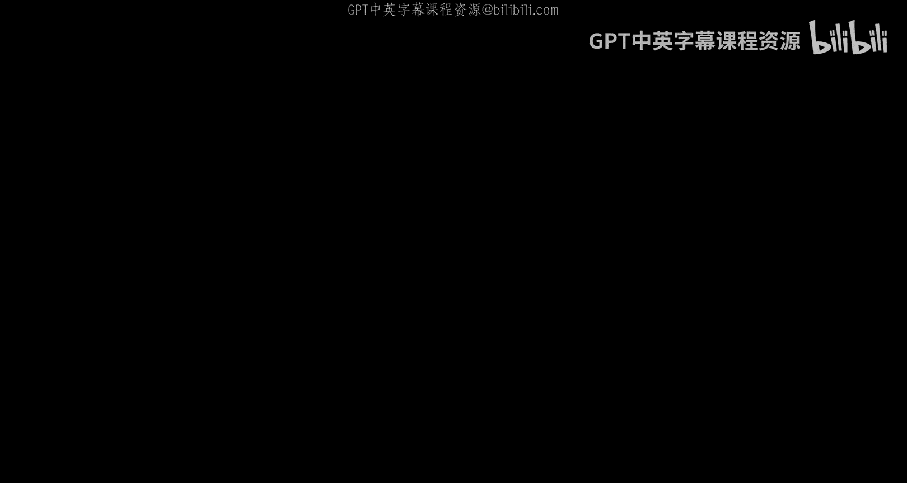
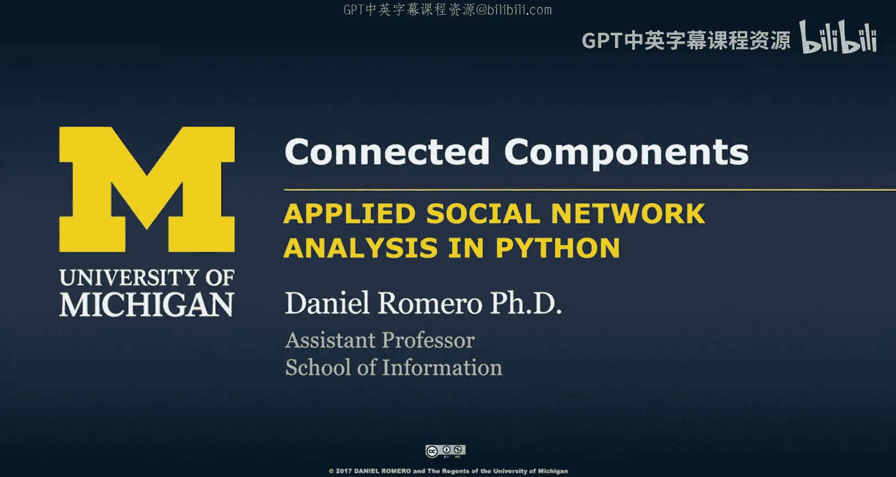
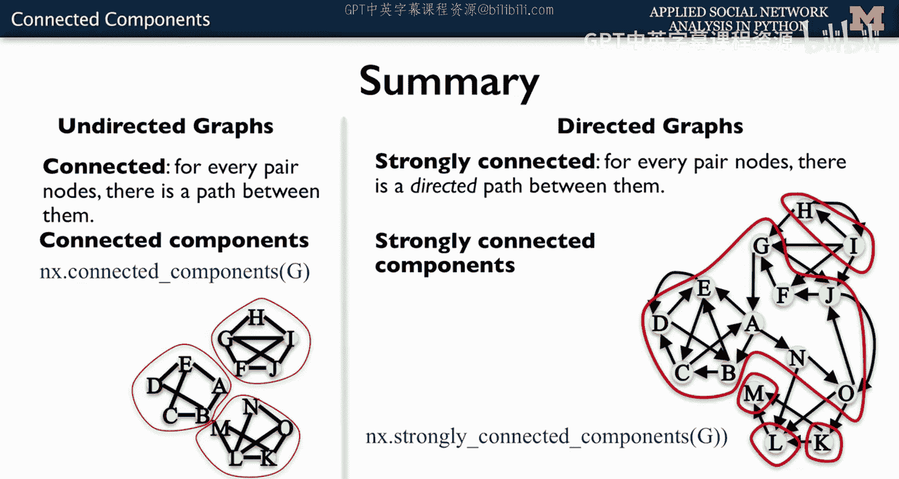

# 密歇根大学《Python用于数据科学实践（4-5课）｜Applied Data Science with Python 》中英deepseek翻译 p28 7_连通组件分析.zh_en -BV1DTtueTEwf_p28-

Today we're going to talk about connectivity in networks。

First we're going to talk about connectivity in undirected graphs。

 those are the ones where the edges don't have a direction。

An undirected graph is said to be connected if for every pair of nodes there is a path between the two nodes。

We can use the function is connected in network X and give it the undirected graph is input and it will tell us whether the graph is connected or not。

 in this case， this example， this graph is connected so it says true it is connected。However。

 if we were to remove a few of the edges， for example， if we remove AG，AN and JO。

 then the graph will become disconnected as you can see。

Now we have these sort of three communities such that if you're in a particular community。

 you cannot find a path to a node in a different community or in a different set of nodes。

Let's try to get at this idea of communities in a more precise way we're going to refer to these communities as connected components。

 so let me give you a definition of what a connected component is。

A connected component is a subset of nodes such that there are two conditions this set of nodes satisfying。

 First， every node in this subset has to have a path to every other node in the subset。

That's condition number one。Condition number two would say that no other node outside of the subset has a path to any node inside the subset。

 So condition 2 can make sure that you get all the nodes that you could possibly can so that every node in in this subset has a connection to every other node in the subset。

 not a subset of the subset that you could potentially get。

So let's see this through examples to make it more clear。

Is the subset of nodes EA GF a connected component？

So first let's find these notes and so here they are。

 these are the node this is a subset of notes we're referring to。

And we can clearly see that this is not a connected component because the nodes， for example。

 A and F cannot reach each other， there is no path going from A to F， so condition number one fails。

Okay， let's look at another example。Is the subset of nodes and OK， a connected component。 Allright。

 these are the the nodes Now in this case， condition number one is actually met。

 There is a path from any node in NOK to any other node in N OK。For example。

 if you wanted to find a path from N to K， you would go N OK。However。

 condition number two fails because there are other nodes that can actually reach nodes in this subset。

 for example， L can actually reach an O and K， there is a path from L to all three of those nodes。

 so therefore this is not a connected component because condition number two fails。

So if you think about it， the only things that satisfy the definition of connected component are the things that we originally started with these three communities such that every node is connected within and no nodes are connected across。

 and these are the three connected components in this particular graph。

You can use network X to find the connected components of an undirected graph by using the function number connected components and give it the graphs input and it would tell you how many it has in this case3。

And you can also ask for which ones are the actual components by using the function connected components G。

 and here we will tell you which are the subsets of nodes and which nodes belong to each one of the components。

What you can also do is use the function node connected component and with the input G。

 the graph itself， but also a particular node as input。

 and this would tell you which connected component this particular node belongs to so in this case。

 for example， if you ask for the component in which M belongs。

 then it would tell you that it belongs to the component K L M and O。

So these are useful things to use in network X。Now let's talk about connectivity in directed graphs。

 remember， directed graphs are those that have edges where the edges have direction。

 so there is a source and a destination。And so here's an example of a directed graph。

 We would like to come up with definitions of connected and connected components that apply to directed graphs。

 but because paths have a different definition in directed graphs than they do in undirected graphs。

 then we we need to adjust our definitions accordingly。And actually。

 what happens is that we will have two types of definitions for each one of the two concepts。

 so let's start with the concept of connected。The first type is we're going to say that a directed graph is strongly connected if for every pair of nodes。

 say U and V， there is a directed path that goes from U to V and another directed path that goes from V to U if graph a directed graph has a property。

 then we say is strongly connected。We can use the function is strongly connected and network X to ask whether this particular directed graph G is strongly connected and it would say false。

 because if you look carefully， there is no path that goes from a to H， for example。

 there are many other examples of pairs of nodes for which there is no path where here's one there is no path from a to H。

 so therefore this graph is not strongly connected。

The second definition for connected is weakly connected。

 and the way weak connected works is that the first thing you do is you replace all the directed edges and you make them undirected。

So every edge you sort of ignore the direction and you make them into an undirected edge。

 and now this graph becomes undirected。And now you ask the question that you already applied to undirected graphs。

 is this graph connected or not， and if it is， then we say that the directed original directed graph is weak connected。

 So in this case， if we use the function is weak connected， network X will say yes。

 this graph is weakly connected because once you turn it into an undirected graph。

 this undirected graph is connected。Alright， now let's talk about the connected component definition again。

 we're gonna have two types。 The first one is strongly connected components and the definition mirrors the definition for undirected It's just that now you have to find paths that are directed。

 so it would have the two conditions for a subset of nodes to be a connected component are that every node in the subset has a directed path to every other node in the subset and that no node outside the subset has a directed path to and from every node inside the subset。

And so in this case， what are the strongly connected components of this graph？

It's actually not that easy to tell it visually it's a little tricky。

 though you could try to pause a video and try and see if you can find what they are。

 but if we use the functions strongly connected components。

 it will tell us what they are and in this case it turns out that these are the strongly connected components。

And so as you can see， for example， you find that M。

 node M and node L are in different components and that's because。

 even though you can go from L to M， you cannot go from M to L right and same thing with。

 for example， H are sort of in their own component。

 that's because while they can reach other nodes like G and J。

 none of those nodes that they can reach can reach them and so these live in their own separate asterly connected component。

And of course we would have the weekly connected component version。

 which works in the same way that it did before。 So first we would make all the directed edges undirected。

 and then we would find the connected components in the new undirected graph。 Now。

 because this graph is weekly connected， that means that when you make all the directed edges undirected。

 it becomes a connected graph。 then this particular graph has only one weekly connected component。

 which is the whole graph。And so to summarize， we talked about undirected graphs and directed graphs。

 and we were talking about a couple of definitions of connectivity。 So for undirected graphs。

 we said that an undirected graph is connected if for every pair of nodes。

 there's a path between them。And we talked about connected components。

 and we said that we could use the function connected components to find these connected components。

 So here's the example。Now for the directed case， we had two types of definitions strong in the weak for the strongly connected。

 we said that graph is terminal connected if every pair of nodes they have a directed path from one node to the other and from the other node to the one and you could use the function strongly connected components to find what these components were and both of these had the corresponding weak definitions so weekly connected and weak connected components and the way that those work is by making the directed edges undirected and then applying the same definitions that we had from undirected graphs to the newdirected graph that comes from the directed graph。

Thank you for watching。 and will see you next time。

