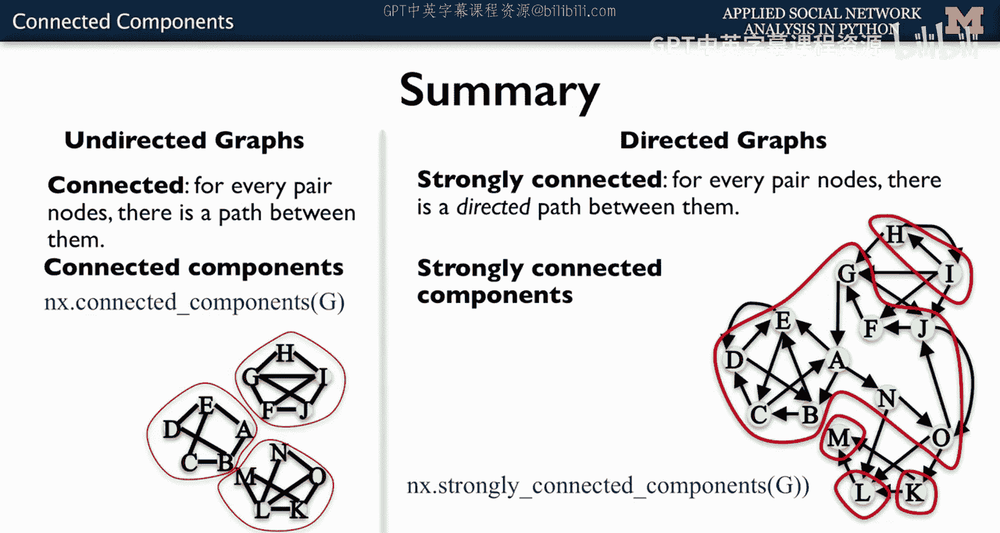

# 密歇根大学《Python用于数据科学实践》：4-5课：连通组件分析


## 概述
在本节课中，我们将要学习网络中的连通性概念。我们将探讨无向图和有向图中的连通性定义，并学习如何使用NetworkX库来分析和识别图中的连通组件。

---

## 无向图的连通性

上一节我们介绍了网络分析的基本概念，本节中我们来看看无向图的连通性。

一个无向图被称为**连通**的，如果对于图中的每一对节点，都存在一条连接这两个节点的路径。

我们可以使用NetworkX中的 `is_connected` 函数，并输入无向图作为参数，它会告诉我们该图是否连通。

```python
import networkx as nx
is_connected = nx.is_connected(G)
```

在这个例子中，该图是连通的，因此函数返回 `True`。然而，如果我们移除一些边，例如边AG、AN和JO，那么图就会变得不连通。

现在，我们有了三个类似社区的节点集合。如果你在其中一个集合中，你无法找到一条路径到达另一个不同集合中的节点。

---

## 连通组件的定义

为了更精确地描述这些“社区”的概念，我们将它们称为**连通组件**。以下是连通组件的定义：

一个连通组件是一个节点的子集，它满足两个条件：
1.  该子集中的每个节点都必须有一条路径到达子集中的其他每个节点。
2.  子集之外的任何节点都没有路径到达子集内的任何节点。

条件2确保你得到了所有可能得到的节点，使得子集中的每个节点都与子集中的其他节点相连，而不是一个可能得到的子集的子集。

让我们通过例子来更清楚地理解。

**示例1：** 节点子集 {E, A, G, F} 是一个连通组件吗？
首先，我们找到这些节点。我们可以清楚地看到，这不是一个连通组件，因为例如节点A和F无法相互到达，它们之间没有路径。因此，条件1不满足。

**示例2：** 节点子集 {N, O, K} 是一个连通组件吗？
在这种情况下，条件1实际上得到了满足。从N、O、K中的任何一个节点到其他节点都存在路径。然而，条件2不满足，因为存在其他节点可以到达这个子集中的节点。例如，节点L可以到达N、O和K。因此，这不是一个连通组件，因为条件2不满足。

所以，唯一满足连通组件定义的就是我们最初看到的三个“社区”，其中每个节点在内部相连，且没有节点跨社区相连。这些就是这个特定图中的三个连通组件。

---

## 使用NetworkX查找连通组件

以下是使用NetworkX处理连通组件的相关函数：

*   **`number_connected_components(G)`**：返回图中连通组件的数量。
    ```python
    num_components = nx.number_connected_components(G)
    # 在这个例子中，返回 3
    ```
*   **`connected_components(G)`**：返回图中所有连通组件（节点集合的生成器）。
    ```python
    components = list(nx.connected_components(G))
    # 返回类似 [{'A', 'B', 'C'}, {'D', 'E'}, {'F', 'G', 'H'}] 的列表
    ```
*   **`node_connected_component(G, node)`**：返回指定节点所属的连通组件。
    ```python
    component_of_M = nx.node_connected_component(G, 'M')
    # 返回节点M所属的组件，例如 {'K', 'L', 'M', 'O'}
    ```

---

## 有向图的连通性

上一节我们讨论了无向图的连通性，本节中我们来看看有向图的情况。

有向图是边具有方向的图，每条边都有源节点和目标节点。由于路径在有向图中的定义与无向图不同，我们需要相应地调整我们的定义。实际上，对于“连通”和“连通组件”这两个概念，我们各有两种定义。

### 强连通与弱连通

让我们从“连通”的概念开始。

1.  **强连通**：如果一个有向图中，对于每一对节点U和V，都存在一条从U到V的**有向路径**，同时也存在一条从V到U的**有向路径**，那么这个图就是强连通的。
    我们可以使用 `is_strongly_connected` 函数来检查。
    ```python
    is_strongly_conn = nx.is_strongly_connected(G_directed)
    # 对于示例图，返回 False
    ```
    例如，在示例图中，没有从节点A到节点H的路径，因此该图不是强连通的。

2.  **弱连通**：判断一个有向图是否弱连通的方法是：首先，忽略图中所有有向边的方向，将它们视为无向边，从而得到一个无向图。然后，判断这个新的无向图是否连通。如果连通，则原图是弱连通的。
    我们可以使用 `is_weakly_connected` 函数来检查。
    ```python
    is_weakly_conn = nx.is_weakly_connected(G_directed)
    # 对于示例图，返回 True
    ```

### 强连通组件与弱连通组件

现在，让我们讨论连通组件的定义，同样有两种类型。

1.  **强连通组件**：其定义与无向图类似，只是现在路径必须是有向的。对于一个节点子集，要成为强连通组件，需要满足：
    *   子集中的每个节点都有一条有向路径到达子集中的其他每个节点。
    *   子集之外的任何节点都没有有向路径到达或来自子集内的每个节点。
    我们可以使用 `strongly_connected_components` 函数来查找。
    ```python
    strong_components = list(nx.strongly_connected_components(G_directed))
    ```
    在示例图中，节点M和节点L属于不同的强连通组件，因为虽然可以从L到M，但不能从M到L。

2.  **弱连通组件**：其工作方式与之前相同。首先，将所有有向边视为无向边，然后在新的无向图中查找连通组件。由于示例图是弱连通的，这意味着当你将所有有向边无向化后，它变成了一个连通图。因此，这个特定的图只有一个弱连通组件，即整个图。
    我们可以使用 `weakly_connected_components` 函数来查找。
    ```python
    weak_components = list(nx.weakly_connected_components(G_directed))
    ```

---

## 总结

本节课中我们一起学习了无向图和有向图中的连通性概念。

*   对于**无向图**，我们说一个无向图是**连通**的，如果对于每一对节点，它们之间都存在一条路径。我们讨论了**连通组件**，并介绍了如何使用 `connected_components` 函数来查找这些组件。
*   对于**有向图**，我们有两种定义：**强连通**和**弱连通**。
    *   一个图是**强连通**的，如果每一对节点之间都存在双向的有向路径。可以使用 `strongly_connected_components` 函数查找强连通组件。
    *   **弱连通**及其对应的**弱连通组件**的定义，是通过将有向边无向化，然后将无向图的定义应用到新得到的无向图上来实现的。



感谢观看，我们下次再见。