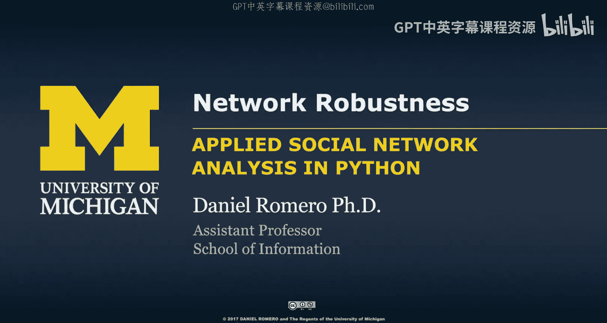
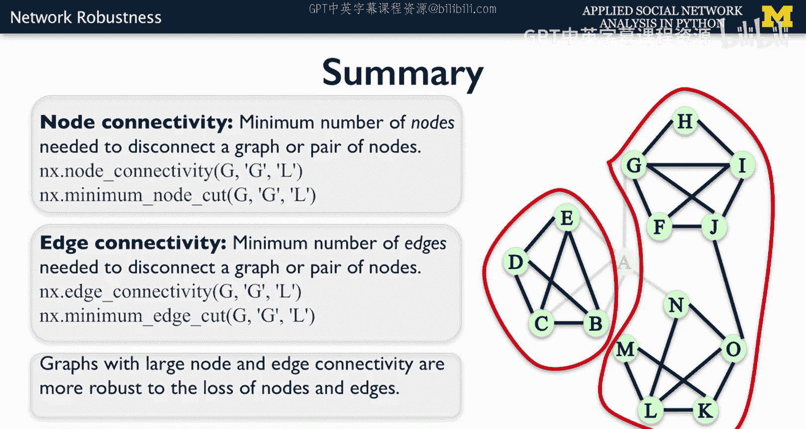

# 密歇根大学《Python用于数据科学实践（4-5课）｜Applied Data Science with Python 》中英deepseek翻译 p29 8_网络鲁棒性研究.zh_en -BV1DTtueTEwf_p29-

Last time we talked about connectivity in networks。

 today we're going to talk about how connectivity relates to the robustness of a network。

So what is network robustness？The way we loosely define network robustness is the ability of a network to maintain its general structure or its general functions when it faces failures or attacks。

So what kind of attacks are we talking about here， Well we're going to talk about attacks that are in the form of removal of nodes or edges。

 this could be somebody purposely trying to remove an node or an edge from the network or maybe just random failures that the network may have。

And then what are the general properties that we're going to be discussing in this case we're going to be talking about connectivity。

 so robustness is going to be the network's ability to maintain its connectivity。

When it loses some of its nodes or some of its edges。So why is this relevant， Why is this important。

 Let's look at some examples of networks that often loose nodes or edges and these things affect their function So one example is the air transportation network where the nodes are airports and the edges are connections between airports Well sometimes airports have to close down for many different reasons。

 and when this happens， of course transportation is affected and so you would like for the transportation network to be robust to closures of airports so that the general connectivity or the general function of the network is still maintained even after we might have lost one particular airport or maybe it's not an airport。

 maybe it's a connection between an airport and some other airport。

 maybe both airports are open but they're not able to fly to each other for whatever reason that is the case where the network might have lost an edge rather than a node and you would like for the network to still maintain its connectivity or functions there are plenty of other examples。

Inter router failures or power line failures and so on and so for all of these。

 this idea of removing node or edges are things that actually happen and for all of these maintaining connectivity is very important。

So let's begin looking at our sort of toy example graph here that we've been looking at。

 and we'll start with an undirected graph and ask what is the smallest number of nodes that I would need to remove from this graph in order to make it disconnected？

And so we can actually use a function in network X。 That's node connectivity。

 And the input will be the undirected graph here。 G underscore N。

 And it says that if I just remove one node， I would be able to disconnect a graph completely。

 You can try and see if you can figure out which node that is。

Or you can use the function minimum node cut and then give it as input the undirected graph and it would tell you which node or which nodes are the ones that you can remove in order to disconnect the graph and in this case it's node A。

So you can see that if you were to remove node A， then this graph goes from being connected to being disconnected。

 so now there are two subsets of nodes that cannot reach each other。And in the airport example。

 this would be really bad right if one airport was responsible for connecting to major parts of the world。

 that's something you probably wouldn't want to have。Now let's ask the question for edges。

 what is the smallest number of edges instead of node that we would need to remove from this graph in order to completely disconnect it。

Well， you can use the function edge connectivity and give it as input the undirected graph。

 and it tells us that there are two edges that you need to remove in order to disconnect this graph。

Well， which two edges are there。 You can try to figure it out on your own。

 or you can use the function minimum edge co and give it a input the undirected graph。

 and it tells you that。The two edges that you need to remove are AG and OJ。

And you can see that if you remove those two edges。

 you indeed make the network disconnected and there are two clusters。

 two subsets of nodes that cannot reach each other anymore。Of course。

 it's possible that there are other options of edges that do this。

 but the fact that the edge connectivity is2 tells us that the smallest number of edges that you have to remove is2 now the particular choice of AG and OJ may not be unique。

 there may be other options， other pairs of edges that achieve the same the same goal of disconnecting the network。

Robust networks are those that have a large minimum node and edge cuts。

 that is those that for which you would have to remove a lot of nodes or edges in order to be able to disconnect them and that's a very desirable property because you don't want your network to be easily disconnected by just removing a few nodes or a few edges。

Okay， now let's look at a different scenario。 First of all， let's now look at a directed graph。

 those that have edges that have a source in a destination。

 And now let's think about a different setting。 Now。

 let's think about these notes as notes that want to communicate with each other。

 Do we want to pass messages to each other。 These could be maybe routers。

 or these could be people who are trying to。Pass a rumor or pass an important message to each other right and so imagine that node G here wants to send a message to node to L by passing it along to other nodes in this network so。

Basically， what G wants to do is to find the paths that could lead that could take a message from G all the way 12。

What options does G have in order to do this， What are those paths that G can use。Well。

 if you use the function， all simple paths with input G， the graph and then the two nodes。

 the source and the destination， in this case， G and L， then you get all the all the paths。

 let's look at each one of those paths。 So the first one is G A and L。

The second one is slightly longer， is G A N O KL。You could also go G A N OL or GJ O KL。

Or you could go with a shorter path， G， JOL。 So these are all the options that G has。Okay。

 now let's imagine that there is some attacker， some person that wants to actually block the message that's going from G to L。

 This attacker is no longer interested in just disconnecting the network in any particular way。

 It's interested in particularly disrupting the communication that's going from G to L。

We could ask the question， if this person was going to try to do this by removing nodes。

 how many nodes would this attacker need to remove in order to block G from L？

We can use the same function， node connectivity as we did before。

 but now we gave it us input not only the graph G， but also the source and the destination， G and L。

 and it would tell us how many nodes you would need in order to achieve that and in this case。

 you would need to remove two nodes from the network。

Which nodes are they again we can use the same function as we used before。

 minimum note cut and give it the graph， the source and the destination as input and it would tells us which are the two node in this case the notes are n and O。

So this says that you have to remove at least two nodes and here are two options for that NN O。

Now let's do some sanity checking here， what if we were only to remove Note end？

Then can we still can we still find a path that goes from G2L And the answer is yes。

 you could take the path G， J， O KL。The other hand， if we were to only remove node O。

 then can the message still make it and the answer is yes， you could go G A and L。

 So this shows that it's not enough to remove one of these two nodes and you could check on your own that when you actually remove both of these and O。

 then there is no longer any path that can go from G2 L So you need two and these are two that achieve that。

We can ask the same question as we did before four edges now the attacker， let's say。

 is only able to remove edges， not completely remove notes。

 how many edges would this attacker need to remove in order to block G from L we can use the function edge connectivity with the input。

 the graph， the source and destination and it tells us that it needs two edges in order to be able to achieve this。

And to figure out which edges there are， we can use again。

 the minimum edge co function with the graph， the source and the destination。

 and it tells us that the two edges are A N and JO。And so here they are shown in red。

 and you can check that if you were to remove those two edges， indeed。

 G would no longer be able to send the message to L。So in summary， in this video。

 we've talked about node connectivity and that is the minimum number of nodes that you need in order to disconnect a graph or disconnect a pair a particular pair of nodes。

And the functions associated with node connectivity are node connectivity。

 which tells us the smallest number of nodes that you need to order to achieve that and minimum node cut。

 which actually tells us which are those nodes。And then you have a similar definition for edge connectivity。

 which is the minimum number of edges that you need in order to disconnect the graph or to disconnect any pair of node and the functions they use are edge connectivity and minimum edgecopped。

And the takeaway here is that graph with large node and large or large edge connectivity are more robust to the loss of nodes and edges。

 and they're able to keep their connectivity， even if some number of edges and nodes are removed from the network。

 And for many applications， this is a very desirable property for networks to have。

 Thank you for watching and we'll see you next time。😊。

