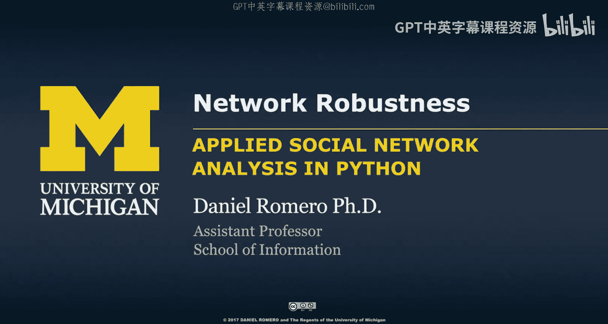
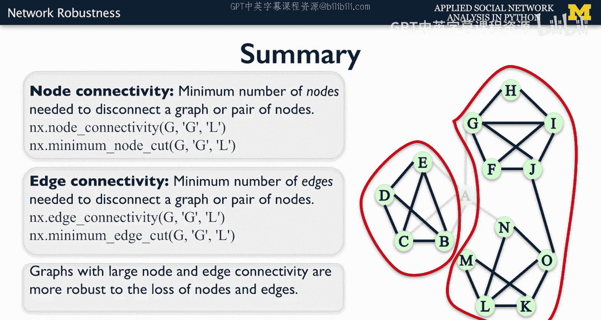

# 网络分析：第8课：网络鲁棒性研究 🔗




在本节课中，我们将学习网络鲁棒性的概念，探讨网络在面临节点或边失效时，维持其连通性和功能的能力。我们将通过具体的函数和示例，理解如何量化网络的鲁棒性。

---

## 概述

上一节我们讨论了网络的连通性。本节中，我们将探讨连通性如何与网络的鲁棒性相关联。网络鲁棒性是指网络在面对节点或边失效（无论是随机故障还是蓄意攻击）时，维持其基本结构和功能的能力。这对于许多现实世界的系统（如航空网络、通信网络）至关重要。

---

## 什么是网络鲁棒性？

网络鲁棒性可以宽泛地定义为：当网络面临故障或攻击时，维持其基本结构或功能的能力。

我们在此讨论的攻击形式是**节点或边的移除**。这可能是有人蓄意移除网络中的节点或边，也可能是网络自身发生的随机故障。

我们将讨论的核心属性是**连通性**。因此，鲁棒性就是网络在失去部分节点或边时，维持其连通性的能力。

---

## 为什么网络鲁棒性很重要？

以下是一些经常面临节点或边失效的网络示例，这些失效会影响其功能：

*   **航空运输网络**：节点是机场，边是机场间的航线。有时机场会因各种原因关闭，此时运输会受到影响。我们希望运输网络对机场关闭具有鲁棒性，这样即使失去某个特定机场，网络的基本连通性和功能仍能维持。
*   **路由器间故障或电力线故障**：在这些网络中，移除节点或边的情况确实会发生。对于所有这些系统，维持连通性都至关重要。

---

## 分析无向图的鲁棒性

让我们从一个简单的无向图示例开始分析。

### 节点连通性

首先，我们提出一个问题：**为了使这个图变得不连通，我需要移除的最少节点数量是多少？**

我们可以使用 NetworkX 库中的 `node_connectivity` 函数。输入是无向图 `G`。

```python
node_connectivity(G)
```

该函数会返回一个数字，表示需要移除的最少节点数。例如，如果结果是 **1**，意味着只需移除一个节点就能使图完全不连通。

为了找出具体是哪个节点，可以使用 `minimum_node_cut` 函数。

```python
minimum_node_cut(G)
```

该函数会返回一组节点，移除这些节点可以使图断开。例如，它可能返回节点 **A**。移除节点 A 后，图会从一个连通图变为两个无法相互到达的节点子集。

在航空网络的例子中，如果一个机场负责连接世界的主要部分，这种情况是非常不理想的。

### 边连通性

现在，我们针对边提出同样的问题：**为了使这个图变得不连通，我需要移除的最少边数量是多少？**

我们可以使用 `edge_connectivity` 函数。

```python
edge_connectivity(G)
```

该函数会返回一个数字，例如 **2**，表示需要移除至少两条边才能断开图。

为了找出具体是哪些边，可以使用 `minimum_edge_cut` 函数。

```python
minimum_edge_cut(G)
```

该函数会返回一组边，例如边 **AG** 和 **OJ**。移除这两条边后，网络确实会变得不连通，形成两个无法相互通信的节点簇。可能还有其他边组合能达到同样效果，但 `edge_connectivity` 的结果 **2** 告诉我们，必须移除的最少边数是 2。

**鲁棒的网络**是指那些具有较大最小节点割和边割的网络。也就是说，你需要移除很多节点或边才能断开它们。这是一个非常理想的属性，因为你不希望你的网络仅因移除少数几个节点或边就轻易断开。

---

## 分析有向图的鲁棒性

现在，让我们看一个不同的场景。首先，我们来看一个有向图，其中的边具有源节点和目标节点。

我们设想一个不同的场景：将这些节点视为需要相互通信的实体（例如路由器或传递消息的人）。假设节点 **G** 想通过网络中的其他节点向节点 **L** 发送一条消息。

### 寻找所有路径

G 有哪些路径可以选择呢？我们可以使用 `all_simple_paths` 函数来找出从源节点 G 到目标节点 L 的所有可能路径。

```python
list(all_simple_paths(G, source='G', target='L'))
```

函数会返回所有路径，例如：
*   G -> A -> L
*   G -> A -> N -> O -> K -> L
*   G -> A -> N -> O -> L
*   G -> J -> O -> K -> L
*   G -> J -> O -> L

### 针对特定通信的鲁棒性

现在，假设有一个攻击者，他不想断开整个网络，而是**专门想阻断从 G 到 L 的通信**。

我们可以问：如果这个攻击者通过移除节点来实现，他需要移除多少个节点才能阻断 G 到 L 的通信？

我们可以使用之前用过的 `node_connectivity` 函数，但这次额外指定源节点和目标节点。

```python
node_connectivity(G, s='G', t='L')
```

假设结果是 **2**，这意味着需要移除至少两个节点。

要找出具体是哪两个节点，可以使用 `minimum_node_cut` 函数并指定源和目标。

```python
minimum_node_cut(G, s='G', t='L')
```

假设它返回节点 **N** 和 **O**。我们可以验证：只移除 N，路径 G->J->O->L 仍然存在；只移除 O，路径 G->A->L 仍然存在。只有同时移除 N 和 O，才没有任何路径能从 G 到达 L。

### 针对边的攻击

同样，如果攻击者只能移除边，他需要移除多少条边才能阻断 G 到 L 的通信？我们可以使用 `edge_connectivity` 函数并指定源和目标。

```python
edge_connectivity(G, s='G', t='L')
```

假设结果是 **2**。要找出具体是哪两条边，可以使用 `minimum_edge_cut` 函数。

```python
minimum_edge_cut(G, s='G', t='L')
```

假设它返回边 **A->N** 和 **J->O**。移除这两条边（图中标红）后，G 将无法再发送消息到 L。

---

## 总结

本节课中，我们一起学习了网络鲁棒性的核心概念：

1.  **节点连通性**：为断开一个图（或断开一对特定节点）所需移除的**最少节点数**。
    *   相关函数：`node_connectivity`（计算最小数量），`minimum_node_cut`（找出具体节点）。
2.  **边连通性**：为断开一个图（或断开一对特定节点）所需移除的**最少边数**。
    *   相关函数：`edge_connectivity`（计算最小数量），`minimum_edge_cut`（找出具体边）。

**关键要点**：具有较高节点连通性和边连通性的图，对节点和边的丢失具有更强的鲁棒性。即使网络中有一定数量的边和节点被移除，它们仍能保持连通性。对于许多应用而言，这是网络非常理想的一个属性。



感谢观看，我们下次再见！😊