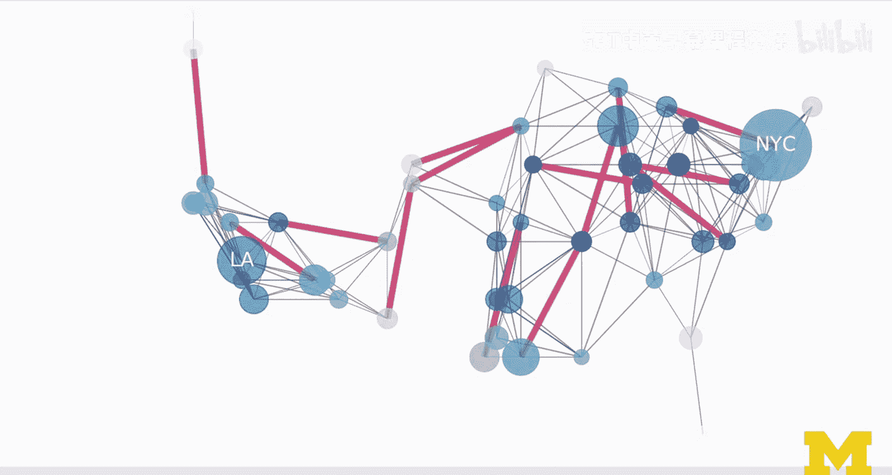

# 密歇根大学《Python用于数据科学实践（4-5课）｜Applied Data Science with Python 》中英deepseek翻译 p30 9_助教演示：NetworkX基础网络可视化.zh_en -BV1DTtueTEwf_p30-

Hi everyone， Today we'll be looking at visualizing networks using Network X。

Although Network X is not primarily a graph drawing package。

 it does provide some basic functionality for visualization with Matplotlib。

This allows us to see and explore our graphs， assuming they aren't too large。

Now let's get started with our network。Today， we'll be looking at a distribution network containing 51 US cities。

Each city in this network has two node attributes， location and population。

Edges correspond to connections that our distribution network can make between cities with the weight attribute corresponding to the cost of traveling over that connection。

First， let's read in our graph， which is in Python pickle file format as graphraph G。Next。

 we can create a new figure and draw the graph G using Matplotlibb by callingDaw Network X。

This will draw the graph with defaults of circular red nodes， black edges and labels。

Notice the positioning of the nodes provides us with some insight on the structure of our network。

Although this layout might not be the best one for us to use。

One of the largest challenges when visualizing networks is figuring out where the node should be positioned。

Network X offers a few node positioning algorithms to help create layouts for the network visualization。

For example， Draw network X uses the spring layout by default。

Which tries to position nodes with as few crossing edges as possible。

While keeping edge length similar。Using list comprehension。

 we can see what layouts network X provides us with。

These functions return a dictionary of node positions， which we can then pass into draw network X。

Here we can see what the positions are that the random layout has given us。

While the circular layout gives us very different looking positions by placing the nodes in a circle。

Which layout is best to use is heavily dependent on the characteristics of the network。

So trying out various layouts can be very important when creating a visualization。

You can also use your own layout by passing in a dictionary of node positions。

Our distribution network actually has a note attribute of location。Which we can use for the position。

So let's try using those。If you're familiar with the locations of US cities。

 you may be able to now better recognize this network。Next。

 let's try playing around with some of the parameters to see how we can change the look of our visualization。

We can set the transparency with the alpha parameter。Move labels。And make the edges gray。

Let's also turn the axis off and reduce padding。Looking at our new figure。

 we can see that by removing some of the information we've made the structure of the network easier to see。

Now let's see how to change the node color， node size， and edge width。

Let's set the node color based on the degree of the node。Using list comprehension。

 we can get a list of the degrees。Will set the node size based on the population of each node。

And multiply each value by a small number so that the nodes aren't too large。

We can also use list comprehension to get the weights or the costs of each edge to be used for the edge widths。

And also multiply this value by a small number so that the widths are appropriate。

Passing all of these into draw network X and setting the color map to blue。

We can see that we have created a pretty interesting visualization。

Now we can quickly see which nodes in our distribution network have high population or high degree。

One last thing I would like to show you is how to plot edges， nodes or labels separately。

Suppose we wanted to visually identify the most expensive edges in our network。

Say where the cost was greater than 770。We can use list comprehension to find the subset of edges with a weight larger than 7。

70。And pass this into the edgeless parameter of draw network edges。

We also indicate that we want to highlight these edges with thick， semi transparent red lines。

Additionally， let's use Dr network X labels to add labels to Los Angeles and New York City。

Looking at our network visualization。By separately adding specific edges and labels。

We can now clearly see the high cost edges， as well as the locations of New York City and Los Angeles。

We've covered many of the tools Network X provides for network visualization。But remember。

 you can always check the network X documentation for additional information on drawing functions and their parameters。

That wraps it up for this tutorial on visualizing Network and Network X。

If you are interested in creating more in depth visualizations of larger networks。

 consider exploring some more fully featured visualization tools such as C escapescape。

 Gafffi or Grvis。 As always， Thanks for watching。😊。

