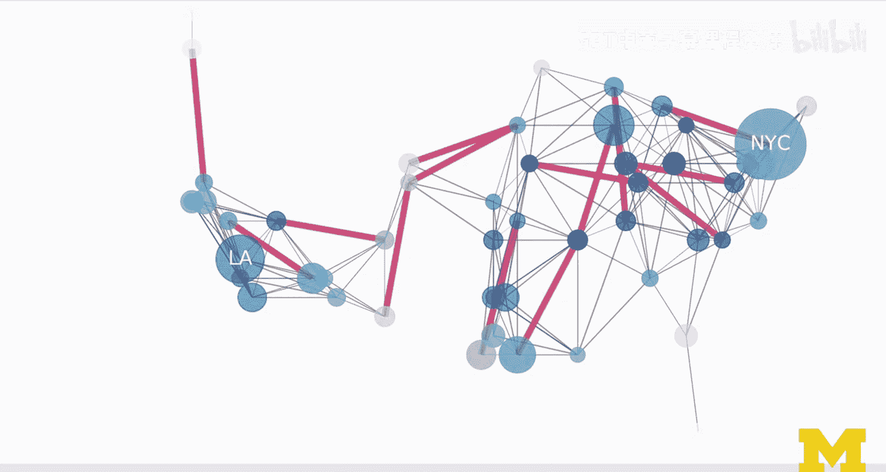

# Python用于数据科学实践：4-5：NetworkX基础网络可视化 🕸️


在本节课中，我们将学习如何使用NetworkX库进行基础的网络可视化。虽然NetworkX并非专业的绘图工具包，但它集成了Matplotlib，提供了绘制网络图的基本功能，帮助我们观察和探索网络结构。

## 读取与绘制基础网络图


首先，我们从一个Python pickle文件中读取一个网络图。这个网络代表了一个包含51个美国城市的配送网络。每个节点（城市）有两个属性：`location`（位置）和`population`（人口）。每条边代表配送网络中的一条连接，其`weight`属性代表通过该连接运输的成本。

```python
import networkx as nx
import matplotlib.pyplot as plt

# 读取图数据
G = nx.read_gpickle('graph.pickle')

# 创建图形并绘制网络
plt.figure()
nx.draw(G)
plt.show()
```
以上代码会使用默认设置（红色圆形节点、黑色边线）绘制网络图。节点布局为我们提供了网络结构的初步洞察。

## 探索不同的节点布局算法

上一节我们介绍了基础的绘图方法，本节中我们来看看如何优化节点布局。网络可视化最大的挑战之一是确定节点的位置。NetworkX提供了多种布局算法来帮助创建可视化布局。

例如，`draw`函数默认使用`spring_layout`（弹簧布局），它试图在保持边长相似的同时，尽量减少边的交叉。

以下是NetworkX提供的一些布局函数：
*   `nx.spring_layout`: 弹簧布局，基于力导向算法。
*   `nx.circular_layout`: 环形布局，将节点均匀排列在一个圆上。
*   `nx.random_layout`: 随机布局，在单位正方形内随机放置节点。
*   `nx.shell_layout`: 壳形布局，将节点排列在多个同心圆上。

选择哪种布局很大程度上取决于网络本身的特性，因此在创建可视化时尝试多种布局非常重要。

```python
# 尝试不同的布局
pos_circular = nx.circular_layout(G)  # 返回节点位置字典
nx.draw(G, pos=pos_circular)
plt.show()
```

## 使用节点属性自定义布局

我们也可以使用自定义的节点位置字典。我们的配送网络节点恰好有`location`属性，我们可以直接用它来定位。

```python
# 从节点属性中提取位置信息
pos = {node: data['location'] for node, data in G.nodes(data=True)}
nx.draw(G, pos=pos)
plt.show()
```
如果你熟悉美国城市的地理位置，现在应该能更好地识别这个网络了。

## 调整可视化样式参数

接下来，我们尝试调整一些绘图参数，以改变可视化的外观，使其更清晰。

以下是可调整的部分参数：
*   `alpha`: 设置节点和边的透明度。
*   `with_labels`: 控制是否显示节点标签。
*   `edge_color`: 设置边的颜色。
*   `ax`: 控制是否显示坐标轴。

```python
nx.draw(G, pos=pos, alpha=0.7, with_labels=False, edge_color='gray')
plt.axis('off')  # 关闭坐标轴
plt.tight_layout()  # 减少边距
plt.show()
```
通过移除部分信息（如标签和坐标轴），网络的结构变得更加清晰易见。

## 基于网络属性设置视觉编码

现在，我们来看看如何根据网络属性（如度、人口、成本）来动态设置节点颜色、大小和边宽，以编码更多信息。

```python
# 1. 根据节点度设置节点颜色
node_degree = [G.degree(n) for n in G.nodes()]
# 2. 根据人口设置节点大小
node_size = [G.nodes[n]['population'] * 0.01 for n in G.nodes()]
# 3. 根据成本（权重）设置边宽
edge_width = [G[u][v]['weight'] * 0.05 for u, v in G.edges()]

nx.draw(G, pos=pos,
        node_color=node_degree,
        node_size=node_size,
        width=edge_width,
        cmap=plt.cm.Blues,  # 使用蓝色系颜色映射
        with_labels=False,
        edge_color='lightgray')
plt.show()
```
通过这个可视化，我们可以快速识别出配送网络中人口密集（节点大）或连接度高（节点颜色深）的城市。

## 单独绘制边、节点和标签

最后，我们将学习如何分别绘制边、节点和标签。这在需要高亮显示特定网络元素时非常有用。

假设我们想高亮显示网络中成本最高（权重大于770）的边，并为洛杉矶和纽约市添加标签。

```python
# 找出成本大于770的边
high_cost_edges = [(u, v) for u, v, d in G.edges(data=True) if d['weight'] > 770]

# 先绘制基础网络（灰色细边）
nx.draw_networkx_edges(G, pos, edge_color='lightgray', width=1)
nx.draw_networkx_nodes(G, pos, node_color='lightblue', node_size=50)

# 再高亮绘制高成本边（红色粗边）
nx.draw_networkx_edges(G, pos, edgelist=high_cost_edges, edge_color='red', width=4, alpha=0.7)

# 为特定城市添加标签
labels = {'Los Angeles': 'LA', 'New York City': 'NYC'}
nx.draw_networkx_labels(G, pos, labels=labels, font_size=12, font_color='darkred')



plt.axis('off')
plt.tight_layout()
plt.show()
```
通过分别添加特定的边和标签，我们现在可以清晰地看到高成本连接以及纽约和洛杉矶的位置。

## 总结与延伸

本节课中我们一起学习了使用NetworkX进行网络可视化的核心技能。我们涵盖了从基础绘图、尝试不同布局、使用属性自定义位置，到根据网络属性设置视觉编码（颜色、大小、宽度），以及分别绘制网络元素以进行高亮展示。

我们介绍了NetworkX提供的主要绘图工具，但请记住，你始终可以查阅[NetworkX官方文档](https://networkx.org/documentation/)以获取绘图函数及其参数的更多信息。


如果你有兴趣为更大型的网络创建更深入的可视化，可以考虑探索功能更全面的专业可视化工具，如 **Cytoscape**、**Gephi** 或 **Graphviz**。