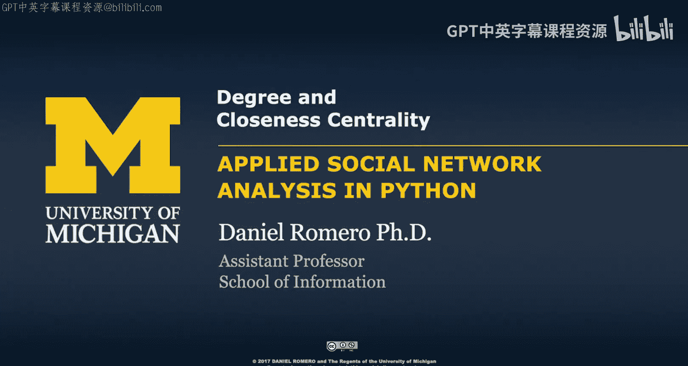
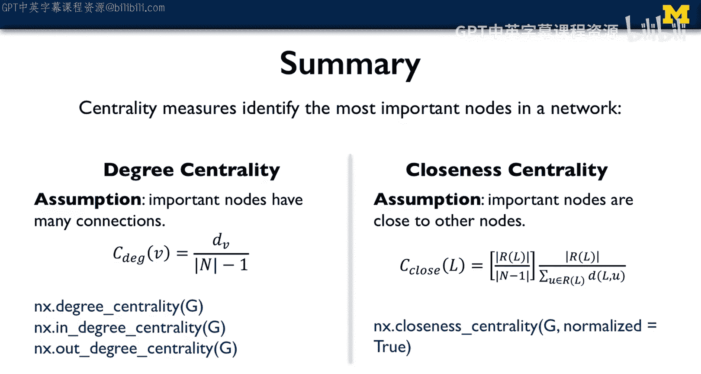

# 密歇根大学《Python用于数据科学实践（4-5课）｜Applied Data Science with Python 》中英deepseek翻译 p31 10_度中心性与接近中心性.zh_en -BV1DTtueTEwf_p31-

Hello， today we're going to talk about how to find important node in a network recall these friendship network among 34 people in a karta club。

Based on the structure of this network， which would you say are the five most important nodes in this network？

Of course， there are many ways of thinking about this question。

 and we're going to start thinking about different ways in which you could imagine answering this particular question。

One way to answer the question would be to say， well。Notes who have a very high degree。

 nodes who have lots of friends are important notes， and if we use that definition。

 then we'll find that the five most important notes are nodes 34，1，33，3， and 2。

 these nodes right here。There are other ways in which you could imagine answering this question。

 another way would be to say that notes who are important are notes who are very close to other notes in network。

 notes who have high proximity to other notes in the network。And if we use that definition。

 then the five most important node in the network would be nodes 1，3，34，32 and 9。

 So instead of having node 33， we'll have node 9 and then instead of having node 2。

 we'll have node 32 and all the other ones stay the same。

Yet another way of thinking about importance would be to say that nodes who are important are nodes who tend to connect other nodes in the network。

And so we could imagine measuring importance by the fraction of shortest paths that pass through the particular node。

And if we do that， if we define it in that way， we find that the five most important notes in the network are node 1 34。

 33，3 and 32， so instead of having note number 9， we'll have note number 33 in the top five and every all the other notes would stay the same。

So at this point， these definitions of importance are very informal and the goal of this video and the following videos is going to be to get at more precise definitions of how to measure importance in a network。

This general topic is called network centrality and these centrality measures are the ones that allows us to find the most important notes in a particular network。

 and the cases in which we want to use these techniques is when， for example。

 sometimes we're interested in finding who the influential notes in a social network are。

 which are the nodes that are very good at disseminating information to many other nodes。

 or on the other hand， which are the nodes that are good at preventing sort of bad behaviors or epidemics from spreading on a social network。

These can be used in other networks as well， so we can use centrality measures to find hubs in a transportation network or important pages on the web。

 or more generally these measures allows us to find nodes that prevent the network from breaking up node that if we were to remove them。

 that would cause the network that would cause the network to fracture and break up into different components。

Here's a list of centrality measures that are commonly used。

 we're going to be talking about some of these in this course。

 and in this video we're going to be focusing on degree centrality and closeness centrality。

So a degree centrality makes the assumption that important nodes have many connections。

 this is sort of the most basic way in which you could define importance or centrality。

 simply that nodes who have lots of neighbors， lots of friends are very important。And it makes sense。

 right？Of course， depending on the type of network you have。

 you would have to use different types of degree so if you have an undirected network you can simply use the degree。

 but if you have a directed network， then you have to choose between using in degree or out degree or a combination of both。

So let's get to exactly how we would define this。 So we'll say that the degree centrality of an node V is going to be the ratio between its degree。

And the number of nodes in the graph minus1。So in this case。

 a node would have a centrality of one if it's connected to every single node in the network。

And a centrality of0， if it's connected to no node in the network。

 and so this measure goes between 0 and 1 with one being the case where you're most connected。

Let's see how we can use network X to find the degree centrality of the node in this network。

 So first let me load up the kate club graph and let me convert the labels of the notes so that they match what we see here in this figure and now we can use the function degree centrality to measure the centrality of all the node in the network。

And so here this returns the dictionary of centralities of every node and we can， for example。

 look at the degree centrality of note number 34， which is 0。515。

 and that's because Note 34 has 17 connections and there are 34 nodes in the network。

 so that is 17 over 33。The degrees centrality of node 33 is 0。364， and that is 12 over 33。Now。

 like I said， in directed networks， we have the choice of using the indi centrality or the out degreeeg centrality of a node and everything else is defined in the same way。

 so the in degreeeg centrality of a node V is going to be its in degree divided by the number of nodes in the graph minus1。

And we can use the function indi centrality network X to find the in degreeeg centrality of all the nodes in a directed network。

 and so in this case a will have in degree of 0。143 which is 2 or 14。

 There are 15 nodes in this network。And L would have a in degrees centrality of 0。214。

 which is 3 over 14， and that's because node L has an n degree of 3。

In the very same way we can define using the out degree instead of the in degree centrality。

 using the function out degree centrality， and the out degree centrality of a is 0。

214 because it has an out degree of 3 and the out degree centrality of node L is 0。

071 because L has an out degree of 1。Another way of measuring centrality is what we call closeness centrality。

 and the assumption here is that nodes that are important are going to be a short distance away from all other nodes in the network。

Recall that we measure distance between two nodes by looking at theest at the length of the shortest path between them。

And so the way we're going to define a close centrality of node V is going to be by taking the ratio of the number of node in the network minus1 divided by the sum over all the other node in the network and the distance between node V and those node。

 so that's the sum in the denominator in the definition of centrality。

Now so let's say that we want to use network X to find the closeness centrality of these Note 32。

 we can use the function closeness centrality， which returns the dictionary of the centrality of the close centrality of all the nodes。

 and here we find the note 32 has a closeness centrality of 0。541。

So using the definition of closeness centrality， let's see how this 0。

541 comes about So first of all， let me look at the sum of the length of the shortest paths from number 32 to all the other nodes in the network I'm using here the shortest path length function which we've seen before。

 which gives you the length of all the shortest paths from the node number 32 to all the other nodes and that sum here is 61。

And so then if we take the number of notes in the graph minus1 divided by 61。

 that's how we get this 0。541。Of course， we're making the implicit assumption that all the nodes can actually reach all the other nodes。

 but of course this is not always the case in particular， when we have directed graphs。

 this is often not the case and even for undirected graphs。

 you could have multiple connected components and you can have it so that some nodes cannot reach other nodes and so what happens how do we measure close and centrality when a node cannot actually reach all the other nodes。

Let's take this example， right， So node L here can only reach node M。

 So how do we measure its closeness centrality We have a couple of options here in the first option。

 we can simply。Only consider the nodes that L can actually reach in order to measure its close centrality。

 so the way this would work is that we define this set are L to be the set of nodes that L can actually reach。

 and we define the closedness centrality of L to be the ratio of the number of nodes that L can reach divided by the sum of the distances from L to all the nodes that L can actually reach。

And so for node L here， this would be simply one because L can only reach node M。

 so our L here is just the set M with is just the node M and L can reach M in just one step。

 so the closest centrality of L here would be 1 over1 which is1。

 and this is the highest possible centrality a node can have in a network。

Which seems a little bit problematic because node L can only reach one node and we're saying that it has the highest possible centrality that any node can have。

 it seems an intuitive， right？And so here's where option 2 comes in in option 2。

 we again only consider the nodes that L can reach。

 but then we normalize by the fraction of nodes that L can reach。

So the way this looks here is that when we compute the closest centrality of L。

 we have the same ratio of R L over the sum。But now we're going to multiply that ratio by the fraction of nodes that L can reach our L divided by the number of nodes in the graph minus1。

So basically we're normalizing by the fraction of nodes that L can reach and so if L can reach many nodes。

 we're going to be multiplying this other fraction by a very small number。And so in this case。

 if we do that， we find that L has a close centrality of 0。071。

 which is more reasonable than defining it to be 1。

One thing to note here is in this new definition when we're normalizing。

 we're not changing the definition of close and centrality when the graph is connected and every node can reach every other node。

 that's because when that's the case， our L for node to L would equal n minus-1 and this formula that you see here would be the exact same formula that we had before。

 so we're not changing the definition， this definition can still apply even if the graph is completely connected。

Okay so how can we use network X to find the closing centrality Well we can use the function close centrality and here you get the option of normalizing or not normalizing and so for example。

 if we choose not to normalize then the closing centrality of node L would be 1 as we saw before and if we choose to normalize then its closed centrality would be 0。

071 So in summary today we talked about centrality measures and how they aim to find the most important nodes in a network。

 we said that there are many， many different ways of defining centrality and today we talked about two specific ones a very basic definition of called degree centrality which makes the assumption that important nodes are those who have many。

 many connections and we use this formula to measure the centrality of a node and is simply the ratio between the degree of the node and the number of nodes in the graph minus-1。

And depending on whether we have a director or undirected graph。

 we can use it the degree of the node or the in degree or the out degree。

 and these are the different functions that you can use in network X to apply them。

The second centrality measure that we looked at was close centrality。

 and the assumption that it makes is that important notes are close to other notes。

And here is this sort general formula that we use to compute it。

 and here we can choose to normalize or not normalize as we discussed。

 and the function that we use in network X to compute it is the function closeness neutrality。

This is it for this video and I hope to see you next time， thanks。

