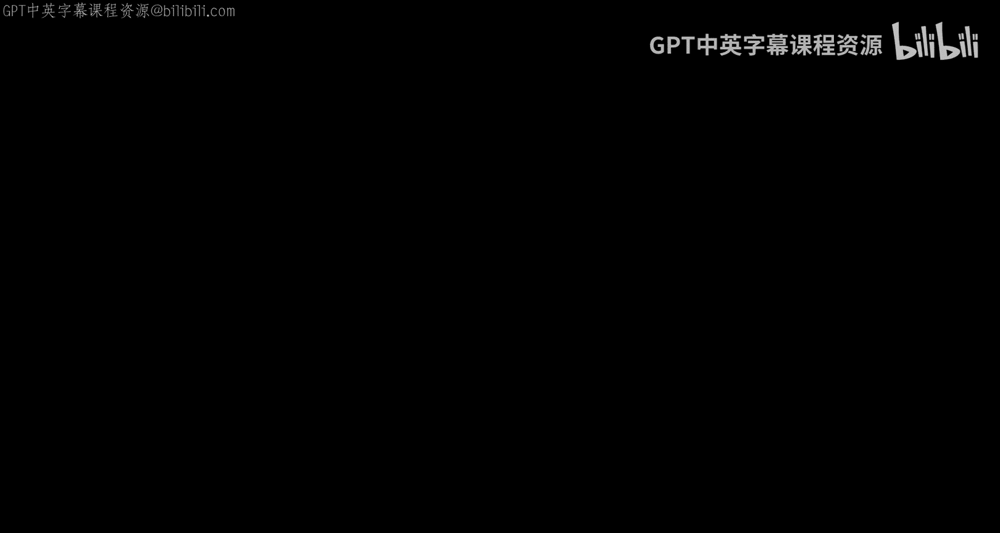
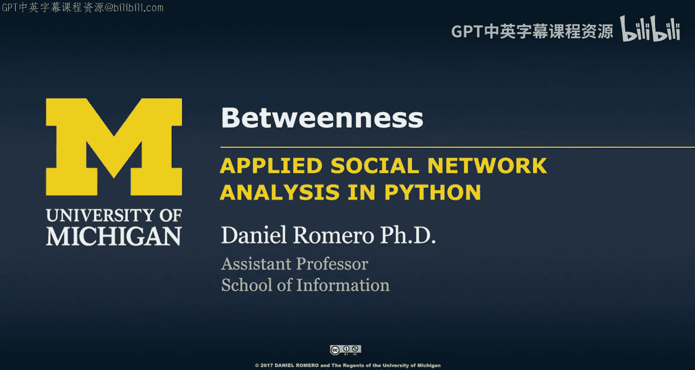
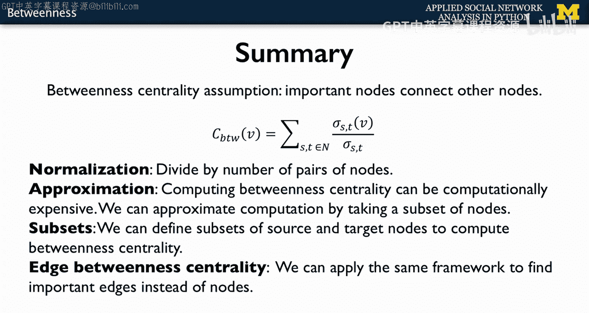

# 密歇根大学《Python用于数据科学实践（4-5课）｜Applied Data Science with Python 》中英deepseek翻译 p32 11_中介中心性分析.zh_en -BV1DTtueTEwf_p32-

Today we're going to talk about another way of measuring centrality in the network。

 This one is calledBetween a centrality， and it makes the assumption that important notes are those who connect other notes。

Recall that the distance between two nodes is the length of the shortest path between them。

So for example， in this network， node 34 and 2 have a distance two because there are multiple ways of getting getting from node 34 to 2 in two steps。

For example， we can take the path 34，31 and2。We can take the path 34， 14，2。Orregon take the path 34。

20 and 2。 notice that nodes 31，14 and 20 are in the shortest paths between note 34 and 2。

 And so this is the kinds of the kind of question we're looking at with between a centrality。

 What are the nodes that show up in the shortest paths between two different nodes。

The way we're going to measure centrality， the between a centrality of a node V is by taking notes S T and finding all the shortest paths between node S and T。

That we're going to call sigma S， Sigma St is going to be the number of shortest paths between those St。

And then we're going to look at。How many of those shortest paths actually contain node V in the middle that's this value here。

 so sigma S T is the number of shortest paths between nodes S and T and sigma S of V is going to be the number of shortest paths between S and T that contain node V。

And between the centrality of node V is going to be the sum of these ratios over all possible S& Ts。

Actually， we're going to find that there are different ways in which we can pick the specific S and Ts that we use to compute the centrality of node V。

 but we'll talk about that next basic idea here is that a node v has high between a centrality if if it shows up in many of the shortest paths of nodes S and T。

One of the questions， one of the options that we have when we do this is whether or not we actually include node V as a possible node S or T。

Let's say for example， that we exclude node V。From being possible note S or T。

 so then we'll have the following。If we measure the between a centrality of node B in this simple network。

 we'll find that is the sum of three different things。 First。

 we're going to have the number of shortest paths between node A and D。

 and there's only one shortest path between node A and D， which is the path A， B and D。

And so because B is involved in this path， then that is going to have value1 over one。Next。

 we look at the。Two notes， A C。And we find that the shortest path between nodes A and C is the path。

 A， B， C， and of course that involves node B， so that contributes a value of 1 over1。Finally。

 if we look at the pair of node C and D， we find that its shortest path is just simply going from node C to D directly since they're connected。

 and that does not involve node B， so that contributes zero and so between a centrality of node B when we exclude B being nodes from playing the role of S and T。

 we find that has between a centrality of 2。Now if we actually include node V as one of the endpoints here。

 then we find that there are many more options to look at right so first we have to look at the pair of node A and B。

 which of course involves node B， so that contributes one。We look at AAC。

 which has the shortest path ABC that involves B， therefore that contributes1。

AD also passes through node B， so that contributes one。BC well this one involves the node B itself。

 so of course node B is involved in the shortest path from node B to C， and so that contributes one。

BD， same story， it's one of the endpoints so it contributes one and then finally C C again they're connected to each other so to get from one to the other they don't have to pass through node B and so that contributes zero and so when we include node B in the computation we find that it has a higher between a centrality in this case5。

We'll find that when we use network X to compute this。

 we'll have the option of either including or excluding the node as one of the endpoints in the pair of loads。

Now here we have another concern， which is that sometimes some pairs of nodes are actually not connected to each other。

 they cannot reach each other So what happens to the computation when we have this case again。

 this tends to happen more often in graphs that are directed and so let's look at this example note here that node D has no nodes that are actually pointing to it So actually no node can actually reach node D and so how do we compute this given that no node can actually reach D。

If we were to simply apply the definition as we stated it and we actually include pairs， for example。

 AD， then sigma AD would be zero because there are no shortest paths between A and D and we have that sigma AD in the definition is in the denominator and so this would make this undefined and so we have to fix it in some way。

And what we do is that we simply only consider the nodes that actually have at least one shortest path between them when we're considering nodes S and T。

So in this case， what is the between the centrality of node B。

 let's say we're not including node B in the computation as one of the endpoints。Well。

 then we have to see which ones are the nodes that actually have at least one shortest path between them and when we'll use those in the computation。

 So AC has a shortest path that's ABC and B is involved in that。 so that contributes one。CA。Is。

C can reach A in just one step by connecting directly to it that does not involve node B。

 so that contributes zero to the computation。DC， again， they're connected without including B。

 so that include0 includess0 to the computation and then D to a that has the shortest path DCA which does not involve node B and therefore it contribute zero to the computation noticeice that you can also reach go from D to A passing through B。

 you can go D BC A， but that is a longer path so it's not the shortest path and so B is not involved in the shortest path between DNA。

And so in this case， node B has centrality of one。Let's look at the same question for node C and so again。

 we have to look at all the paths， all the pairs of nodes that actually have a shortest path between them and we're not including C as one of the endpoints and so the first one is AB which there is a direct connection between them and does not involve C so that contribute0。

B2 a， the shortest path from B2 A is BCA and contributes and that involves node C。

 so it contributes1 to the centrality of C。There's DB， they're directly connected。

 so that contributes zero。And then there is D and again， the path from D2A。

 the shortest path passes through node C， so that contributes one to the computation。

 and overall we find that node C has a between a centrality of  two。

So so far we haven't talked about normalizing between a centrality in any way。

 and the problem with this is that nodes that are in graphs that have more a larger number of nodes will tend to have higher centrality than node of graphs that are smaller in terms of the number of node。

 that's simply because in large graphs， there are more node S& T to choose from to compute the centrality of the notess。

 and so for example， if we look at these friendship network in a 34 person kity Club。

 the node they are going to have a lower centrality than the node in this larger network of 2200 people。

And so sometimes if we want to compare between us andability， across networks。

 it's useful to normalize。And the way we normalize is simply by dividing them between a centrality of a node V by the number of possible pairs of nodes in the network。

 not including node V。So for undirected graphs， you would divide that between a centrality of v by n minus1 times n minus2 over 2。

 that's the number of pairs that you could have in an undirected graph。

 excluding the node that you're currently looking at。And in directed graphs。

 you have twice the number of pairs because for any pair as T， you could have a path from S to T。

 but also a potentially different path from T to S。

So you would divide the between a centrality of node v by n minus1 times n 2。And in network X。

 you can use the function between a centrality to find the centrality of every node in the network and you have the various options that we've discussed here。

 so for example you can choose to normalize or not。

 and you can also choose the question of the endpoints whether you use the node that you're computing into the centrality of as one of the endpoints in the computation of its centrality so you can choose to do this in any way you want here so for example。

 if we look at the ktic cloud and look at between a centrality。

 compute between a centrality of all the nodes and then find the five largest the five nodes with the largest between a centrality。

 we find that these are the nodes 1，34，333 and 32。Now。

 one of the issues with between a centrality is that it can be very computationally expensive。

 depending on the specific algorithm you're using， this computation can take up to order number of node cube time and just forced to get some idea about this。

 they look at the network of friendship， marital tie and family tie among these 2200 people。

 this is a。This is a relatively small network。 Yet when you look at the number of pairs of nodes that it can have。

 you have in the order of。4。8 million of pairs of nodes and so you small networks have lots and lots and lots of pairs of nodes。

 and so computing them between the centrality of these networks becomes pretty expensive。

So one of the things that you can do is rather than computing the between a centrality based on all the nodes。

 S and T， all the possible node as teamed the network。

 you can approximate it by just looking at a sample of nodes instead of looking at all the nodes。

And in that word X， can use this， you can do this by using the parameter K。

That says how many nodes you should use to compute the between a centrality。

 And so here I'm computing the between a centrality of the net of the node in the karate club network using only 10 nodes rather than 34 nodes。

 And so this gives you an approximation for what the between a centrality of the notes actually is。

 And if I look at the。the largest the five node with the largest between a centrality。

 largest approximated between the centrality， we find that these are nodes 134， 32，3 and 2。

 so we get almost exactly the same list as we did when we didn't approximate where we find the actual between a centrality except that we now get two as one of the top five and we lose 33 as one of the top five so it gives us something that is close to the actual but but of course there can be some differences since now you're only using 10 rather than 34 nodes to compute the centrality。

The other thing that sometimes is useful is that sometimes you rather compute between a centrality based on two subgroups in the network。

 not necessarily looking at all pairs of all potential pairs of nodes。

 but you maybe really care about two groups communicating with each other so you want to find what are the most important node in this network that tend to show up in the shortest paths between a group of source nodes and a group of target nodes。

And so to do this in network X， you can use the function between a centrality subset in which you pass a graph and you pass the set of source nodes and the set of target nodes and you can choose to normalize or not in this case I'm normalizing and I'm just sort of here selecting two groups of nodes pretty arbitrarily just to going to give you an example here so we're going to see based on these source nodes and target nodes。

 what are the most important node and again here the meaning of these source node and target notes is that when we select the node as T to compute the centrality of all the nodes。

 we're always going to choose S from the set of source nodes and T from the set of target notess rather than selecting all possible pairs。

And so when we find the top nodes here with the highest between the centrality in this setup with these sort node and these target notes。

 we find that nodes 1，34， 3，33 and 9 are the most important notes Now notice that this tend to be the node that also have highest centrality when you don't restrict to source and the subset of source and target notes。

 but there are some changes So for example， we had not seen that node number9 was important before now that is important in connecting this particular sets of nodes。

The other thing you can do is you can define the between a centrality of an edge rather than the between a centrality of a node in much the same way that you define between centrality for a node。

 so if you're defining the between a centrality of an edge。

 you're going to again look at pairs of nodes as T and you're going to take the ratio of the number of shortest paths and going from S to T that involve the edge E divided by all shortest paths between nodes S and T。

So it's the exact same definition， but now rather than asking is this node。

 is this particular node showing up in the shortest path between S and T， we're asking。

 is this particular edge showing up in the shortest path？And in network X。

 you can use the function edge between the centrality to find between this centrality of all the edges in the network。

And so here if we find the top five edges with the highest between an centrality。

 we find that these are it， so they all tend to be edges that are connected to node number one。

 which if you remember， node number one here is the instructor of the karate Club。

In the same way that you could define a specific set of source nodes and a specific set of target nodes。

 you can do the same thing when you compute the edge between a centrality rather than the node between a centrality and for this you can use the function edge between a centrality subset and you pass again the graph and the source nodes and the target nodes。

And if we find here the top five edges with the highest between a centrality for this particular choice of source and target nodes。

 we find that these are the most important ones， notice that most of them tend to be edges that go from inside the target or inside the source set to the outside and that make sense because these are the ones that actually make actually end up showing up in the shortest paths between the source and the targets。

And they also tend to be connected to very important node in the network， namely node number one。

 which is the instructor of the karate Club and node number 34。

 which is the instructor of the new karate Club after these club splits in two。So in summary。

 we say that between centrality makes the assumption that important nodes tend to connect other nodes。

 and this is the formula that we use to compute it in general is the sum of the fraction of the number of shortest paths that involve a particular node V divided by all the possible shortest paths between this nodes S and T。

 we talked about normalizing this， especially if we're comparing between between a centrality among different networks of different sizes。

 so we divide by the number of pair of nodes。We also talked about approximating this because sometimes we're unable to compute it exactly because it can be computationally expensive so we can approximate it by selecting a subset of nodes rather than older nodes and we showed you how to do this in network X。

 we also talked about choosing specific sets of target nodes and specific sets of source nodes rather than using all possible pairs that's if you have a particular sets of nodes that you care about and that you want to know who are the important nodes that are good at are connecting nodes in these two specific sets。

And then we talked about how we can generalize this a bit more and talk about the between a centrality of not only the notes。

 but also the edges much in the same way that we define it for notes。 we can also define it for edge。

 This is all for this video。 Thank you for watching， and I'll see you next time。

