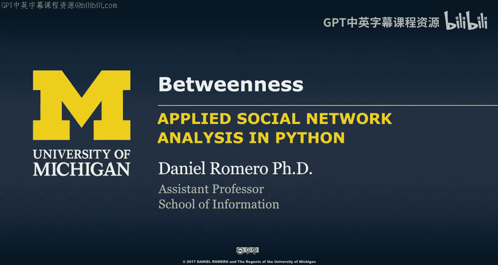
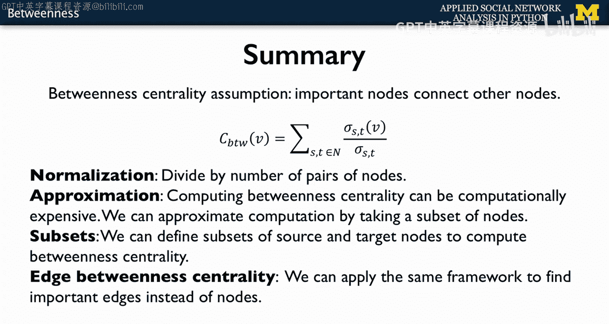

# Python用于数据科学实践：4-5：中介中心性分析 📊




在本节课中，我们将学习网络中另一种衡量中心性的方法——中介中心性。该方法基于一个核心假设：网络中重要的节点是那些连接其他节点的节点。

## 核心概念与定义

上一节我们介绍了中心性的概念，本节中我们来看看中介中心性的具体定义。首先，两个节点之间的距离是指它们之间最短路径的长度。例如，在一个网络中，节点34和节点2之间的距离是2，因为存在多条两步即可从节点34到达节点2的路径。

中介中心性关注的问题是：哪些节点会频繁出现在不同节点对之间的最短路径上？为了量化这一点，我们为节点V定义中介中心性。

以下是其计算公式：

`C_B(v) = Σ (σ_st(v) / σ_st)`

其中：
*   `s` 和 `t` 是网络中除 `v` 外的任意节点对。
*   `σ_st` 是节点 `s` 到节点 `t` 的最短路径总数。
*   `σ_st(v)` 是节点 `s` 到节点 `t` 且经过节点 `v` 的最短路径数。

**核心思想是：** 如果一个节点 `v` 出现在许多其他节点对的最短路径中，那么它就具有较高的中介中心性。

## 计算中的关键选项

在具体计算时，我们需要考虑几个选项，这会影响最终结果。

### 是否包含节点自身作为端点

计算节点V的中介中心性时，一个关键选择是：是否允许节点V本身作为路径的起点（s）或终点（t）。

*   **排除V作为端点：** 此时只计算其他节点对（s, t）之间的最短路径，并检查V是否出现在这些路径中。这种方法下，V的中心性仅源于其作为“桥梁”连接其他节点的能力。
*   **包含V作为端点：** 此时计算的所有节点对（s, t）中，s或t可以是V本身。这通常会导致V的中心性值更高，因为它与自身之间的路径（距离为0）总是经过自己。

### 处理不连通节点对

在图中，特别是**有向图**中，可能存在节点对之间没有路径可达的情况。此时，`σ_st = 0`，会导致公式中的分母为零，计算无意义。

**解决方法：** 在求和时，我们只考虑那些至少存在一条最短路径的节点对（s, t）。对于无法互通的节点对，我们直接忽略，不将其纳入计算。

## 中心性的归一化

直接计算的中介中心性存在一个问题：节点数多的网络，其节点可能仅仅因为潜在的节点对（s, t）更多而获得更高的中心性值。为了在不同规模的网络间进行比较，我们需要进行归一化。

归一化的方法是：将节点的中介中心性除以其所在网络中可能的节点对数量（计算时排除节点自身）。

*   对于**无向图**，归一化除数为：`(n-1)*(n-2)/2`
*   对于**有向图**，由于每条边有方向，可能的节点对数量是无向图的两倍，因此归一化除数为：`(n-1)*(n-2)`

## 在NetworkX中的实现

NetworkX库提供了便捷的函数来计算中介中心性。

以下是使用 `betweenness_centrality` 函数的基本代码示例：

```python
import networkx as nx

# 假设G是一个NetworkX图对象
# 计算所有节点的中介中心性，不归一化，且排除节点自身作为端点
bc = nx.betweenness_centrality(G, normalized=False, endpoints=False)
print(bc)

# 找出中心性最高的5个节点
top_nodes = sorted(bc, key=bc.get, reverse=True)[:5]
print("Top 5 nodes by betweenness centrality:", top_nodes)
```

该函数支持我们讨论过的参数，如 `normalized`（是否归一化）和 `endpoints`（是否包含节点自身作为端点）。

## 近似计算与子集中心性

### 近似计算

对于大型网络，精确计算所有节点对的最短路径非常耗时（时间复杂度可达O(n³)）。此时，我们可以采用**近似计算**。

方法是：不遍历所有节点作为源节点（s），而是只随机抽取 `k` 个节点作为源节点集，基于这些源节点到所有目标节点（t）的最短路径来计算中介中心性。在NetworkX中，通过设置 `betweenness_centrality` 函数的 `k` 参数来实现。

```python
# 使用k=10个节点进行近似计算
bc_approx = nx.betweenness_centrality(G, k=10)
```

### 子集中介中心性

有时，我们只关心网络中特定**子集**之间的连接。例如，我们想知道哪些节点在连接“源节点组”和“目标节点组”时最为关键。

NetworkX提供了 `betweenness_centrality_subset` 函数来实现此功能。

```python
# 定义源节点集合和目标节点集合
sources = [1, 5, 10]
targets = [20, 25, 30]

# 计算基于特定子集的中介中心性
bc_subset = nx.betweenness_centrality_subset(G, sources=sources, targets=targets)
```

## 边的中介中心性

中介中心性的概念不仅可以应用于节点，同样可以应用于**边**。边的中介中心性衡量了一条边出现在其他节点对最短路径中的频繁程度。

其定义与节点类似：
`C_B(e) = Σ (σ_st(e) / σ_st)`
其中 `σ_st(e)` 是经过边 `e` 的最短路径数。

在NetworkX中，使用 `edge_betweenness_centrality` 函数计算。

```python
# 计算所有边的中介中心性
ebc = nx.edge_betweenness_centrality(G)

# 同样，也可以计算基于子集的边的中介中心性
ebc_subset = nx.edge_betweenness_centrality_subset(G, sources=sources, targets=targets)
```

## 总结

本节课中我们一起学习了中介中心性分析。我们了解到：

1.  **核心假设**：中介中心性认为，网络中重要的节点是那些连接其他节点、充当“桥梁”的节点。
2.  **计算方法**：通过统计一个节点出现在所有其他节点对最短路径中的比例来量化其重要性。
3.  **关键选项**：计算时需注意是否包含节点自身作为端点，并妥善处理不连通的节点对。
4.  **归一化**：为了在不同规模的网络间进行比较，需要对中心性值进行归一化处理。
5.  **实用技巧**：对于大型网络，可以使用近似算法（抽样）来高效计算。还可以针对特定的源节点组和目标节点组计算子集中心性，以分析局部连接重要性。
6.  **边的中心性**：中介中心性的概念可以自然地扩展到边上，用于识别网络中关键的联系通道。




通过掌握中介中心性，我们能够从“信息流控制”或“连接枢纽”的角度，更深入地识别和理解复杂网络中的关键元素。