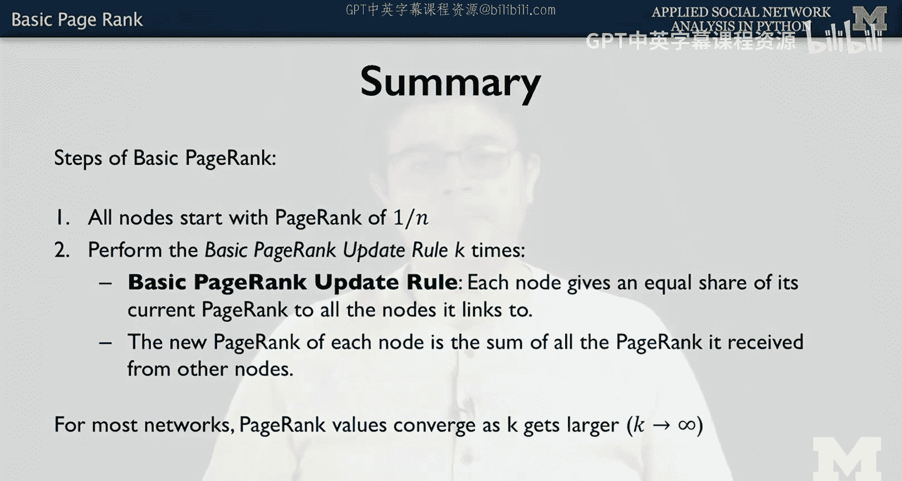

# 密歇根大学《Python用于数据科学实践（4-5课）｜Applied Data Science with Python 》中英deepseek翻译 p33 12_基础PageRank算法.zh_en -BV1DTtueTEwf_p33-

Hello， we've been thinking about how to measure the importance or the centrality of a node in a network and today we're going to talk about another way of doing this。

 It's called Patrink and it was developed by the Google founders when they were thinking about how to measure the importance of web pages using the hyperlink network structure of the web。

And the basic idea is that Pagenk will assign a score of importance to every single node。

 and the assumption that it makes is that important nodes are those that have many inlinks from important pages or important other nodes。

Now this idea of patronon can be used on any type of network， like for example。

 the web or social networks， but it really works better for networks that I have directed edges。

 so for example， a social network where the edges indicate who emailed whom。

And so if we think about the definition， what I said that important pages are those that have many in-links from all important pages。

 then there's a little bit of a circular definition because if you imagine trying to measure the page rank of a particular node that's say the first node that you're looking at。

 then you would want to look at the page rank of the nodes that point to it and you don't have those yet。

 so the way it's defined sounds a little bit circular and in this video we're going to walk through the process of how you can actually compute it。

So the setup is that we're going to have a network with N nodes and then we're going to compute Page ranknk in a step by step fashion。

 and so what's going to happen is that the sum of the page anchor where all the nodes is always going to be constant。

 it's always going to be one and so at first we're going to start with every node having a page rank value of one over n。

And then what we're going to do is we're going to have every node give all of each page rank to all the nodes that it points to。

 and then we're going to do this over and over again。

So what we're going to do is we're going to perform these basic patchearchck update rule K times。

And the basic Patarch update rule that what I just said。

 so every node will give an equal share of its current page rank to all the other nodes that it links to。

And then the new value of Patck for every node is going to be simply the sum of all the patronarch that are received from all the nodes that point to it。

So let's look at an example， let's take for example this network here that you see and now take some time to think about which one should be the most important node。

 and then we're going to compute Pagechenk and then you can see if your guest matches with what Pageri would say。

So we're going to calculate Patreck for every node after just two steps。

 I'm going to show you the calculations for just two steps。

 and then I'm going to show you what happens if you were to perform even more steps on this network。

So first， like I said， we're going to assign every node a patarch of 1 over n。

 so in this case every node will have a patriarch value of 1 over5。

And now we're going to start applying the update rule that I described。

 so we're going to have to keep track of the old values of Page ranknk and what the new value of Page ranknkov each node is。

Let's start with node A Note D& E point to node A， so a is going to get page rank from D&E。

Now let's think about how much Patarch A is going to receive from each one of those two notes。

So if we look at D， D has three edges， it points to three different nodes， CA A and E。

 so a is going to receive one third of the current page rank that D has D currently has one over five page rank and so a is going to get one third of that one fifth of page rank that D has。

Now A is also going to get page rank from node E。And because E only points to a。

 then it's going to give all of its page rank to node a。

 And so a is going to get one over5 page rank from node E。 And so in total。

 a is going to get4 over 15 page rank from those pseudonos。

 And so the new value of page rank of node a is4 over 15。Now let's think of node B。

B gets paidche from Note A。And a currently has one over5 page rank。

 Now it's important here to note that we've updated the page rank of node A to be 4 or 15。

 but when we do this computation， we're always using the old values， not the updated values。

 So B is going to get a page rank of one over 5 from node A。

And then B is also getting page rank from C， and so because C is only pointing to node B。

 then it's also going to give all of its page rank to B， which is one over5。

 and so in total B is getting two or five pat rank from both nodes。Now let's look at node C。

 C is getting pating from D， which again is pointing to three nodes and is giving one third of its page to node C。

 so C is getting one third times 1 fifth from D。And it's also getting page from node B。

 and because b is pointing to two nodes， B is going to get one half of its page rank to node C for page of one half times 15。

 and so in total C is getting5 over 30 or 1 over6 page rank。Now， no D is getting patronuring from B。

 which again is giving half of which pat rank to D and half to C， so D is getting1 half times1 fifth。

And that's the only note D is getting page rank from， so it's getting a total of one or 1 page rank。

And then E is getting patroning from D only， which is one third times one fifth。

 and so in total is's getting one over 15。So we've now computed the new paton values of all the nodes。

 and so that's our first step K equals  one。And so now those new values are going to become our old values。

And we're going to do this process again。Now using the values we got after the first step。

 we're going to do the exact same thing again to get the second step of patroning k equals 2。

So let's start with note a。 A is getting pat rank from D，1 third of its page rank。

 and D has one over 10 page rank。 so it's given a one third times 1 over 10。

And a is also getting patnk from E， E is giving all of each page rank to a。

 so it's getting one over 15 page rank and so a in total is getting1 over 10 and that's its new pat rank value。

Now if we look at node B， B is getting page rank from node C， C points to only B。

 so it's going to give all of each page rank to B and it has one over6， so B is getting1 over6。

 B is also getting page ranknk from A and a is going to give all of each page rank to B as well。

 so it is going to give all of its current 4， 15 page rank to B and in total B is going to be getting 13 over 30。

Now let's go look at node C， C is getting pating from D。

 which again is giving 1/ third of which paton to each of the three nodes he points to。

 so it sees getting one third times1 or 10。And C is also getting page rank from node B。

 which is given half of each page rank to C， so one half times its current page rank which is  two or5 for a total of 7 or 30。

And no D is getting pat ranknk from B12 times 2 or5。And finally。

 E is going to be getting pay rank from D only， which is  one3 times1 over 10 for a total of 1 over 30。

And so that's our new values of patroning for all those nodes after two steps。Now。

 if we look at those values， we find that node B has the highest page rank so far after two steps of 0。

43， followed by node C， then node D， node A and E and so。Up to this point。

 this is suggesting that B is the most important node in this network。

But what happens if we continued for another step。 Well。

 here's the values that you would get if you go to k equals3。

 So you notice that the values change a little bit。

 but so far you still have the same ordering B still the most important node followed by c followed by D followed by a and followed by E So you may wonder what happens if I just sort of continue doing this for k equals 456 and so on how do I know when to stop and how do I know when the actual values that I should consider R right So what if we continue this process Well for this particular network if you continue doing this over and over and do it for many。

 many， many steps It turns out that eventually these values will start to change very little So they're converging to a unique value and that unique value in this case is the values that I'm showing So B has a page rank of 038 C has a page rank of 0。

25 then D0。19， then a。12 and E。06。And it actually turns out that for most networks。

 these page ranknk values will actually converge， and that's the value that we think of as the page of the node。

 so the page rank of the node is the value that you get after you do this process many， many。

 many times。So in summary， the steps of basic page rank are the following first you start with all the notes with a page rank value of 1 or n。

And then you perform this basic page rank update rule K times and this update rule says that every node is going to give an equal share of its current page rank to all the other nodes that it links to。

 and so the new page rank value of every node is going to be simply the sum of all the page rank that it gets from all the nodes that point to it。

And for most networks， these patroning value will actually converge as k gets larger。

 as k goes to infinity， we're going to find that these values convertverge to a unique value。

And so that's how you compute a basic Patrenk and that's all for this video and we'll see you next time。

