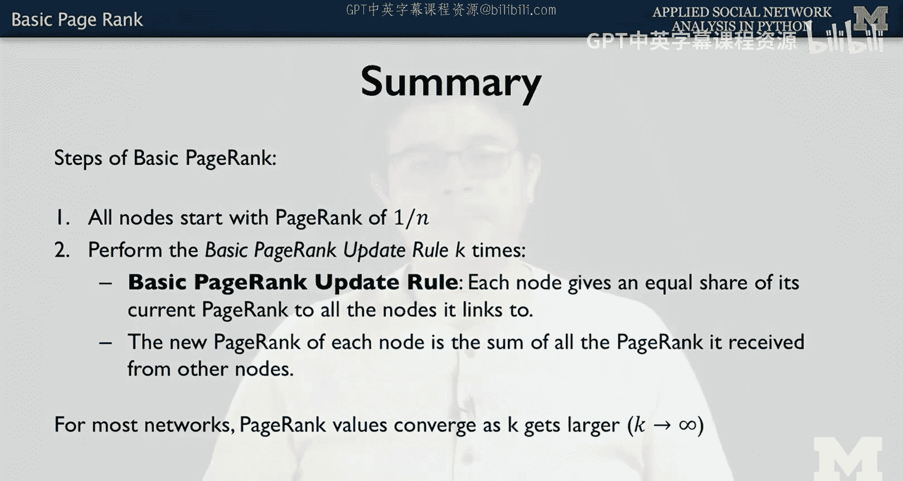

# 应用数据科学Python：4-5：基础PageRank算法 📊

在本节课中，我们将学习如何衡量网络中节点的重要性或中心性。我们将介绍一种名为PageRank的算法，该算法由谷歌创始人开发，用于通过网页的超链接网络结构来衡量网页的重要性。

PageRank的基本思想是为每个节点分配一个重要性分数。其核心假设是：重要的节点是那些被其他重要节点大量链接指向的节点。虽然PageRank可用于任何类型的网络（如网页或社交网络），但它尤其适用于具有有向边的网络，例如表示“谁给谁发送了电子邮件”的社交网络。

听起来这个定义有些循环：要计算一个节点的PageRank，需要知道指向它的节点的PageRank，而这些值最初是未知的。在本节中，我们将逐步讲解如何实际计算PageRank。

## 算法设置与初始化

首先，我们有一个包含N个节点的网络。PageRank的计算将逐步进行。所有节点的PageRank总和始终保持为常数1。初始时，每个节点的PageRank值被设置为 **1/N**。

以下是算法的核心更新规则：

1.  每个节点将其当前的PageRank值平均分配给所有它指向的节点。
2.  每个节点新的PageRank值，就是所有指向它的节点所给予的PageRank值的总和。

我们将重复执行这个基本更新规则K次。

## 逐步计算示例

让我们通过一个具体例子来理解这个过程。考虑以下包含5个节点（A, B, C, D, E）的网络。在开始计算前，可以先思考一下，你认为哪个节点最重要？

我们将计算经过两步（K=2）迭代后每个节点的PageRank值。

### 第一步：初始化与计算 (K=1)

首先，初始化每个节点的PageRank为 **1/5**。

现在，我们应用更新规则。**请注意**：在每一步计算中，我们总是使用**上一步**的PageRank值，而不是本轮已更新的值。

以下是每个节点新PageRank值的计算过程：

*   **节点A**：接收来自D和E的PageRank。
    *   来自D：D指向3个节点（C, A, E），因此A获得D当前PageRank（1/5）的1/3，即 **(1/3) * (1/5) = 1/15**。
    *   来自E：E只指向A，因此A获得E所有的PageRank，即 **1/5**。
    *   A的新PageRank总和：**1/15 + 1/5 = 4/15**。

*   **节点B**：接收来自A和C的PageRank。
    *   来自A：A指向B，因此B获得A所有的PageRank，即 **1/5**。
    *   来自C：C只指向B，因此B获得C所有的PageRank，即 **1/5**。
    *   B的新PageRank总和：**1/5 + 1/5 = 2/5**。

*   **节点C**：接收来自B和D的PageRank。
    *   来自D：D指向3个节点，因此C获得D PageRank的1/3，即 **(1/3) * (1/5) = 1/15**。
    *   来自B：B指向2个节点（C, D），因此C获得B PageRank的1/2，即 **(1/2) * (1/5) = 1/10**。
    *   C的新PageRank总和：**1/15 + 1/10 = 5/30 = 1/6**。

*   **节点D**：只接收来自B的PageRank。
    *   来自B：B指向2个节点，因此D获得B PageRank的1/2，即 **(1/2) * (1/5) = 1/10**。
    *   D的新PageRank：**1/10**。

*   **节点E**：只接收来自D的PageRank。
    *   来自D：D指向3个节点，因此E获得D PageRank的1/3，即 **(1/3) * (1/5) = 1/15**。
    *   E的新PageRank：**1/15**。

至此，我们完成了第一步（K=1）的计算。这些新值将成为下一步计算的“旧值”。

### 第二步：继续迭代 (K=2)

现在，我们使用第一步得到的结果作为起点，再次应用相同的更新规则。

*   **节点A**：接收来自D和E。
    *   来自D：D当前PageRank为1/10，指向3个节点。A获得 **(1/3) * (1/10) = 1/30**。
    *   来自E：E当前PageRank为1/15，只指向A。A获得 **1/15**。
    *   A的新PageRank总和：**1/30 + 1/15 = 1/10**。

*   **节点B**：接收来自A和C。
    *   来自C：C当前PageRank为1/6，只指向B。B获得 **1/6**。
    *   来自A：A当前PageRank为4/15，只指向B。B获得 **4/15**。
    *   B的新PageRank总和：**1/6 + 4/15 = 13/30 ≈ 0.433**。

*   **节点C**：接收来自B和D。
    *   来自D：D当前PageRank为1/10。C获得 **(1/3) * (1/10) = 1/30**。
    *   来自B：B当前PageRank为2/5，指向2个节点。C获得 **(1/2) * (2/5) = 1/5**。
    *   C的新PageRank总和：**1/30 + 1/5 = 7/30 ≈ 0.233**。

*   **节点D**：只接收来自B。
    *   来自B：B当前PageRank为2/5，指向2个节点。D获得 **(1/2) * (2/5) = 1/5**。
    *   D的新PageRank：**1/5 = 0.2**。

*   **节点E**：只接收来自D。
    *   来自D：D当前PageRank为1/10，指向3个节点。E获得 **(1/3) * (1/10) = 1/30 ≈ 0.033**。

经过两步迭代，节点的PageRank排序为：**B (0.433) > C (0.233) > D (0.2) > A (0.1) > E (0.033)**。这表明节点B目前是网络中最重要的节点。

## 收敛性与最终结果

你可能会问，应该迭代多少次？何时停止？如果继续迭代K=3,4,5...步会怎样？

对于这个特定网络，如果持续迭代很多很多步，PageRank值的变化会越来越小，最终**收敛**到一个唯一的值。这个收敛值才是我们最终认为的节点的PageRank。

上图展示了该网络PageRank的最终收敛值：
*   B: 0.38
*   C: 0.25
*   D: 0.19
*   A: 0.12
*   E: 0.06

节点的重要性排序保持不变，但数值稳定在了这些收敛值上。对于大多数网络，当迭代次数K趋近于无穷大时，PageRank值都会收敛到一个唯一解。

## 总结 🎯

本节课我们一起学习了基础PageRank算法。我们来总结一下关键步骤：

1.  **初始化**：为网络中所有N个节点分配初始PageRank值 **1/N**。
2.  **迭代更新**：重复执行以下更新规则K次：
    *   每个节点将其当前PageRank值平均分配给所有它**指向**的节点。
    *   每个节点新的PageRank值，是所有**指向它**的节点所给予的PageRank值之和。
    *   用公式可表示为：`PR_new(node) = sum( PR_old(source) / OutDegree(source) )`，其中求和针对所有指向`node`的源节点`source`。
3.  **收敛**：对于大多数网络，随着迭代次数K增加，PageRank值会收敛到一组稳定的唯一值。这些收敛值即代表了节点在网络中的最终重要性评分。

PageRank通过模拟一个“随机冲浪者”在链接间跳转的过程，巧妙地解决了节点重要性评估中看似循环定义的问题，是网络分析中一个强大而基础的工具。