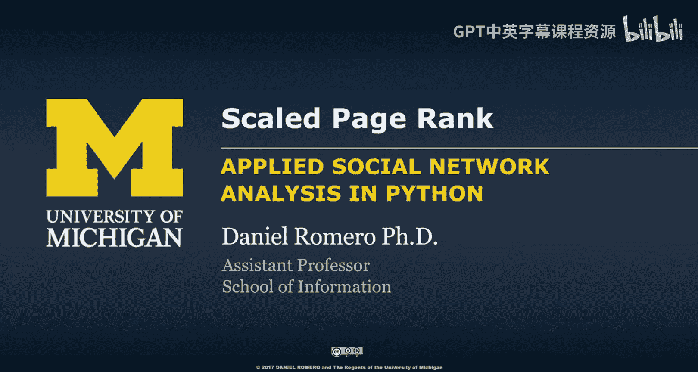
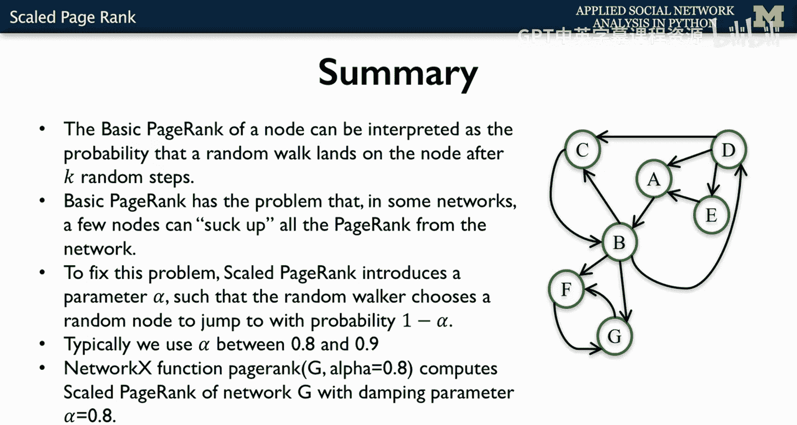

# 密歇根大学《Python用于数据科学实践（4-5课）｜Applied Data Science with Python 》中英deepseek翻译 p34 13_扩展PageRank算法.zh_en -BV1DTtueTEwf_p34-

Hello， last time we talked about Paton and how to compute it on a network。

 and today we're going to talk about how to interpret it and identify a potential problem that it has and also a solution。

So first of all， the page rank value of a node after K steps can be interpreted as the probability that a random walker lands on that node after taking K random steps。

And so having said that， let me tell you what a random walk is。

Let's think about a random walk of case steps， the way it works is that you would start on a random node。

And then you're going to choose outgoing edges at random and follow those edges to the next node。

 and then you're going to repeat this K times。 So for example。

 let's take a random walk of five steps in this graph。So first you would choose some random node。

 let's say you chose node D。And now you're going to choose one random edge going from D to another node。

 So there are three options here。 Let's say you chose the one going to node A。

 So then for your first step， you're going to walk from D to a。

And then you're going to repeat this four more time。

 so you're going to choose a random edge going out from a in this case， there are no options。

 the only one you can choose is the one going to B， so you follow it and you go to node B。

 and then you choose again a random edge。 there are two options either go to C or go to D。

 let's say you go to C。 That's your step 3。Then out of C。

 there's only one edge you have to go back to B， so you go back to B。 That's step 4。

 and then we're back at B， you choose again randomly between going to C and D。

 you may go to C again or maybe you go to D in this case， you went to D and that's your fifth step。

 So that's a random walk。 you simply randomly choose edges and walk along in the network。

And so in thinking about this interpretation of Patnk that says that the value of Pat of each node is the probability that you would land on that node after k steps well。

 we computed the patron rank values for this network and I told you that if you repeat this for a lot of steps say k equals infinity。

 these are the values that you can eventually approach these are the values that it converges to So here B had the highest value of pagenk of 0。

38 and you can interpret these value of 0。38 as the probability that a random walk after taking many。

 many， many steps would land on node B。Here's why this interpretation is useful。 Well。

 we have this network that we've been looking at。 let me make a small change to this network and I'm going to add these two nodes F and G。

 where B points to both of those nodes， and then they point to each other。

I want you to look at this network and try and figure out what the patronrearch of each node is after taking a lot of patroning steps。

 so for k very large。I claim that you should be able to figure this out without doing any type of computation just by thinking about the interpretation of patronnk as a random walk。

 so it take some time to do that。So you should have figured out that for large enough k F and G are going to have a paton value of about1 half and all the other nodes are going to have a paton value of0。

 So why is that Well imagine a random walk in this network whenever the random walk lands on f or G which will happen eventually if you walk long enough in this network then they're going to be stuck on f and G because there are no other edges to go to right So if you're in G the only place you have to go is F and if you're an F the only place you have to go to is G and so there is no way to get back from G and F to any of the other nodes and so all the other nodes。

 the probability that you land on one of them after taking a very。

 very long random walk is going to be0 and the probability of landing on either f or G after a very long random walk is going to be about half for each。

And so this seems like a problem， right because while it may be true that FNG are very important for this reason。

 it's not reasonable to think that all the other nodes have no importance of zero importance。

And so we need to figure out a way of how to fix this problem。

And the way we fix this problem is by introducing a new parameter to the Paton computation called these damping parameter alpha。

 And so what we're going to do is we're going to change the way we do our random walk。

 What we're going to do is we're going to take a random walk with the damping parameter alpha。

 And the way it works is that we again started a random node。And then with probability alpha。

 we're going to follow the outgoing edges at random just like we did before。

 but this is only going to happen with probability alpha。With probability 1 minus alpha。

 we're actually going to choose a node completely at random and jump to it。

So again at every step what we used to do before was to always follow the edges。

 what we're going to do now is that at every step we're either going to follow the edges with probability alpha or we're going to forget about the edges and choose a random node and go to it with probability 1 minus alpha。

And we're going to repeat this K times。And so what happens now if you think about the random walk in this particular network is that we're no longer stuck on node F and G。

 right because even if we were to be on node F and G。

 because we have some probability online alpha of choosing a random node。

 then we're going to get unstuck whenever we actually choose a random node。

And so the scale patronnk of K steps with damping parameter alpha of a node n is going to be the probability that this new random walk with damping parameter alpha lands on a node n after case steps I'm not going to show you how to actually compute this scale patron I'm assuming you're going to use network X to do this。

 but this is the way you interpret it with respect to a random walk。

And so just like with the other pagearch with the basic page rank。

 for most networks as K gets larger， the scaled page rank converges to a unique value。

 but now that unique value will be dependent on the particular value of alpha that you choose。

And so in practice， what we do is we choose a parameter alpha between 0。8 and 0。9。

 so most of the time we're going to be following the edges。But sometimes maybe 10 or 20% of the time。

 we're going to be jumping randomly that way we're not stuck anywhere in the network。

And so if we look at the scaled pat rank value for each one of these nodes for k very large and alpha parameter of 0。

8， these are the values that we get so what you find is that f and G still have a very high pat rank compared to the other nodes。

 but the other nodes don't have a pat rank value of0 and if you look at the patchearch of all the other nodes A through E。

 you find that it follows the same type of ordering that it did before so B still has the highest value of scale pat rank followed by C followed by DNA。

 which roughly get the same value and then followed by nodei。And so FNGs still have high pay rank。

 but not all of the pay。And this damping parameter works better for large networks like the web or very large social networks and this small network sometimes it doesn't work very well in this particular example that I showed you it works well so it serves the purpose of showing you how it works。

 but really it's much better for very very large networks and if you're using network X。

 you can use the function page rank with input G which is the graph and then you have to tell you what the alpha parameter is to compute the scale page rank of the network G with the damping parameter alpha。

So in summary， what we find is that the basic patnk of a node can be interpreted as the probability that a random walk lands on that node after K steps and this is a useful interpretation because well it allows us to see this problem that basic pagearchnk has that sometimes for some networks a few nodes can sort of suck up all the pagenk from all the other nodes in the network and so to fix this problem there' is this other version of page rank which is called scale page rank that introduces this parameter alpha so this random walker chooses a random node to jump to with probability 1 minus alpha so what that does is that it allows the walker to not be stuck anywhere but sometimes it sort of jumping randomly and typically we use a parameter alpha between 0。

8 and 09 but we do have to keep in mind that the page rank value that we get will depend on the particular choice of alpha。

And to compute this or to use this in network X， you can use the function page rank with input parameters G。

 the network， and then the alpha that you want to compute the scale page rank of the network G with damping parameter alpha and that's all for today and I hope to see you next time。

