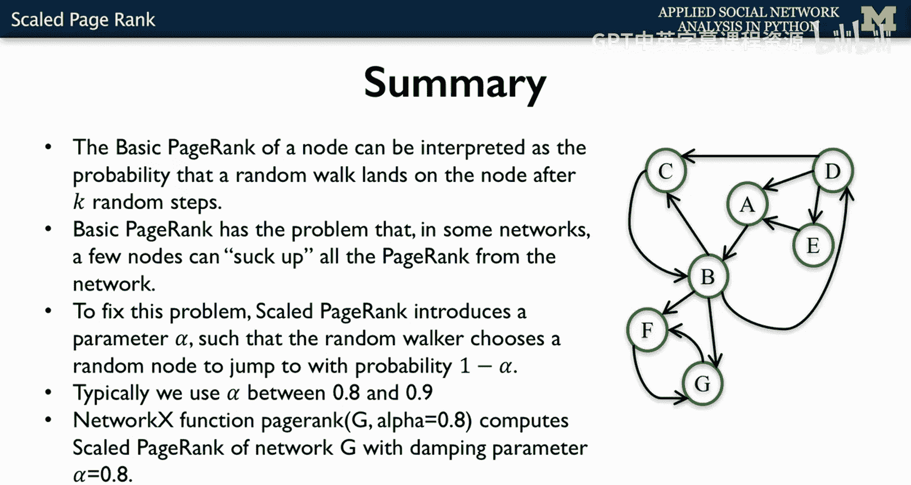

# Python用于数据科学实践：4-5：扩展PageRank算法 📈


在本节课中，我们将学习如何解释PageRank算法，识别其潜在问题，并了解一个名为“阻尼参数”的解决方案。我们将从随机游走的角度理解PageRank，并学习如何通过调整参数来优化算法在网络分析中的应用。

---

## PageRank的随机游走解释 🚶‍♂️

上一节我们介绍了PageRank及其在网络上的计算方法。本节中，我们来看看如何从随机游走的角度解释PageRank值。

经过K步后，一个节点的PageRank值可以解释为一个随机游走者在进行K次随机移动后，落在该节点上的概率。

以下是随机游走过程的描述：
1.  从网络中的一个随机节点开始。
2.  随机选择一条从当前节点出发的出边，并沿着这条边移动到下一个节点。
3.  重复步骤2，共进行K次。

例如，在下图所示的网络中，进行一次5步的随机游走：
*   第一步：从随机节点D开始，随机选择一条边（例如D→A），移动到A。
*   第二步：从A出发，唯一的选择是A→B，移动到B。
*   第三步：从B出发，随机选择一条边（例如B→C），移动到C。
*   第四步：从C出发，唯一的选择是C→B，移动回B。
*   第五步：再次从B出发，随机选择一条边（例如B→D），移动到D。

这就是一次随机游走。基于此，我们可以将每个节点的PageRank值理解为长时间随机游走后停留在该节点的概率。

---

## 基础PageRank的问题 🚧

我们之前计算了示例网络的PageRank值。当K趋近于无穷大时，这些值会收敛。例如，节点B的PageRank值最高，为0.38，这意味着在进行了大量随机游走后，有38%的概率会落在节点B上。

现在，让我们对网络做一个小改动：添加两个新节点F和G，其中B指向F和G，而F和G互相指向。


请思考：当K非常大时，每个节点的PageRank值会是多少？

通过随机游走的解释，你应该能推断出：对于足够大的K，节点F和G的PageRank值将各约为0.5，而其他所有节点的PageRank值都将为0。

原因如下：一旦随机游走进入F或G节点，由于它们只互相连接，没有指向网络中其他部分的边，游走者将被困在这个“陷阱”中，无法离开。因此，在极长的游走后，落在其他节点上的概率为0，而落在F或G上的概率则各占一半。

这显然是一个问题。虽然F和G可能因此显得“重要”，但认为网络中其他所有节点的重要性都为0是不合理的。我们需要一种方法来修正这个问题。

---

## 解决方案：带阻尼参数的PageRank 🛡️

为了解决上述问题，我们在PageRank计算中引入了一个新参数，称为**阻尼参数**，通常用 **α** 表示。

我们对随机游走的规则进行了修改，引入了“随机跳转”的机制。新的游走过程如下：
1.  从一个随机节点开始。
2.  在每一步，有两种选择：
    *   以概率 **α**，按照原有规则，随机选择一条出边并跟随它。
    *   以概率 **1 - α**，忽略所有边，完全随机地跳到网络中的任意一个节点（包括当前节点）。
3.  重复此过程K次。

这种新的游走方式被称为**带阻尼参数的随机游走**。一个节点经过K步后的**缩放PageRank值**，就是这种新游走方式下落在该节点上的概率。

引入阻尼参数后，即使游走者进入了像F和G这样的“陷阱”，由于有 **1 - α** 的概率会进行完全随机的跳转，它最终也能跳出陷阱，访问网络中的其他部分。

---

## 参数选择与实际应用 ⚙️

与基础PageRank类似，对于大多数网络，当K足够大时，缩放PageRank值会收敛到一个唯一值，但这个值取决于你选择的 **α** 的具体数值。

在实践中，我们通常将 **α** 设置在 **0.8 到 0.9** 之间。这意味着大部分时间（80%-90%）游走者会遵循链接，但仍有小部分时间（10%-20%）会进行随机跳转，从而避免被困在任何局部区域。

让我们看看在 **α = 0.8** 且K很大时，修改后网络中各个节点的缩放PageRank值：
*   F和G仍然拥有相对较高的PageRank值。
*   但关键的是，其他节点（A到E）的PageRank值不再为0。
*   并且，这些节点的重要性排序与基础PageRank计算时一致：B最高，其次是C，D和A大致相当，最后是E。

因此，带阻尼参数的PageRank既保留了F和G的重要性，又没有完全剥夺其他节点的权重。这种方法在像万维网或大型社交网络这样的大规模网络中效果更好。在我们的小例子中，它很好地展示了其工作原理。

在NetworkX库中，你可以使用 `pagerank` 函数来计算带阻尼参数的PageRank。函数调用方式如下：

```python
# 假设 G 是你的网络图
alpha = 0.85  # 设置阻尼参数
scaled_pagerank_scores = nx.pagerank(G, alpha=alpha)
```

---

## 总结 📝

本节课中我们一起学习了：
1.  **PageRank的随机游走解释**：基础PageRank值可以理解为长时间随机游走后停留在某个节点的概率。
2.  **基础PageRank的局限**：在某些网络结构（如存在“陷阱”节点）中，基础PageRank会导致少数节点吸收几乎所有重要性，而其他节点的重要性被错误地评估为0。
3.  **带阻尼参数的PageRank**：通过引入阻尼参数 **α**，我们修改了随机游走规则，使其在每一步有 **1-α** 的概率随机跳转到网络中的任意节点。这有效解决了游走者被困的问题。
4.  **实践应用**：通常将 **α** 设为0.8到0.9之间，并在NetworkX中使用 `nx.pagerank(G, alpha=alpha)` 函数进行计算。




通过引入阻尼参数，我们获得了一个更健壮、更适合分析真实世界大型网络的PageRank算法版本。