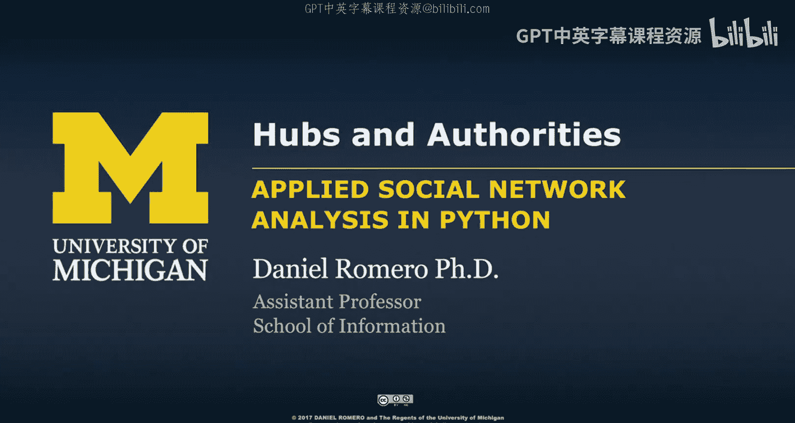
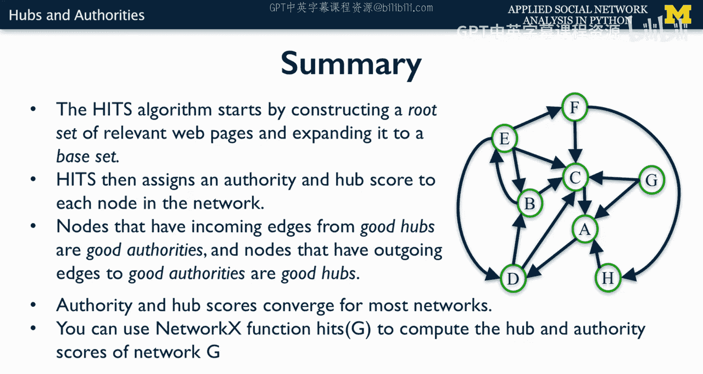

# 密歇根大学《Python用于数据科学实践（4-5课）｜Applied Data Science with Python 》中英deepseek翻译 p35 14_枢纽与权威节点分析.zh_en -BV1DTtueTEwf_p35-

Hello， today we're going to talk about another way to find central nodes in the network。

Just like Page ranknk this way was also developed in the context of how a search engine might go about finding important web pages given a query using the hyperlink structure of the web so the first step will be to find a set of relevant web pages so for example web pages that contain the query string in the text of the web page or for some other reason the search engine things that these might be an important page to look at。

So these are potential authorities， potential pages that are important given the query that the user submitted。

This will be called the root set and so let's say in this example that notes A B and C are these potential authorities。

 This is the root set。 and the next step will be to find a all the web pages that link to any page in the root set and these pages will be potential hubs So hubs are pages that are not themselves necessarily relevant to the query that the user submitted。

 but they link to pages that are relevant， So there are pages that are good at pointing at things that may be relevant。

And let's say that in this example， the notes E FG。

 D and H are these pages that point to at least one of the pages in the root set。

 these whole set of notes， the whatever was in the root and anything that points to something in the root is going to be called the base set。

And we're going to consider all the hyperlinks that link any node in the base set to any other node in the base set。

 so there may be many other edges in this network and we're going to consider them all。

And so this is the network that we're going to use in order to find the important web pages。

So the difference between this new way Hsson authorities and Pagerinknk is that rather than taking the full network。

 we're starting with a subset of the network。Again， looking at first， just the rootet。

 the web pages that may be relevant， and then any page that links to it。

 and so this will be just a subset of the full network of the web。

Now we're going to run the hits algorithm on this network and the hits algorithm。

 just like Patrenk works by computing K iterations and keeping track of the score for every node。Now。

 the difference is that the hits algorithm is going to keep track of two kinds of scores for every node。

 the authority score and the H score。 The first step is to give every node an authority and a hub score of one。

And then we're going to apply two different rules。 These rules are going to be similar to the rules that we used when we compute page ranknk。

 but again now we're going to have to keep track of two different scores。

 so the first rule is going to be the authority update rule which says that each node authority score is going to be the sum of the hubB scores of each node that points to that node。

And then the other rule is the hub update rule， which is sort of the symmetric thing。

 so each nodes hub score is going to be the sum of the authority scores of each node that it points to。

 and then we're going to have to do some normalizations because these scores are going to keep growing and growing so at every iteration we're going to normalize the hub and at the authority score and so for example the way you normalize the authority score is you take each node's authority score。

 let's say J and you divide the authority score of J by the sum of all the authorities in the whole network and then we're going to repeat this process K times。

Now this maybe this might seem a little abstract at this point。

 but let's run to an example to see exactly how it works。

 So we're going to take the network that we had just discussed and we're going to compute two iterations of the hits algorithm on the network。

So just like in Patrearch， we're going to have to keep track of the old scores to be able to compute the new scores。

And because the first step is to give every node a hub and authority score of 1。

 we're going to start there。 We're going to give every node an old authority on hub score of one。

 and then we're going to compute the new scores。 So let's start with the authority scores。

We look at node A and we're going to look at what nodes point to node a in order to figure out what the new authority score of a is。

 and it turns out that CG and H0 to a， and because CG and H all have hub score of one。

 then the new authority score of a is going to be3。Next， node B node D and E point to B。

 and E and D both have hub score of1， so B is going to have a new authority score of 2。

And so you can see at this point that what we're really doing when we get this new authority score is looking at the in degree of each one of the nodes and that's what's going to happen。

 So for example node C has an indi of5 and because all the nodes at this point have a hub score of1。

 then C is going to have a new authority score of 5。And then D has two nodes pointing to it。

 so it has a new authority score of2 and E has a degree of 1， F has an degree of 1。

 G has in degree of 0， so it's going to have a new authority score of 0。

And H has one node pointing to it， so it has the authority score of one。Okay。

 now let's move to the new hub scores is's going to be very similar。

 but now instead of looking at the in degree of every node。

 we're going to look at the out degree and so for example， a has an out degree of 1。

 it points to D and now we have to look at this old authority score and again because this is our first step。

 every node has an old authority score of1， then D does as well。

 and so a is going to have a new hub score of1。B points to two things。

 both of whom have an authority score of 1， and so B has hub score of2 C has an out degree of1。

 so it has a new hub score of 1 D has an out degree of 2 E has an out degree of 4 F has an out degree of 2 G has out degree 2 and H has out degree 1。

Okay， so the hub for the new hub scores， all we had to do was figure out what the out degree of each node was。

Next we have to normalize and so to normalize we have to add up the authority scores and add up the hubB scores in this case they all both add up to 15 it's not the case that in every iteration they're going to add up to the same thing but in the first one they do so they both in this case add up to 15 and so we have to divide all the scores by 15 and so if we do that we normalize the scores。

And now the new authority on hubB scores are going to become our old scores。

And we're ready to go for the next iteration， which is going to be slightly more interesting since now the nodes don't all have the same authority and hub score。

 so we have to pay attention the nodes that we're looking at。So let's start with node a。

 we want to figure out the new authority score of a， and so we have to figure out what nodes 0。 to a。

 so C G and H0。2 a and now we have to look at the hub scores of CG and H which are1 over 15 to over 15 and 1 over 15。

 and so we add those up and we get 4 over 15 and that is going to be A's new authority score。

Now let's move to B， B has two nodes point to it， E and D。

 and they have old hub score of 2 or 15 and 4 over 15， which adds up to 6 over 15。

And then C has five things pointing to it notes E F G B and D。

 which have these old hub scores that I'm highlighting here and they add up to 12 over 15 so that's C's new authority score D has two things pointing to it with old hubub score of 1 over 15 and 4 over 15 which adds up to1 third and so on right we can continue doing this for all the other nodes and find all of the new authority scores Now let's go and try to find the new hub scores So looking at a again now we're not looking at the in degree。

 we're not looking at who points to8， but who does a。2。

And now we have to pay attention to the old authority scores of those nodes， so in this case。

 a points to D and D has a old authority score of 2 or 15， so that's going to be a's new hubub score。

And then for B， it points to EN D， and they have an old authority score of 1 over 15 and one/ third。

 which adds up to two fifths， and so that's going to be B's new hubub score。

C points to a and a has an old authority score of one over 5， so that's C's new hub score。

D points to B and C， and they have an old authority score of2 or 15 and  one/ third。

 which adds up to 7 over 15。And then so on， we can continue doing this for all the other notes and find the new hub scores Next we have to normalize so we have to add up all the authority scores in this case they add up to 35 over 15。

 so we have to divide every new authority score by 35 over 15。

 so if we do that these are the updated normalized scores。And we do the same thing for the hubs。

 so we add up the hub scores for all the node which adds up to three in this case。

 and so we have to divide every new hubub score by3 and then these are the updated normalized scores and so these are our final new authority and hubub scores after two iterations of the hits algorithm。

So just like in Patrearch， we wonder what happens to this course if we continue iterating the algorithm over and over and over again。

 is it going to converge to a unique value？Well let's take a look so here are the scores that we just computed for k equals to two iterations these are the authority scores so what happens as we go to four iterations well this is what you would find and six iterations this is what you would find and same thing for the hops scores these are the scores that we found so far with two iterations and we can figure out what they are for four iterations and six iterations。

So what you see here is that for some nodes， these scores aren't changing。

 but for others they are changing so here I'm highlighting the notes for which the authority or H score continue to change after six iterations so for example node B here starts out with an authority score of 0。

15 then after  four iterations it goes to 0。18 and after 6 iterations it goes 0。

19 so will this score forbe continue to grow or will it saturate at some point what could happen here。

And so if we continue iter here I'm showing you what happens to the hub and authority score of node B so in this plot on the X axis we have the number of iterations and on the Y axis we have the authority on hub scores for node B As it turns out for most networks as K gets larger the authority on the hubub scores actually do converge to a unique value and in this case this is the unique value that you find as K becomes larger and larger。

And so for this network， the nodes with the highest authority score are B and C and the notes with the highest hub score are DNAE and if you remember the original setup of the network。

 B，C and A were these root node right the ones that were supposed to be very relevant and it turns out that B and C have the highest authority scores。

And then the biggest hubs， the node that are good at pointing at node that are particularly relevant or particular authorities are D and E。

 and if you notice both A D point to B and C as well as other node in particular。

 D only points to B and C and E points to them to and also others。

Now to compute the HB scores and the authority scores of a network using network X。

 you can use the function hits and give it the graph that you're analyzing as input and hits will output two dictionaries key by node that contain the hub and authority scores of all the nodes in that network。

So in summary， we find that the hits algorithm starts by constructing a root set of relevant web pages and then expands it to a base set using the network structure。

And then hits will assign an authority score and a hubub score to every node in the network。And here。

 node that have incoming edges from good hos are thought to be good authorities and then node that have outgoing edges to good authorities are thought to be good hos。

Authorities， scores and Hs scores for most networks will converge to a unique value。

 and you can use network X to find these scores by using the function hits on any network that you want。

And that is all for this video and I will see you next time。

