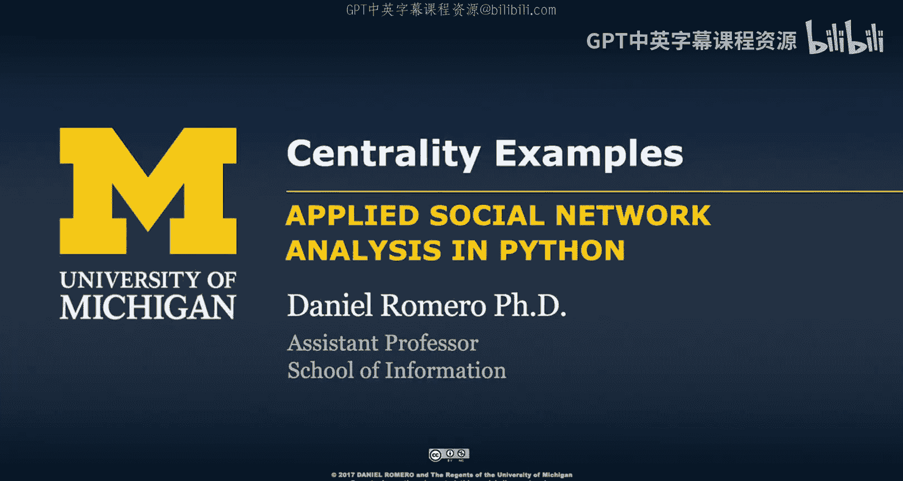
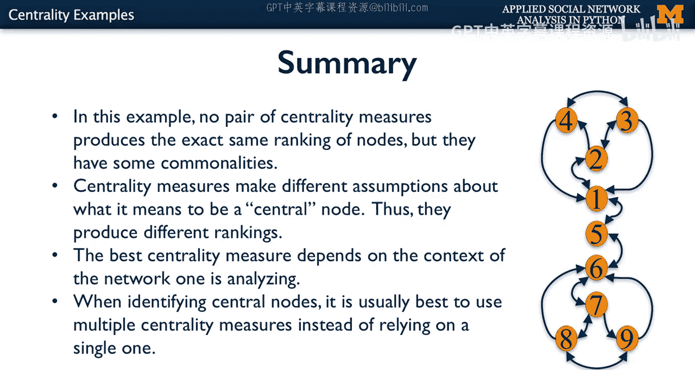

# 密歇根大学《Python用于数据科学实践（4-5课）｜Applied Data Science with Python 》中英deepseek翻译 p36 15_中心性应用实例.zh_en -BV1DTtueTEwf_p36-

Now that we've seen a number of different ways of finding central nodes in a network today we're going to look at an example where we compare how the different centrality measures that we've looked at rank nodes differently。

 And so we're going to be looking at this particular network and we're going to run the different algorithms that we looked at on this particular network And so let's start with the most basic way of thinking about centrality in a network and that is your in degree。

 how many nodes point to you。 if we use this measure on this network。

 what we would be able to say is that nodes  one and6 have the highest in degree。

 So they're the most central。They have in degree of four and then all the other nodes are sort of second because all the other nodes have in degreeeg 2 So the indi centrality is only able to say that nodes1 and6 are sort of the most central and everything else is the same And so I'm going to be looking at all the other measures and just like I did for in degree I'm going to be putting the nodes ranked by highest to lowest and I'm going to be using red lines to indicate when the ties break So in this example nodes one and6 are the most central nodes and then everything else comes second and I'll indicate that using this red line here So now let's look at closeness centrality。

Just remember that closing centrality says that node who are central are a short distance away from all the other nodes in the network。

And so using this measure we'll find that5 is the most central node You can see that this makes sense because note 5 is in the middle of the network most nodes can reach node 5 in just a small number of hops for other nodes such as3 or4 it is going to take a larger number of hops to reach them for example it takes multiple hops to go from node8 to node 3 so it makes sense that5 has a high closer centrality。

Notes1 and6 come next， and you can see that they are also in the center of the network。

 but not as central as5。Then come notess 2 and7， which are closer to the center of the network than node 4。

3， and8 and 9， but less central than 5，1 and 6， and finally the notes with the lowest closedness centrality are notes 4。

3，8 and 9， and closeness centrality could not distinguish between them。

You can see why notes3 and4 have the same closing centrality by noticing that to get to one of those notes。

 you must reach note2。And at that point， you are one hop away from reaching notes3 and four。

A similar argument holds for nodes 8 and9。However， note that there is a structural difference between notes3 and4。

For example， while we can go from node3 to2 directly in order to get from node4 to 2。

 we must pass to do note 3， however， closest centrality does not capture this difference。

Next we'll look at between this and as a reminder， between us says that central nodes are those that show up in the shortest paths between different pairs of nodes in the network。

And so the node with the highest between this is node 5 and again this makes sense it's pretty central in network。

 you can kind of tell that five does show up in the shortest path between many pairs of nodes。

And then next will come one and6， just like with closeness and again if this makes sense。

 then we have nodes2 and7 again， just like with between this andity。Next will be node 3 and 8。

 so unlike closeness between a centrality is able to capture the structural differences between Note 3 and 4。

 as we noted earlier in order to get from node 2 to4， we must pass through node 3。

 whereas Note 3 can reach node 2 directly， therefore Note 3 has higher between a centrality than node 4。

Then finally， notes4 and9 have the lowest between a centrality。

So betweenness turns out very similar to closeness。

 but betweenness is able to capture those structural differences between nodes 3 and 4 that closeness does not capture。

Next let's look at page and again， Pageing has this useful interpretation which says that nodes who are central are the ones that if you were to take a random walk on this network。

 then you would pass by them a lot or you would end up landing on them a lot。

And so the nodes with the highest page rank in this network are node1 and6 and then node 5 So unlike between this。

 which says that five is the most central node， page rank has one and6 and then five。

Now why this may be， well， if you notice， Note 5 here gives all its patron to nodes 1 and6。

 whereas nodes 1 and 6 give some other patroning to node 5， but they also give two other nodes。

 So this part of the reason why note 5 comes second to one and6。

And then you have the exact same thing you have2，7，3，8 and 4，9。

 so in this case Patreon comes out very similar to between this。

 but it flips the notes one and 6 and5 Now let's look at the authority scores from the hits algorithm that computes authority and hop scores for every node。

This just like Pat rank puts one and6 at the top and then come nodes 4 and 9。

 which is kind of surprising at first right because you would imagine， well。

 what happened to node5 and what happened to nodes 2 and 7 which are clearly central in this network why are they not coming before4 and 9 and we'll see that in a minute but for the authority score next you have nodes 3 and 8 to 7 and then finally you have node 5。

 So the node with the lowest authority score here is 5 even though for many of the other centrality measures it had a very high centrality So why may this be the case Well if you remember the hits algorithm gives every node and authority score and a hub score and so in order to kind understand what the hits algorithm is saying you have to kind of look at those scores together And so what happens is that when you look at the hub scores of these network2。

5 and7 which were the nodes that were。Kind of wondering why they wouldn't have high centrality。

 high authority， well it's because they have high hop score so the way that the hits algorithm and a license network is that it says that the authorities are one and six。

And two， five， and7 are the nodes with a very high hub score， so to interpret the scores。

 you really have to take them together。And then next will' come three and eight， four，9， and one。

 and six。And so what we see here is that all of these measures sort of give different rankings。

 right， although there are some commonalities， so they all have nodes one，5。

 and 6 with high scores generally， but there are some differences as well。So if we summarize。

 we find that in this example no pair of centrality measures produced the exact same ranking。

 but there are some commonalities so you are able to pick out some of the nodes that are very central。

 Of course these centrality measures make different assumptions about what it means to be a central node and so that's why they produce different rankings。

And to figure out what the best centrality measure is really depends on the context of the network that you're analyzing。

And usually the best thing to do to identify central nodes is to take up multiple centrality measures and figure out which nodes come out central in many of them rather than relying on a single one to do this。

And so I hope this gives you some context into how these difference traveling measures compare and look at the differences between them as well。

 and that's all for this video and we'll see you next time。

