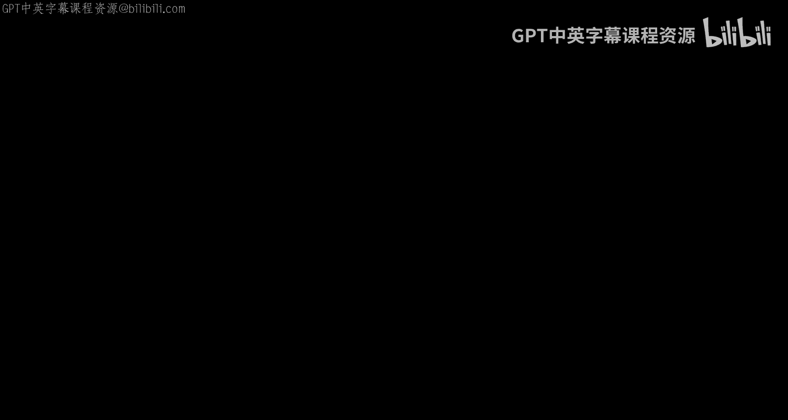
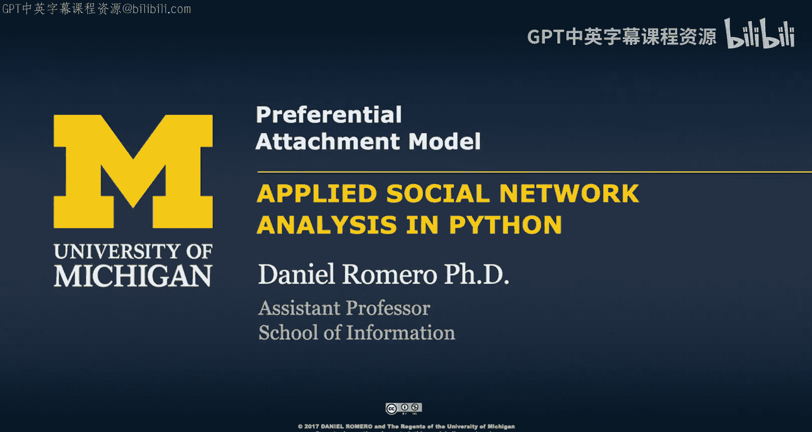
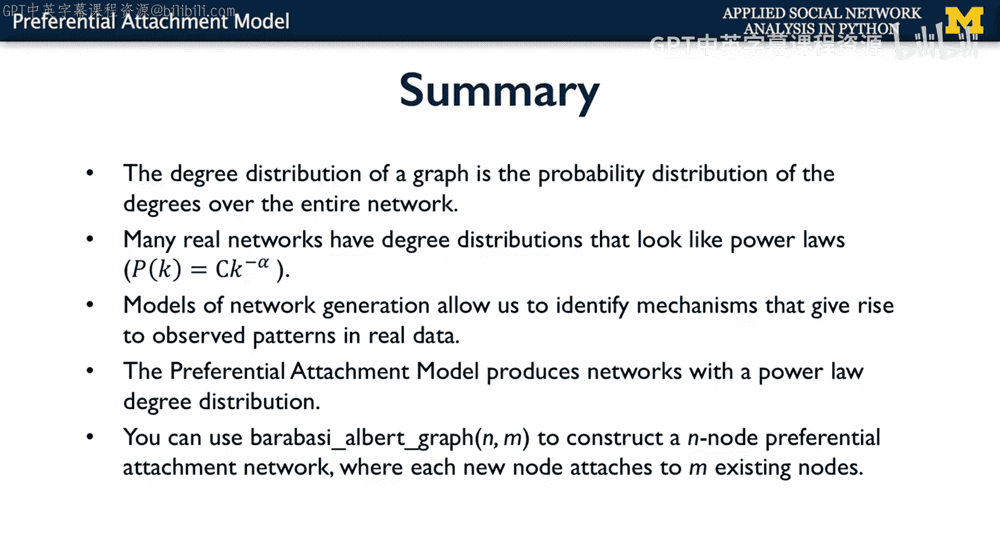

# 密歇根大学《Python用于数据科学实践（4-5课）｜Applied Data Science with Python 》中英deepseek翻译 p37 16_优先连接模型.zh_en -BV1DTtueTEwf_p37-

Hello， as we have seen before， the degree of a node in an undirected graph is the number of neighbors that it has。

But sometimes we're not interested in the particular degree of a specific node。

 we're interested in seeing how the degrees of all the nodes are distributed across the whole network。

And so for example， here in this network we see that many of the nodes have degree 2。

 some have degree 3， and only one of them has degree 4 and one has degree 1 and so suppose we like to see how these are distributed over the network and when we do we look at the network's degree distribution。

 which is the probability distribution of the degrees over the entire network and so if we let P of k where k is degree be the degree distribution of these network we'll find that P of k has the following values P of 1 would be1 over9 because only one node node e has degree 1 out of all nine nodes。

P of2 will be four over nine because there are four nodes that have degree2 over the nine nodes。

And then P of3 is3 over9 or 1 third because three nodes have degree3。

We can plot the degree distribution of a network using network X in the following way。 First。

 we use the function degrees， which returns a dictionary where the keys are nodes and the values are the degree of the nodes。

And then we construct a list of sorted degrees， so these would just have the degrees of all the nodes in the network in a sorted list。

And then we construct a histogram that tells us how many nodes of a particular degree we have。

 and then we can just plot a bar plot of this histogram and so if we do that for this network。

 this is what that histogram looks like so we see that as we had seen before。

 most of the nodes have degree 2， then some of them have degree 3 and very few of them have degrees1 and 4。

And this allows us to see how these degrees are distributed over the network。

Now sometimes we're working with directed graphs instead of undirected graphs。

 and then in that case we would be interested in the indi or the out degreeeg of the nodes。

And so usually we look at the indi and in this case， if we look at the ind。

 this is how they're distributed， and if we look at the indi distribution， say pn of k。

 that degree distribution would have these values， so we have pn of0 is2 over 9 because two nodes have degree 0。

 pn of 1 is4 over 9 because4 of the nodes have in degree1 and so on。

And we can also visualize the indigr distribution in the same way that we did for the degree distribution and the undirected graph。

 but now we use the indi function rather than the degree function and everything else is the same and we can visualize the indigr distribution of this network。

So one interesting question to ask is what does the degree distribution look like for real networks？

And so let me show you three examples。Here are the degrees divisions of three different networks。

 and let me tell you what the networks are。 So a network A is a network of 225。

000 actors connected when they appear in a movie together。B is a network of the World wide web。

 so it has but 325，000 documents that are connected by URLs。

And then C is a network of the US power grid， so it's a network of about 5000 generators connected by transmission lines and so there are two things to notice about these degree distributions。

 the first thing is that they're all in log log scale。

 meaning that the x axis in the y axis are both on log scale rather than linear scale。

 and then the second thing to notice is that for at least part of these distributions they tend to look like straight lines for all three cases。

And so when you put those two things together， when you have a degree distribution on a log log scale and it looks kind of like a straight line。

 then we say that this degree distribution is looks kind of like a power law。

 a power law degree distribution would have the form P of k equals C times k to the negative alpha where C and alpha constant and the alpha values for these three distributions that we have here are 2。

3 for a 2。1 for B and 4 for C okay these details are not so important at least for this course。

 but the thing to know about power law degree distributions is that they tend to have most of the notes with very。

 very small degree。But you have a few nodes that accumulate a very， very large degree。

 So for example， if we look at the degree distribution for a network A。

 we have that most actors have a very small degree。

 so they've appeared in movies with a very small number of other actors。

 but a few actors actually appear in a movie with many。

 many actors some appear in at least one movie with almost 1000 actors。

 so you can notice that when you。Look at this degree distribution。

 these actors have accumulated a degree that's very large， almost 1000。

 whereas most actors actually have a very small degree。

 and that's typical of power law degree distributions。

So one of the things we try to ask when we see something like this。

Is what could explain these property that we observe happening in many different networks？

And the way we try to answer this question is by coming up with models that generate networks that make a few assumptions about how these networks get formed and then they give rise to whatever properties we observe。

 so in this case the question would be can we come up with a model that generates a network that has a power law like degree distribution。

One of the models that achieve this property is called a preferential attachment model。

 and so let me tell you how the preferential attachment model works。First。

 we started with just two nodes that are connected by an edge。And then at each time step。

 we're going to add a new node and that new node is going to connect to a single existing node。

 and so the。So if special sauce in the model comes when you decide which node to pick out of the existing nodes。

 and so the way that this new node is going to pick an existing node to attach to is going to be that it's going to choose it at random。

 but is going to choose it with probability proportional to the node's current degree。

So the probability of connecting to a node U that has degree KU is going to be KU divided by the sum of all the degrees of all the other nodes。

So let's run an example of this model again， we started with these two nodes connected by an edge and then at each time step we're going to add a new node so node3 is going to come in and is going to attach to a single node。

 either node1 and node2， but it's going to do so with probability proportional to their degree。

Well right now， node 1 and 2 both have degree of1， so the probability of choosing 1 and2 is 5050 for node 3。

 and so let's say it chooses node2。Now node 4 comes in but now node 2 has degree of2 and nodes 1 and3 have degree 1 and so the probability of attaching to node 2 is 0。

5 and the probability of attaching to nodes 1 or3 is 0。

25 and so node 4 attaches to node 3 which you know it had a lower probability that could happen so it attaches to node 3 Now node 5 comes in and we have to recompute all the probabilities Well now nodes 2 and 3 both have degree2 and nodes 1 and 4 have degree 1 so nodes 2 and 3 are going to have a higher pro of attaching and so that's 0。

33 for node 2 and 3 and 0。17 for node 1 and 4 and so let's say 5 attaches to node 2 and we continue this node 6 again we recompute the probaities Now node 2 has the highest degree so we will have the highest probability of getting that new attachment and so6 let's say attaches to2 now 7 comes in we recompute the probabilities again now。

2 has a even higher degree so it has a even higher probability of getting that new node second is node 3 that has a degree of 2 with probability of getting that new node edge at a 0。

2 and7 attaches to2 node 8 comes in we recompute the probabilities node 2 probability becomes even larger but this node 8 attaches to node 3 and so on you can see how these continues and the thing to notice here is that as node2 started to get larger and larger degree its probability of getting a new edge became larger and larger as well so there is this sort of rich get richer phenomenon where as the nodes get get larger and larger degree they also start to become more and more likely to increase their degree。

And so what we can prove about this particular mechanism is that it gives rise to a power law。

 it approaches a power law as the number of node gets larger and larger and larger。

 and so it matches the kind of degree distribution that we see in these real networks。

And so this type of modeling technique allows us to explain or at least have some hypothesis for what kind of mechanism could give rise to this shape of the the distribution that we observe。

 And so， for example， if we believe that a very popular actor that has appeared with many other actors in movies has a higher likelihood of getting。

An additional actor to co appearedear in a movie than a maybe less popular actor that has not appeared with many other actors in movies。

 then this is the kind of mechanism that could be explaining the sort of very skewed power law distribution that we observed。

In network X， you can use the function byrobahi Albert Graph。

 which is named after the researchers that came up with this model with input parameters n an M where n is the number of nodes and M is the number of new nodes that an arriving node would attach to in our example the way we define it。

 these M parameter would be one because we said that every node every new node would attach to only a single existing node。

 but you can generalize this and have it so that every node attaches to M existing nodes and that M will not change the fact that you still get a power law degree distribution。

So you can use this function in network X to create networks that follow these preferential attachment model。

And so let's create one here with a million nodes and an M of one。

 so every node attaches to a single existing node。And now let's plot the degree distribution thats in the same way that we did before。

 except that now I'm not using a bar plot， I'm using a scatter plot， and now I'm setting the scales。

 the y scale and x scales to be log so we can see the straight line that gets formed on the log log scale for the degree distribution。

And so here it is， we see that it forms the straight line that characterizes the power law degree distribution。

 So in summary， we have that the degree distribution of a graph is the probability distribution of the degrees over the entire network。

And in many real networks that we see this degree distribution tends to look sort of like a power law because it looks sort of like a straight line on a log log scale。

And we also discussed that models of networks generation allow us to identify mechanisms that give rise to patterns that we observe in real networks。

 So in this case， we observed that many real networks tend to have these power law degree distribution。

 and then we covered a model that gives rise to this particular property。

 which allows us to have some insight about the kinds of things that could be given rise to these properties in real networks。

 And in this case， this was the preferential attachment model that produces these networks with power law degree distribution。

And in Network X， you can use this function bybahi Albert Graph to construct networks that have end nodes and where every single node attaches to M existing nodes following the preferential attachment model。

And that's all for today， I hope to see you next time。

