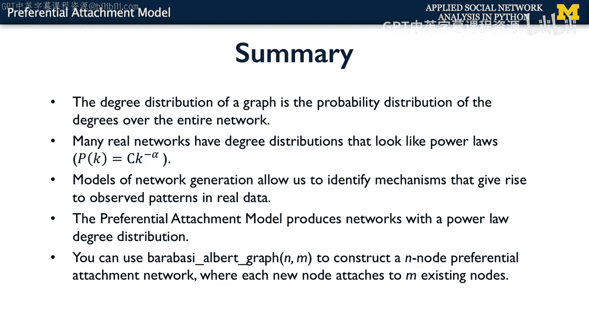

# 网络科学：4.5：优先连接模型


在本节课中，我们将学习网络中的度分布概念，探讨真实网络中常见的幂律分布现象，并介绍一种能够生成此类网络的模型——优先连接模型。

## 度分布

在上一节中，我们了解了节点的度。有时，我们不仅关心单个节点的度，更关心网络中所有节点的度是如何分布的。

节点的度分布是指网络中所有节点的度的概率分布。对于一个无向网络，如果我们用 **P(k)** 表示度为 **k** 的概率，那么可以通过统计每个度值出现的节点数量来计算。

以下是计算和绘制度分布的步骤：
1.  使用 `degrees()` 函数获取一个字典，其中键是节点，值是节点的度。
2.  将所有节点的度值提取出来，排序后形成一个列表。
3.  统计每个度值出现的频率，生成直方图。
4.  使用条形图绘制这个直方图。

```python
# 示例：计算并绘制无向图的度分布
degrees = G.degree()
degree_values = sorted([d for n, d in degrees])
hist = {}
for d in degree_values:
    hist[d] = hist.get(d, 0) + 1
# 绘制条形图...
```

对于有向图，我们通常分别关注入度分布和出度分布。计算入度分布的方法与上述类似，但使用 `in_degree()` 函数。

## 真实网络的度分布

观察真实网络的度分布时，有两个关键现象：
1.  坐标轴通常采用对数刻度。
2.  在对数-对数坐标下，度分布常常近似为一条直线。

这种在对数-对数坐标下呈直线的分布，被称为**幂律分布**。其数学形式为：
**P(k) = C * k^(-α)**
其中，**C** 和 **α** 是常数。

幂律分布的特点是：网络中绝大多数节点的度非常小，但同时存在少数连接数极高的“枢纽”节点。

## 优先连接模型

为了解释为何众多真实网络都呈现幂律度分布，科学家提出了网络生成模型。优先连接模型就是其中之一，它能生成具有幂律度分布的网络。

该模型的工作原理如下：
1.  初始时，网络有两个通过一条边连接的节点。
2.  在每个时间步，添加一个新节点。
3.  这个新节点会连接到网络中的一个现有节点。
4.  **关键机制**：新节点选择连接哪个现有节点不是随机的，而是**概率正比于该现有节点当前的度**。即，一个节点已有的连接越多，新节点连接它的概率就越大。

连接到一个现有节点 **u** 的概率公式为：
**P(连接到u) = ku / Σ kv**
其中，**ku** 是节点 **u** 的度，分母是所有节点度的总和。

这个过程导致了“富者愈富”的现象：度高的节点更容易获得新连接，从而度变得更高。随着网络规模增大，该模型生成的网络的度分布会趋近于幂律分布。

## 在 NetworkX 中实现

在 NetworkX 库中，可以使用 `barabasi_albert_graph(n, m)` 函数来生成遵循优先连接模型的网络。

以下是该函数的参数说明：
*   **n**：最终网络中的节点总数。
*   **m**：每个新加入的节点会连接到现有节点的数量（在基础模型中通常设为1）。

```python
import networkx as nx
# 生成一个具有100万个节点，每个新节点连接1个现有节点的网络
G = nx.barabasi_albert_graph(n=1000000, m=1)
# 绘制其度分布（使用散点图和对数坐标）
# ... 绘图代码
```

在对数-对数坐标下绘制该网络的度分布，可以观察到近似直线的特征，验证了其幂律属性。

## 总结

本节课我们一起学习了以下内容：
1.  **度分布**：网络中节点度的概率分布，是描述网络整体连接模式的重要指标。
2.  **幂律现象**：许多真实网络（如社交网络、万维网）的度分布在双对数坐标下呈直线，即服从幂律分布，其特点是存在少数高度连接的枢纽节点。
3.  **优先连接模型**：一种网络生成模型，通过“新节点以正比于现有节点度的概率进行连接”这一简单规则，成功地解释了幂律度分布的产生机制，体现了“富者愈富”的动力学过程。
4.  **工具应用**：我们了解了如何使用 NetworkX 中的 `barabasi_albert_graph` 函数来生成具有幂律特性的模拟网络。



网络生成模型帮助我们理解观察到的网络模式背后可能存在的形成机制。优先连接模型为我们理解真实网络中枢纽节点的出现提供了一个清晰而有力的理论框架。