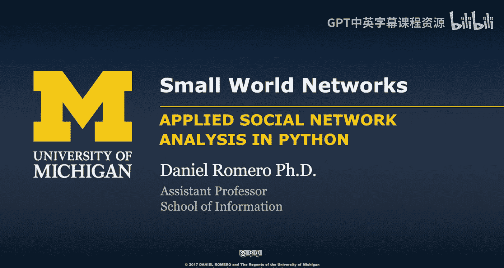
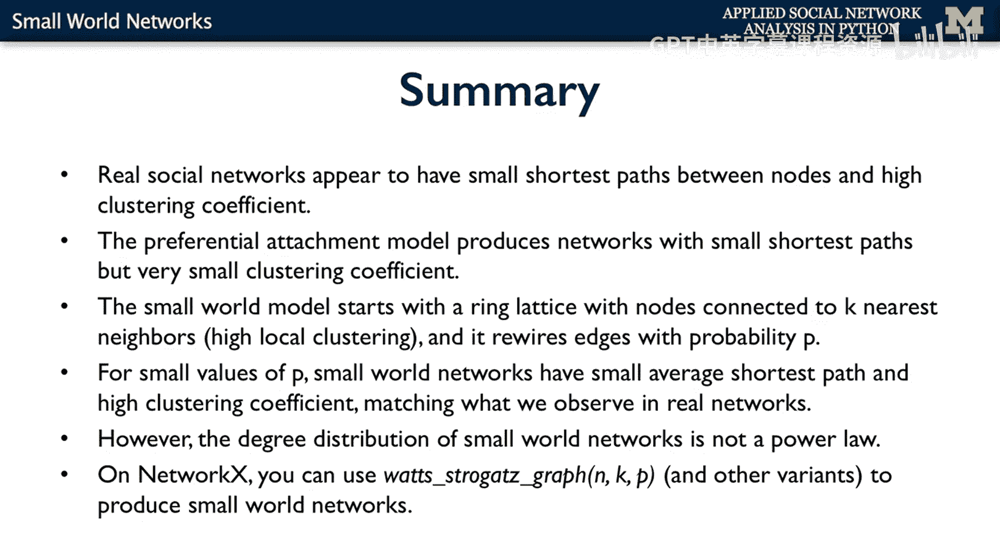

# 密歇根大学《Python用于数据科学实践（4-5课）｜Applied Data Science with Python 》中英deepseek翻译 p38 17_小世界网络.zh_en -BV1DTtueTEwf_p38-

Hello， today we're going to talk about this small world phenomenon。

 which suggests that the world is small in the sense that we're all connected by very short paths between each other。

But how can we measure these paths and how short are they really？So in the 1960s。

 a researcher named Stanley Milgram was wondering about this very question。

 and he set out to create an experiment that would allow him to measure how long these paths are and whether or not they really exist。

And so the setup of the experiment was the following He chose 296 people at random as starters all over the US and asked them to forward a letter to a target person。

 This target person was a broker in Boston and instructions for the starters was that they were to send the letter to the target if they knew him on a first name basis Of course。

 since these were randomly selected people， most of them didn't know this person on a first name basis。

 So if they didn't know him， their job was to send a letter to someone else along with instructions who they knew on a first name basis。

 was more likely to know the target on a first name basis。

And the instructions contain some information about the target like this city where he lived and his occupation。

So then what they did is they checked how many letters actually arrived at the destination and how many hops they took to arrive there。

And so these were the results out of all 296 starters， 64 of them reached the target。

So the median chain length， the number of hops that it took for these letters to get there was6。

 which was consistent with this fus phrase of 6 degrees of separation here in this plot。

 we can see a histogram of the chain length for the letters that actually arrived and we can see that they took anywhere from one to 10 hops to get there。

 but the median was 6。And so the key points here are the following。 so first of all。

 a relatively large percentage of these letters actually arrived if you think about the fact that these were kind of randomly selected and that people could drop out of this and say I'm not even going to try to forward this letter 21 and so despite all of these things。

 more than 20% of the letters actually reach the target。

And the second is that for the ones that reached， these paths were relatively short， right。

 So median of six single digit in a network of millions and millions of people。

 that seems pretty small。The other thing that's interesting。

 although we were not going to focus too much on this part of it is that people are actually able to find these short paths。

 so not only do these paths exist， but somehow people are able to find them。

 which is also kind of interesting。Now more recently people have tried to answer this question but without actually running an experiment。

 instead looking at actual data and measuring how long these paths are。

 of course in the 1960s we didn't have access to very large data sets of networks but nowadays we do so one example of this is looking at instant message communication among people so researchers took a network of 240 million active users on Microsoft instant Messenger。

And then they connected them if two users were engaged in a two way communication over a period of a month。

 and so these defined a network， a very large network。And the estimated path length in this network。

 so if you take any two people at random and check what the distance between them is in the network。

 so the length of the shortest path， the median is estimated  to be7。

Which is very close to what Milgramm had found in the 1960s， which was6， and it's also very small。

 Here is the histogram of the distances of this particular network。 We again。

 see that these tend to be small。People have also tried to do this on using Facebook data and so what they did is they looked at how these distances change over time and how they vary if you try to measure them on the full Facebook network versus just a subset of it in a particular region like in the United States and what they found is that if you take a global network。

 the average path length in 2008 was about 5。28 and three years later in 2011， it was 4。

74 so it seems like these path lengths are short and they seem to be getting smaller over time and as you may expect if you take a smaller region like just the United States then they tend to be even smaller。

So what this tells us is that if we look at these real networks that have millions and millions of people。

 the average shortest path between pairs of nodes。Tends to be， on average。

 or mediumn tends to be very small。So that's the first property that I wanted to discuss today。

The other property that I wanted to talk about is this clustering coefficient property which we've talked about before。

 so remember the local clustering coefficient of a node is the fraction of pairs of the node's friends who are friends with each other it's roughly talked about are there lots of triangles or not and when we take the average local clustering coefficient of all the nodes？

And when we look at real networks like for example， Facebook in 2011。

 we find that the average clustering coefficient tends to be pretty high。

 so here is a plot that has on the x axis， the degree of a node and on the y axis we have the average clustering coefficient and we find that it decreases us degree increases so for people that have lots and lots of friends their clustering coefficient tends to be smaller but on average it's still pretty large so if you look at notes that have say 20 to 50 friends。

 their clustering coefficient is somewhere in the 30s or so。In the Microsoft Ins messageage network。

 the average clustering coefficient was 0。13 and in the actor network that we talked about before。

 the average clustering coefficient is even higher at 0。

78 and so I think to note here is that I say that these clustering coefficients are high because if you imagine that these graphs were completely random meaning you take all of these notes and whatever number of edges it has and you can just assign them at random then you would find that the average cluster coefficient would be much much smaller because there is nothing that sort of making these triangles appear here and so these clustering coefficients tend to be high we think that there is something happening in the formation of the network that is sort of favoring triangle formation。

So we've noticed two things， one that social networks tend to have a high clustering coefficient and two that they tend to have small average path length。

So the next question is， can we think of a model that generates networks that have these two properties？

Just like we did for the power law degree distributionion。

 we observed that the network tend to have these power law degree solutionsions and then we covered a model that gives rise to these types of properties and that allowed us to think about well maybe maybe this model explains how these properties come about in the real data can we do the same kind of thing here？

Well， the first natural thing to do would be to check well we already have a model of network formation。

 preferential attachment model， can we check if this particular model has networks with high clustering coefficient and small average path length。

So let's create one of 1000 nodes and parameter m of4。

 that means that each new node is going to attach to four existing nodes。

And let's see what its average clustering is。 Well， in this case， iss 0。02。

 which is pretty small compared to the networks that we had seen before。

Now for the average shortest path length， it is 4。16， which is pretty small， it's pretty decent。

 so it seems that it gets one of the properties， but not the other。

Let's see what happens if we vary the number of nodes and the number of edges per new node。

 the parameter M， and let's see what happens to the path length and the clustering。On the x axis。

 I have the number of nodes， and on the y axis I have the average clustering coefficient。

 and we have different curves that represent different values of the parameter M。

And then I have the same thing for the average shortest path Well we serve it as these networks have a small average shortest path and the reason why is that if you remember these power law degree regions have the property that some nodes have a very。

 very high degree and so these high degreeeg nodes act as hubs that connect many pairs of nodes and make sort of bridges between them and so this is why we see that these average shortest path than E kind of small。

However， for the clustering side we see that as the number of nodes increases。

 the average clustering coefficient also decreases and it becomes very small and so even at 2000 nodes we see that the average clustering coefficient is very small at like 0。

05 or so and we have seen networks of millions and millions of nodes that had a much larger clustering coefficient and so it seems like the preferential attachment model while it has this small average shortest path property fails to have these clustering coefficient high clustering coefficient property and the reason is that there is no mechanism in the preferential attachment model that would favor triangle formation so it's natural that it just doesn't have that property。

So now let's talk about a new model called a Small world model that actually gives networks that have these two properties。

So first let's discuss how the model actually works。So you start with a ring of end nodes。

 so basically you put end nodes in a circle and then you have each node connected to its K nearest neighbors。

So there is some parameter K to fix。And then you have fix another parameter p between0 and 1。

 and what you're going to do is we're going to take each one of these edges that we created in the first step。

And with probability P， we're going to rewire it。 So let's say we're taking the edge Uv with probability P。

 we're going to find another node W completely a random。

 and we're going to rewire it so that the edge Uv becomes UW。

You do this for each one of the edges and you're done。So let's walk through an example here。

 We have 12 nodes and in the example K will be 2， so each node is connected to its two nearest neighbors and p will be 0。

4。 I will say that these parameters， K equals 2 and p equals 0。

4 are not the typical parameters you would use for this particular model。

 typicallyyp you have a k that's much larger and a P that's much smaller。

 but just for the purposes of the illustration I'm showing you here。

 I'm going to choose these parameters。So what we have to do is we're going to have to go through every edge and decide whether we're going to rewire it or not and we're going to rewire it with probability 0。

4 and so let's start with the edge La and we have to decide whether to rewire or not and let's say we use some type of random number generator and we decide that we don't rewire it and then we go to the next one and this one we won't rewire either we go to the next one and this one we will rewire so now we have to pick another node at random and in this case we pick G and so this edge instead of connecting K and J or is going to connect K and G。

Okay， we're going to the next edge J I， and this one we're not going to rewire the next edge we will rewire。

 so we pick a note at random and rewire it。Go to the next edge。 We don't rewire it。

 go to the next edge。 We don't rewire it， go to the next one， and we rewire it。Becomes FJ。

 go to the next one， no rewire， go to the next one， rewire， so it becomes DH， go to the next one。

 we rewire it and go to the next one， we don't rewire it and we're done。

So this is the network that this model produces， or at least one of the possible instances of the network that it can produce with these parameters。

So now let's think about。What happens to this network as we sort of change this parameter P。

 which ends up being the kind of more interesting parameter of the network？Well。

 here's an illustration from the original paper that came up with this model。

Let's think about first of all， what happens in the extreme cases。So when p is0。

 so we're looking at this。Type of network。 What we have is a completely regular lattice。

 So there is no rewiring。 And because every node is connected to K of its neighbors。

 then there are lots of triangles that get formed locally right because it depends on the value of K。

 but if K is sort of large enough， then you start to form many triangles。

 And so this network will have pretty high clustering coefficient because it purposely kind of forms triangles in the beginning。

 and then nothing gets rewired， nothing gets changed。 So it has a pretty high clustering coefficient。

 However， if you imagine these being a very large network。

 you can imagine that the distances between nodes can get very large right so if you're in one side of the sort of ring to get to the other side of the ring you can hop a little bit。

 but there is no sort of long bridge that can take you there。

And so we expect that the distances would be long。Now let's think at the other extreme we we're going to rewire every single one of the edges。

And so， that would be。This。Network and so what's happening here is that we're going to rewire every single edge。

 and so this network is now completely random， so we've created a bunch of long bridges and so presumably distances are pretty small between different notes。

But now we kind of destroyed the sort of local structure that we had before and so now we probably don't have many triangles there and so while the distances are small。

 now the clustering also got very small if you're in between if p's between0 and 1 then what you have is that some edges get rewired so you create some long bridges and so the distances between node the average distance gets reduced but the local structure depending on P can be maintained so you can maintain that high clustering as well so there's a sweet spot for the parameter P where you can maintain both the short distances as well as the high clustering and so let's see that next。

So what is the average clustering coefficient and shortest path of a small world network？Well。

 it depends on the parameters KNP。So here I'm showing two plots where on the x axis we have the value of P and on the y axis we have the average shortest path and the average clustering。

 and then we have curves for networks that have different parameters k。

And so what we see is that as P increases from 0 to 0。1。

 and notice here that we don't get anywhere close to p equals 1。

 so this is staying for with very small values of P。

What we see happening is that the average shortest path decreases rapidly right after sort p is away from 0。

 it just drops down whereas the average clustering coefficient while it also decreases a p increases it decreases much slower So for example。

 an instance of a network with 1000 nodes and k equals 6 and p equals 0。

04 has a following values has a value of 8。99 average shortest path and 0。

53 average cluster in coefficient So for these types of values of p。

 we can of achieve both of the properties that we wanted the average shortest path being small single digit and the average and the average clustering coefficient being pretty large。

In Network X， you can use the function Waatt Strtrogas graph。

 again named after the researchers who came up with this model and with parameters NK and P。

 and it returns a small world network with NNots that starts with a ring lattice where each node is connected to its K nearest its neighbors and it has rewiring probability P。

Now let's wondering about the degree distribution of the small or network。

 what does it look like Well let's use the same code that we used before to visualize the degree distributions of network this time using a small or network with 1000 nodes k equals 6 and p equals 0。

04。we see is that it looks like this。 so most nodes have degree 6。 a few of them have five and7。

 and I think maybe one or very small number of them as degree 4 and 8。 and that's about it。

 and this makes sense because well the rewiring probability is very small so most of the edges aren't going to be rewired。

 And so most of the nodes are going to stay with their degree of6 that they had in the in the beginning when the ring was still was first formed。

And because there is no mechanism that sort of makes some notes accumulate a very large degree。

 then none of them do。And so while this model gets the two properties that we discussed。

 the clustering coefficient and the shortest path。It doesn't get the power law degree distribution that we also observed in real networks and that the preferential attachment model gets correctly。

There are certain variants of the small world network and network X that you can use。

 so the first one addresses an issue that small world networks in general can become disconnected。

 so there is nothing that makes them so that they necessarily are in a single component if you rewire too many of the edges。

 you could end up with more than one connected component and this is sometimes something we don't want sometimes we want to create a network that is connected where every node can reach every other node。

And so if that's what we need， then we can use the function connected Watstrogas graph。

 which has the same parameters， except that it has an additional parameter t。

 and what it does is it runs the standard Waattstrots graph model up to t times until it returns a connected this world network。

 so it kind of keeps trying different iterations of the model until it gets one that's connected。

Un let's say it runs out of tries， which you know， if it tries more than t times。

 then it returns some type of error。There's also the Newman Waatttrogas graph。

 which is very similar to the small world model， but instead of rewiring the edges。

 when it's time to rewire an edge， it actually adds a new edge and leaves the other one still in a network and still does this with probability P so instead of rewiring it adds additional edges。

In summary， today we looked at real networks and we found that they appeared to have a small shortest path。

In that they tend to have high clustering coefficient。

And we found that this preferential attachment model that we talked about last time produces networks that have small shortest paths。

 but they also have a very small clustering coefficient。So then we talked about a new model。

 the small world model that starts with a ring lattice with node connected to the can nearest neighbors。

 so it starts out with very high clustering。But then it requires some of the edges with probability P。

And we found that for some values of P， namely for very small values of P。

 these small neural networks have a small average shortest path because new long edges are added to the network and those create bridges for node to reach each other。

And they still maintain this high clustering coefficient。

 which matches what we observe in the real networks that we looked at。 However。

 the degree distribution of a small world network is not a power law。

 as we had also seen in real data。And our network X。

 you can use the function Watt Strtroettes graph or some of the other variants that we covered to produce small world networks。

And that's all for today， I hope to see you next time。

