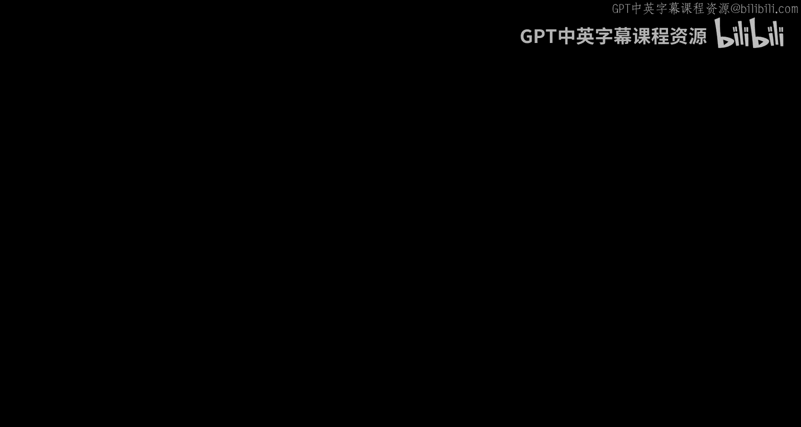
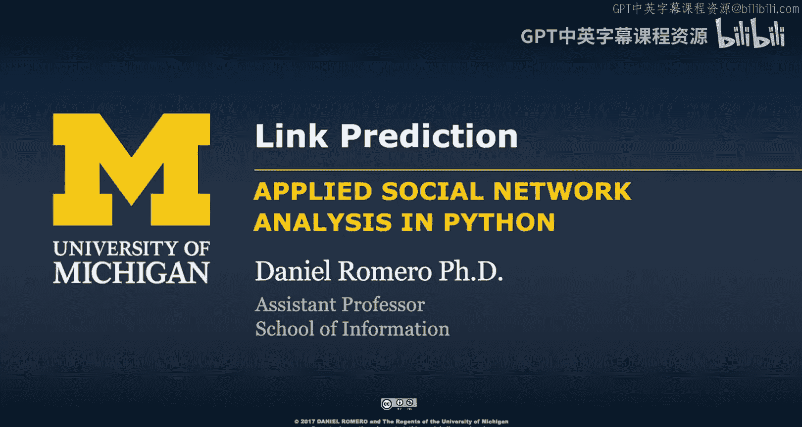
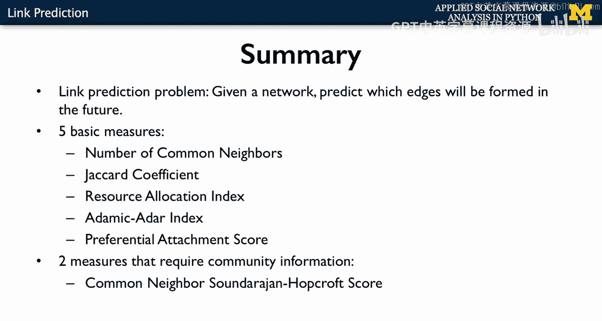

# 密歇根大学《Python用于数据科学实践（4-5课）｜Applied Data Science with Python 》中英deepseek翻译 p39 18_链接预测技术.zh_en -BV1DTtueTEwf_p39-

Hello， this week， we've been looking at networks as dynamic structures that change over time。

 In the past two videos， we looked at different models of network evolution that give you the dynamics for how a network evolves from the beginning to the end today。

 we're going to look at a related problem， which is given a fixed network。

 can we predict how this network is going to look in the future。And more specifically。

 we're going to be looking at the link prediction problem， which is， given a network。

 can we predict which edges are going to be formed in the future？

This problem has a lot of applications， for example。

 if you're Facebook and you want to create a friend recommendation algorithm or a friend recommender to tell people who they should friend。

 then basically you're solving this problem， you're looking at the current Facebook network and you're trying to predict which new friendships are likely to form in the future。

Let's take this small network as an example， and let's try to ask the question what new edges are likely to be formed。

And more specifically， let's formulate the problem in this way。

 let's say that we take a specific pair of nodes and we want to assess whether or not they're likely to connect。

What we're going to do today is we're going to go over several measures。

 seven of them to try to make this assessment， to try to decide whether specific pair of nodes are likely to become friends or not。

And so we've actually thought about this kind of question before。 If you remember。

 we talked about Tritic closure， which is the tendency for people who share connections in a social network to become connected themselves。

 So Tri closure actually gives us a hint for what the first measure that we're going to look at is。

And that is very simple measure。 Just look at the number of common neighbors that the two nodes have。

Now this is very simple， but let me define this measure to introduce some notation。

 so we're going to say that the number of common neighbors of nodes x and y is going to be the size of a set which is the intersection of the sets Nx and Ny。

 where Nx defines the set of neighbors of the node X。And so for example。

 the common neighbor measure for nodes AC in this network is going to be two because nodes A and C have two common neighbors that is node B and node D。

 so AC have two common neighbors。In network X， we can use the function common neighbors。

 which takes in as input the graph to nodes and it outputs an iterator of all the common neighbors of the two nodes。

And so here what I'm doing is I'm creating a list of tus which have the two nodes and the number of common neighbors。

 and I'm only including the nodes that are not connected with each other。

 the ones that don't have an edge between them by using the function non edges。

And if I sort this list， we can see the pairs of node that have the most common neighbors between them and we see that the pair AC has two neighbors in common。

 there are many others that have only one neighbor in common and then many others that have zero neighbors in common and so if we start to compare between different edges so for example。

 we look at the pair AG and the pair H and ask which one of these two is more likely to become connected。

 then by looking at the number of common neighbors we actually can't tell because both of these have exactly one neighbor in common and so let's look at other measures that may potentially give us different answers for this particular pairs of notes。

The next measure we're going to look at is called the Jaquart coefficient。

 and what it does is that it looks at the number of common neighbors。

 but it normalizes it by the total number of neighbors of the two nodes。

So the way that we write it down is we say the jaar coefficient of node x and y is going to be the fraction of the number of common neighbors that's in the numerators。

 so it's the intersection of the sets and x and N divided by the number of neighbors of x and Y。

 which would be the union of N x and N and so here the pair of node A and C have a jaquarard coefficient of12 because they have two common neighbors。

 B and D， and they have four total neighbors， nodes B， D， E and F， and so that's2 or 4 which is12。

In network X， we can use the function Jaard coefficient。

 which takes this input the graph and it outputs an iterator of two poles which have the two nodes and the Jaar coefficient of the two nodes。

 but it only outputs the pairs of nodes that are not already connected， so the non edges。

So if we sort this list， we now find that IH have the highest Jaquarard coefficient of one and that's because I and H are both connected to a single neighbor。

 which is a common neighbor G， whereas the notes A and G， they have one common neighbor。

 but they have more neighbors that are in the union of the neighbors of A and G。

 and so therefore they have a lower Jaquard coefficient。

The next measure is called the Research allocationoc Ind。

And the intuition behind it is that it considers a fraction of a resource， for example。

 information or something else， that a node can send to another node through their common neighbors。

And so first， let me tell you how it's defined mathematically。

 and then I'll tell you a little bit more what the intuition is behind the measure。

So the resource allocation index of the notes， Xy is going to be the sum over all the common neighbors of x and y of1 over the degree of the nodes。

So in this case， if x and y have。A lot of common neighbors and they're going to have a large resource allocation index。

But if they have a lot of neighbors that have low degree。

 then they're going to have an even larger resource allocation index。

Now what's the intuition behind this， let's consider two nodes， x and y。

 and let's say that we're measuring the resource allocation index between these two nodes。

 and let's say that they have exactly one common neighbor or Z。

Now imagine that x is trying to send to y some type a unit of something。

 let's say information or something else， and is going to do so by passing it first to Z and then hoping that Z will pass this unit to y。

But actually， what Z does is that when it receives this unit from x is going to distribute this unit evenly among all the neighbors of Z。

 then in that case， well y is only going to get a fraction of that unit and which fraction depends on what the degree of z is。

 so if z has degree n， then y is only going to get1 over n of that unit。

And so if Z is the only common neighbor of x and y and Z has a lot of neighbors， a very large degree。

 then x is going to be able to send less to y， than if Z had very few neighbors。

 and so that's why this resource allocation index penalizes pairs of nodes that have common neighbors that themselves have lots of other neighbors。

So for example， when we measure the research allocation index of nodes A and C。

 we would have one third for node B because node B is a common neighbor of A and C and it has degree 3 plus1 over 3 which is for node D。

 which also has degree 3 and it's also a common neighbor of A and C。

 so the research allocation index of A is going to be23s。

We can use the function Research allocationlocation In to compute the research allocationlocation index of all pairs of nodes that are not connected by an edge already in the graph。

And if we sorted， we can see the research allocation index of all pairs in this network。

And if we look at the two edges that we're being kind of following， we see that in this case。

 A G has higher research allocation index than Ih。 And that is because Ih has a common neighbor。

 which is G。But G has a high degree， has a degree of 4， whereas A and G。

 there are common neighbors E and E has a slightly smaller degree of 3。

 so that will give A G a larger research allocation index than IH。

The next measure is called the atmic at R index， which is very similar to the research allocation index。

 The only difference is that rather than dividing by the degree， it divides by the log of the degree。

 So in this case， the atmic at R index for node A instead of being2 over3 is going to be1 over the log of 3 plus1 over the log of 3。

 which is 1。82。And there's a function for it too that you can use in network X is Atag Aar index。

 and again we can compare AG and H， but in this case it's going to be very similar to the resource allocation index and all we did was to put the log in the denominator。

Next， measure 5 is going to be the preferential attachment score。

 so if you recall the preferential attachment model has the feature that node that have very high degree are more likely to get more neighbors。

And so the intuition behind this measure is that， well。

 if I'm looking at a pair of notes and they both have a very high degree。

 then they're more likely to be connected to each other in the future。

And so what it does is very simply to take the product of the degree of the two nodes。

And so it's very simple， the preferential attachment score of xy is going to be the product of the number of neighbors of x times the number of neighbors of y。

And AC would have a preferent attachment score of nine。In network X。

 we can use the preferential attachment function to compute the preferential attachment score over all the pairs of nodes that are not connected by an Aile ready。

And here we can look at the two edges that we've been following AG and H。

 and we see that AG has a higher preferential attachment score than IH。

 and that's because A has a degree of 3 and G has a degree of 4。

 which makes the preferential attachment score of 12， whereas I and H both only have one neighbor。

 and so they have a score of 1。Okay， next， we're going to look at two other measures that take into account the community structure of the network。

So in cases where you have a network and on top of the network you have some knowledge about different communities and here we'll think of communities as sets of nodes and we'll make the assumption that each node belongs to only one community。

 so one example is if this network was， for example a network of communication among employees in a company。

 then you may think that the department for which an employee works for would define a community。

 so for example there's HR and there's legal and so on。

 and so you could imagine thinking of those as communities。So if you had that type of structure。

 then you could use different measures for determining whether two nodes are likely to connect to each other or not。

So in this case， let's assume that this network has two communities。

 so these are the two communities， so there's A， B。

 D and C belong to community 1 and the other nodes belong to community 2。

And what these two measures do is they make the assumption that if two nodes belong to the same community and they have many neighbors that also belong to the same community。

 then they're more likely to form an edge than if they had neighbors that belong to different communities or if the two nodes themselves were in different communities。

 that's sort of the basic assumption that that we make。And so this allows us to compute new measures。

 And so let's go over two of them。 So the six measure that we're going to look at today is the number of common neighbors。

 but with a bonus for neighbors that belong to the same community as the two node we're looking at。

So this is called the common neighbors under Rajan Hcraftft score and if we're looking at node x and y is simply going to be the number of common neighbors。

 so the size of the intersection of n x and and y plus sum bonus which is going to be the sum over all the common neighbors of this function f and f is simply an indicator that tells us whether the node u which is a common neighbor of x and y belongs to the same community as x and y or not。

 and if it does then it's a1 if not it's a0 so it just simply gives a bonus for the common neighbors that belong to the same community as x and y so for example。

 if we look at node A and C their common neighbors are B and D and they all belong to the same community so A and C would get a score of2 for having two common neighbors plus two bonus points so it get4。

Notes E and I would have a score of2 because they both have a common neighbor namely G。

 and it belongs to the same community， so it would get a bonus point for a total of2。

 But if we look at the edge A G， for example， they have one common neighbor namely E。

 but A and G are not in the same community， so E is not in same community as A and G。

 therefore A and G have a score of just one。Now to use this on network X。

 we first have to tell network X which communities each node belongs to。

So here we're adding a attribute to each one of the nodes named community that tells which community the node belongs to。

 so for A through D we say belongs to community0 and for the other ones。

 it belongs to the community one。And now we can use the function CNN sound Ran Hcroft G。

 which outputs an iterator of the tus with the nodes and the score for each one。

 each pair that is not already connected by an edge and we can sort it and find which nodes have the highest score and if we look at the two edges that we've been following。

 then we find that Ih has a score of two because their common neighbor G belongs to the same community as they do。

 whereas AG has a score of one。The last measure we're going to look at is a measure that is similar to the resource allocation index。

 but it only takes into account nodes that are in the same community as the two nodes we're looking at。

So if we're computing this measure， which is called the resource allocation and the Rajan Hcroft score。

 and this is after the researchers that came up with this measure of x and y。

 then what we do is we sum over all the neighbors of x and y and rather than summing just one over the degree of the notes of the common neighbors like we did in the standard resource allocation index。

 we now have these f in the denominator of the fraction and this function f again is the same as before is one if u belongs to the same community x x and y and0 otherwise。

 so in the case where you have a common neighbor that does not belong to the same community as x and y then that neighbor is not contributing anything to the sum because you have a0 in the numerator。

And so if we look at some examples for the node A and C。

 we would find that well because both of the neighbors， B and D belong to the same community as AC。

 then we have the same score as we did before， one over3 plus1 over3。

 which is two third for this resource allocation index。And if we look at， for example， nodes E and I。

 we find that well they have one common node， which is node G， and node G has a degree of4。

 so it has a score of1 over four because G belongs to the same community as E I。 However。

 if we look at two nodes that are not in the same community like A and G。

 then they would have score0 because their common neighbor while they have one name E belongs to a different community as at least one of the two nodes。

 and so it doesn't contribute anything to the sum， so these two don't get anything in the sum。

 so get a score of 0。We can use this functioning network X， RA index under undern。

 Hcro to compute this course of all the non edges。And here we find that IH has a score of 0。25。

 whereas AG has score of 0 again because AG has a their common neighbor is not in the same community as at least one of A and G。

 and so in this case again， we find that IH has a higher score。Okay。

 so these were the seven measures I wanted to talk about today。 And I want， I want to know。

 I want to point out two things one。None of these measures actually tell you。

Whether or not you should predict that a particular edge is going to come up in the future or not。

 it just gives a score that is supposed to give you a sense for whether or not these tunnel are likely to connect。

The second thing is that different measures can give you different scores right so for example we saw that sun measures would give the H H a higher score than A G and some measures would do the opposite and so these measures are't necessarily consistent with each other so if you're actually trying to solve the link prediction problem typically what would happen is that you would use these measures as features and then you would use a classifier if you have some label data you would train a classifier and use these measures as features in order to make the prediction。

And so in summary， we talked about the link prediction problem， which says that given a network。

 we're trying to predict which edges are going to be formed in the future。And to do so。

 we talked about five different measures， the number of common neighbors， the Jakar coefficient。

 which takes the number of common neighbors， but normalizes by the total number of neighbors that the two nodes have the resource allocation index。

 which is thinking along the lines of if a node needed to pass information or pass a resource to another node through their common neighbors how much of that will actually get there。

The atmic atR index， which is similar to the resource allocation index。

 but it takes the log in the denominator。And the preferential attachment score。

 which bases the score on the idea that in preferential attachment。

 notes with high degree tend to accumulate more edges。

As well as two measures that require community information。

 so if you do have community information on your network。

 then you can use these two and they're very similar to other ones we saw above。

 we have one that takes the common neighbors and it gives a bonus for the common neighbors that are in the same community as the two nodees and then the research allocation one which only considers common neighbors that are in the same community as the two nodees。

And this is all for this video， I hope to see you next time， thanks。

