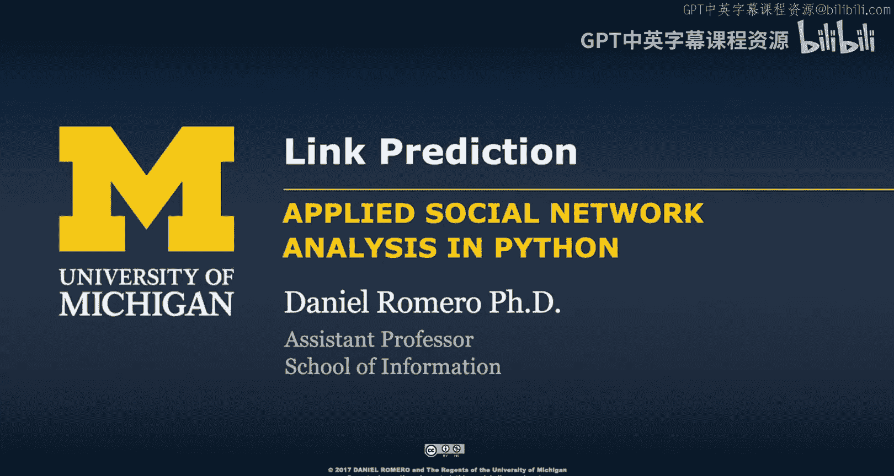
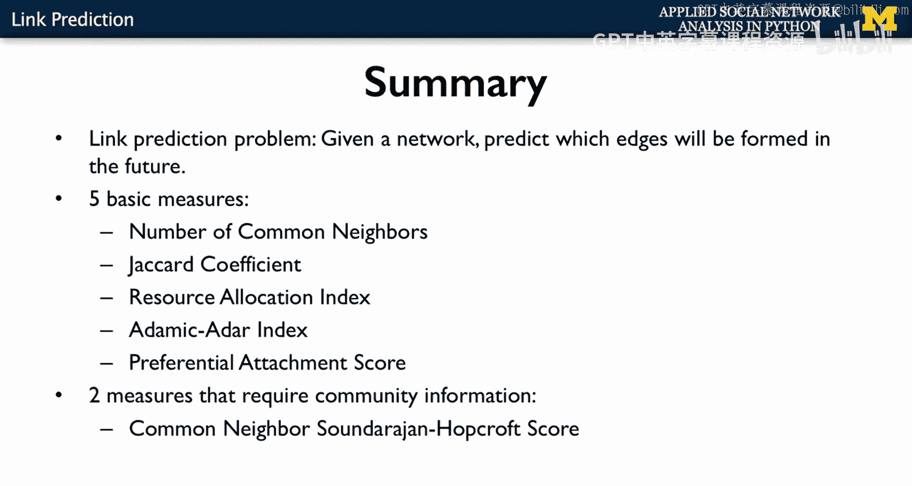

# 应用数据科学（Python）：第4-5课：链接预测技术 🔗




在本节课中，我们将学习链接预测技术。链接预测的核心问题是：给定一个静态网络，我们能否预测未来哪些节点之间会形成新的连接？这个问题在社交网络好友推荐、学术合作预测等领域有广泛应用。

上一节我们讨论了网络作为动态结构的演化模型。本节中，我们将具体探讨如何量化评估网络中任意两个节点未来形成连接的可能性。

## 问题定义与示例

让我们以一个简单网络为例。我们的目标是：评估网络中尚未连接的任意一对节点，在未来形成连接的可能性。

以下是链接预测中常用的七种衡量指标。我们将逐一介绍其定义、直观解释以及在`NetworkX`库中的实现方法。

## 1. 共同邻居数

这是最简单直接的衡量指标。其核心思想源于三元闭包理论：在社交网络中，拥有共同朋友的人更有可能成为朋友。

**公式**：对于节点 `x` 和 `y`，其共同邻居数定义为它们邻居集合的交集大小。
`CN(x, y) = |N(x) ∩ N(y)|`
其中，`N(x)` 表示节点 `x` 的邻居集合。

**示例**：在示例网络中，节点 A 和 C 的共同邻居是 B 和 D，因此 `CN(A, C) = 2`。

**代码实现**：
```python
# 使用 NetworkX 的 common_neighbors 函数
common_neighbors = list(nx.common_neighbors(G, 'A', 'C'))
# 计算数量
cn_score = len(common_neighbors)
```

## 2. Jaccard 系数

共同邻居数的一个缺点是它没有考虑节点自身的“流行度”。Jaccard 系数通过将共同邻居数归一化到两个节点总邻居数来解决这个问题。

**公式**：
`Jaccard(x, y) = |N(x) ∩ N(y)| / |N(x) ∪ N(y)|`

**示例**：节点 A 和 C 有 2 个共同邻居（B, D），总共有 4 个不同的邻居（B, D, E, F）。因此，`Jaccard(A, C) = 2/4 = 0.5`。

**代码实现**：
```python
# 使用 NetworkX 的 jaccard_coefficient 函数
# 该函数返回一个迭代器，包含所有非边节点对及其 Jaccard 系数
jaccard_preds = nx.jaccard_coefficient(G)
```

## 3. 资源分配指数

该指标基于一个直观想法：如果节点 `x` 想通过共同邻居 `z` 向节点 `y` 传递资源（如信息），那么 `z` 会将该资源平均分配给它的所有邻居。因此，`y` 能收到的资源量与 `z` 的度数成反比。

**公式**：
`RA(x, y) = Σ_{z ∈ N(x) ∩ N(y)} 1 / degree(z)`

**示例**：节点 A 和 C 的共同邻居是 B 和 D，它们的度数都是 3。因此，`RA(A, C) = 1/3 + 1/3 ≈ 0.667`。

**代码实现**：
```python
# 使用 NetworkX 的 resource_allocation_index 函数
ra_preds = nx.resource_allocation_index(G)
```

## 4. Adamic-Adar 指数

该指数与资源分配指数非常相似，区别在于分母取的是度数的对数。这降低了对高度数邻居的惩罚力度。

**公式**：
`AA(x, y) = Σ_{z ∈ N(x) ∩ N(y)} 1 / log(degree(z))`

**示例**：节点 A 和 C 的共同邻居 B 和 D 的度数都是 3。`log(3) ≈ 1.099`。因此，`AA(A, C) = 1/1.099 + 1/1.099 ≈ 1.82`。

**代码实现**：
```python
# 使用 NetworkX 的 adamic_adar_index 函数
aa_preds = nx.adamic_adar_index(G)
```

## 5. 优先连接分数

该指标基于优先连接模型的原理：度数高的节点更容易获得新连接。因此，两个高度数节点未来连接的可能性更高。

**公式**：
`PA(x, y) = degree(x) * degree(y)`

**示例**：节点 A 的度数为 3，节点 C 的度数为 3。因此，`PA(A, C) = 3 * 3 = 9`。

**代码实现**：
```python
# 使用 NetworkX 的 preferential_attachment 函数
pa_preds = nx.preferential_attachment(G)
```

## 6. 带社区加权的共同邻居数（Soundarajan-Hopcroft）

前面的指标都未考虑网络中的社区结构。如果我们已知节点的社区归属（例如，公司中的不同部门），则可以引入社区信息。该指标为属于同一社区的共同邻居提供额外加分。

**公式**：
`CN_SH(x, y) = |N(x) ∩ N(y)| + Σ_{z ∈ N(x) ∩ N(y)} f(z)`
其中，如果共同邻居 `z` 与节点 `x` 和 `y` 属于同一社区，则 `f(z) = 1`，否则为 `0`。

**示例**：假设节点 A, B, C, D 属于社区 1，其余节点属于社区 2。节点 A 和 C 的共同邻居 B 和 D 都属于社区 1，因此 `CN_SH(A, C) = 2 + 1 + 1 = 4`。

**代码实现**：
首先需要为网络中的节点添加社区属性。
```python
# 为节点添加社区属性
community_map = {'A': 0, 'B': 0, 'C': 0, 'D': 0, 'E': 1, 'F': 1, 'G': 1, 'H': 1, 'I': 1}
nx.set_node_attributes(G, community_map, 'community')

# 使用带社区信息的共同邻居函数
cn_sh_preds = nx.cn_soundarajan_hopcroft(G)
```

## 7. 带社区加权的资源分配指数（Soundarajan-Hopcroft）

这是资源分配指数的社区加权版本。它只考虑那些与目标节点对属于同一社区的共同邻居。

**公式**：
`RA_SH(x, y) = Σ_{z ∈ N(x) ∩ N(y)} f(z) / degree(z)`
其中，`f(z)` 的定义同上：如果 `z` 与 `x` 和 `y` 同社区则为 1，否则为 0。

**示例**：节点 A 和 G 的共同邻居是 E。但 A 属于社区 1，G 属于社区 2，E 属于社区 1。因此 E 不与 A 和 G 同时同社区，`f(E) = 0`，所以 `RA_SH(A, G) = 0`。

**代码实现**：
```python
# 使用带社区信息的资源分配指数函数
ra_sh_preds = nx.ra_index_soundarajan_hopcroft(G)
```

## 重要说明与应用建议

在介绍了七种指标后，有两点需要特别注意：
1.  **分数而非决策**：这些指标计算出的都是一个“可能性分数”，而不是一个“是或否”的预测。分数越高，表示连接形成的可能性越大。
2.  **指标间的不一致性**：不同的指标可能会对同一对节点给出不同的排序结果。例如，有些指标认为 (I, H) 比 (A, G) 更可能连接，而另一些指标则相反。

因此，在实际解决链接预测问题时，通常的做法是：
*   将这些指标的计算结果作为**特征**。
*   如果拥有带标签的历史数据（即已知哪些节点对后来确实形成了连接），则可以使用这些特征来训练一个分类器（如逻辑回归、随机森林等）。
*   最终使用训练好的分类器模型来对新节点对进行预测。

## 总结

本节课我们一起学习了链接预测问题及其七种核心衡量指标：
1.  **共同邻居数**：最基础的指标，直接计算共享邻居的数量。
2.  **Jaccard 系数**：对共同邻居数进行归一化，考虑节点总邻居数。
3.  **资源分配指数**：模拟资源通过共同邻居传递的效率，惩罚高度数共同邻居。
4.  **Adamic-Adar 指数**：资源分配指数的变体，使用度数的对数作为分母。
5.  **优先连接分数**：基于“富者愈富”原理，高度数节点对的分数更高。
6.  **带社区加权的共同邻居数**：在已知社区信息时，为同社区共同邻居加分。
7.  **带社区加权的资源分配指数**：只考虑同社区共同邻居的资源传递效率。



理解这些指标的原理和适用场景，是构建有效链接预测系统的第一步。在实际应用中，通常需要结合多种指标，并利用机器学习方法进行综合预测。