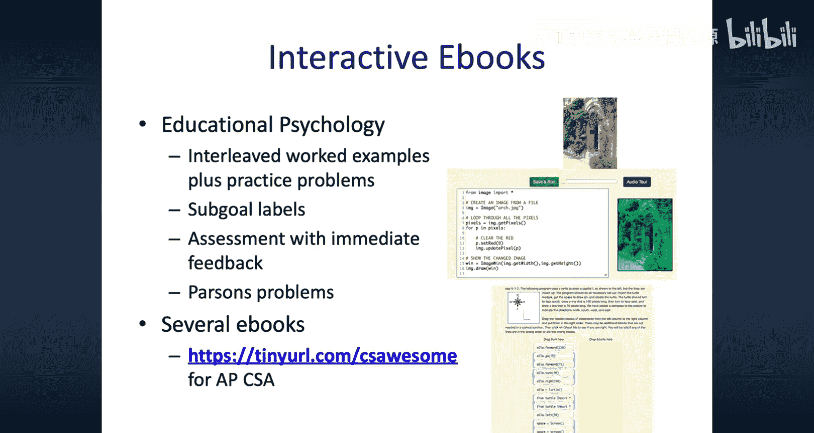
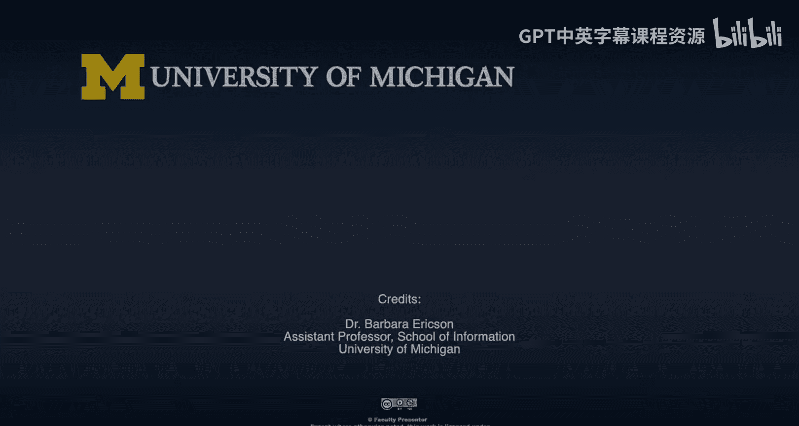

# 00：遇见Barb Ericson博士 👩‍🏫

在本节课中，我们将通过Barb Ericson博士的自我介绍，了解她的学术背景、职业经历以及她为计算机科学教育所做的贡献。

---

让我介绍一下自己。我是信息学院的助理教授。我担任助理教授只有三年时间，但我从事相关工作的时间要长得多。

那么，我的背景是怎样的？高中时期，我的职业选择要么是成为一名兽医，因为我热爱动物；要么是成为一名律师，因为我在高中参加过辩论。这些是我当时考虑的方向。

然而，我获得了底特律市中心韦恩州立大学的奖学金，但该校没有兽医学院。因此我想，或许我可以成为一名律师。我主修了政治学，但这门专业只有去法学院深造才有用。于是我决定攻读双学位。

我应该双修什么专业呢？我在高中时上过一门使用BASIC语言的编程课，当时我们使用的是电传打字机（图中可见）。我觉得这很有趣。因此，我决定双修政治学和计算机科学。

最终，我发现自己更喜欢计算机科学。我做了几次实习，发现自己非常享受这个过程。于是我决定坚持走计算机科学的道路，并于1983年从韦恩州立大学获得了理学学士学位。

毕业后，我首先在通用汽车研究实验室工作。这是一张当时的照片，我们最初在计算机房里工作。后来，我的工作是协助支持人们使用3D图形软件包。

之后，我转到贝尔通信研究所，从事了大量数据库方面的工作。他们资助我在密歇根大学攻读硕士学位。接着，我做了许多关于双音多频信号输入和语音合成输出的工作，以帮助电话维修人员。为此，我曾与维修人员一同乘车，观察他们如何使用我们的软件。

我后来又回到了通用汽车研究实验室，并开发了软件，帮助他们从油泥模型中创建3D数学模型。汽车设计师们先用油泥雕塑出汽车模型。我的工作涉及用户界面设计和3D图形。

接下来，我去了造纸科学与技术研究所，同样从事3D图形和流体动力学方面的工作。之后在克拉克亚特兰大大学，我们参与了一个有趣的项目，旨在利用人工智能帮助医生在X光片中检测肿块等异常。

这引导我后来在NCR公司从事基于案例的推理研究，针对中风和脑肿瘤，尝试利用人工智能辅助医生进行诊断。

随后，我在佐治亚理工学院工作了很长时间，担任讲师和计算推广主任，并最终在那里获得了博士学位。

我从事的工作之一是对教师进行推广培训。我举办了大量研讨会，帮助教师学习如何教授计算科学。我为学生组织了许多夏令营，并协助修订了佐治亚州的课程。

特别值得一提的是，我与我的丈夫Mark Guzdial博士合作编写了关于“媒体计算”的书籍，这让我有了一些知名度。这是一种通过编写程序来操作媒体（如图片中的像素、声音中的样本、视频中的帧）来教授计算的方法。

当然，作为推广人员，我还与学生，尤其是年轻学生，做了许多事情。我们举办了许多计算夏令营、与青年服务组织的研讨会、小学周末项目。我们还运营了一个名为“Rise Up for CS”或“Sisters Rise Up for CS”的项目，旨在帮助来自代表性不足群体的学生在高中AP计算机科学课程中取得成功。

近年来，在获得博士学位后，我一直专注于交互式电子书的研究，你们将在本课程中使用到它们。这些电子书基于教育心理学的原理设计。

核心理念是：通过“示例+练习”的模式，学习效果会更好。因此，我们设计了这些带有子目标标签的交互式示例和练习题。子目标标签是一种试图抽象出更高层次逻辑的注释。

我们提供了大量不同类型、能即时反馈的练习题，这对学习很有帮助。我特别研究过的一种题型是“代码排序题”，我们会给出解决一个问题的正确代码块，但顺序被打乱，你需要将它们拖拽到正确的顺序。

我一直在创建多本交互式电子书，你们将在本课程中使用其中一本。以上就是关于我的一些介绍。

那么，为什么不在论坛上也分享一下关于你自己的信息呢？

---

本节课中，我们一起了解了Barb Ericson博士从学生时代到成为计算机科学教育者的丰富历程，包括她的学术选择、多样的职业路径以及在教育技术，特别是“媒体计算”教学法和交互式电子书开发方面所做的突出贡献。