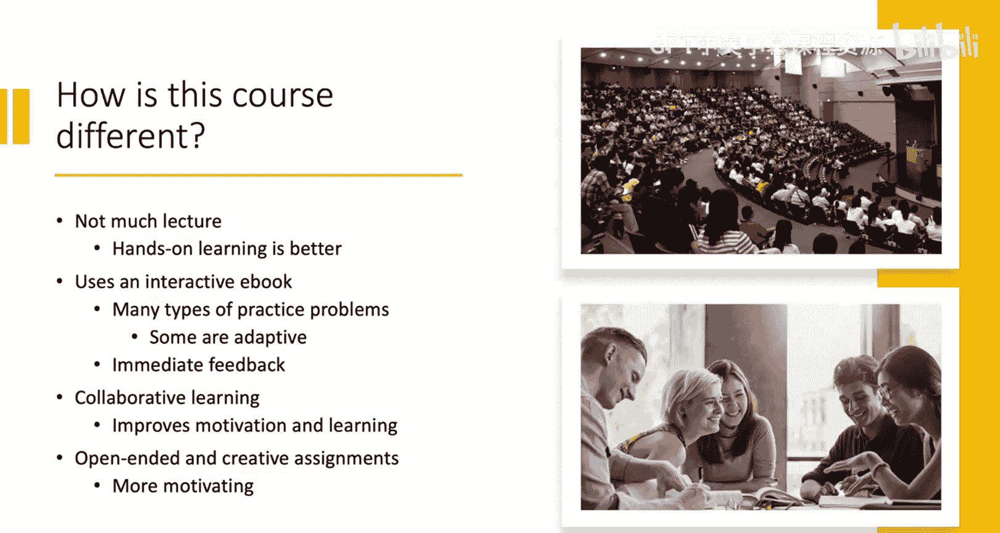
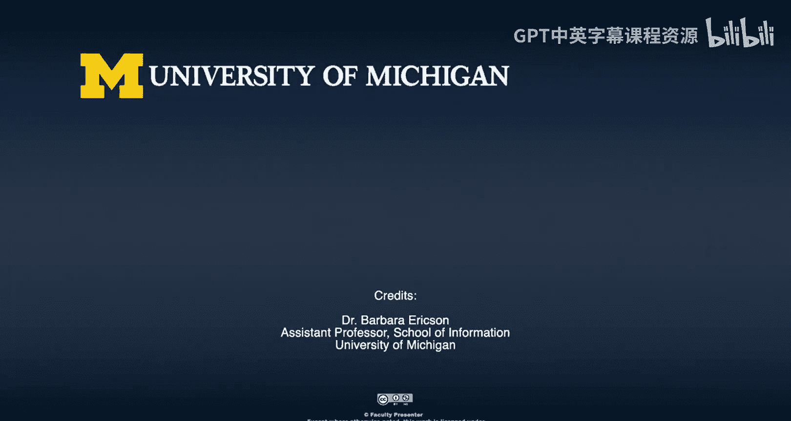

# 创造性编程：1：本课程的独特之处 🎨

在本节课中，我们将要了解这门课程与其他在线课程的不同之处，以及它如何通过实践、协作和创意项目来帮助你学习编程。

## 课程概述

欢迎来到这门课程。这门课程与许多在线课程不同，它不会包含大量讲座，而是更侧重于动手实践学习。

## 实践与协作学习

上一节我们介绍了课程的实践导向，本节中我们来看看协作的重要性。我们鼓励你与他人合作，以小组形式学习，因为这将提升你的学习效果和动力。人类是社会性生物，我们可以通过观察他人和与他人讨论来学习。

## 互动练习与自适应学习

课程提供了大量互动练习。如果你需要复习，可以回顾前面的章节或完成更多练习题。以下是练习的一些特点：

*   部分练习题是**自适应**的，这意味着它们会帮助你逐步找到正确的解决方案。

## 创意项目与开放性任务

接下来，我们将探讨课程的核心——创意项目。与许多编程入门课程中常见的练习（如计算销售税或转换摄氏与华氏温度）不同，你将进行绘画创作或编写个性化故事。

以下是课程任务的特点：

*   课程包含**开放性编辑**和**创意性任务**。
*   这些任务旨在更有趣，更能激发你的学习动力。

## 总结

本节课中，我们一起学习了这门课程的独特之处：它强调动手实践、鼓励协作学习、提供自适应互动练习，并最终通过开放性的创意项目来应用所学知识，使学习过程更加有趣和富有动力。