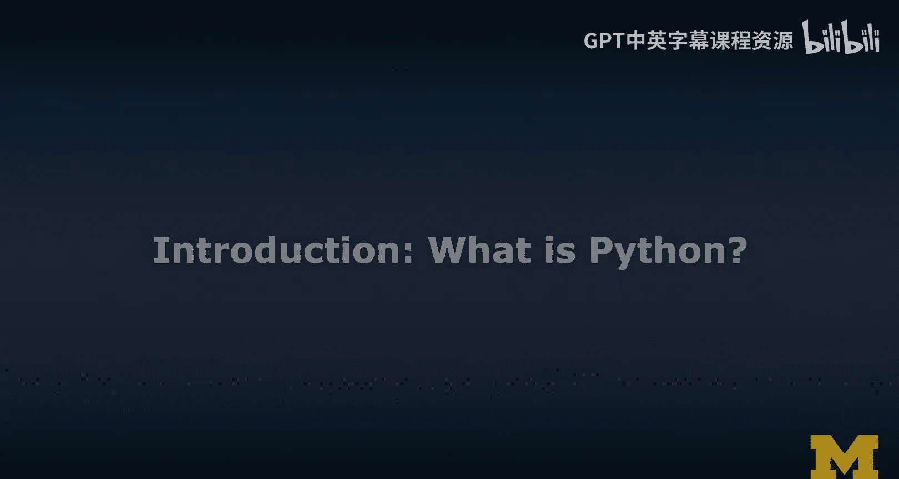
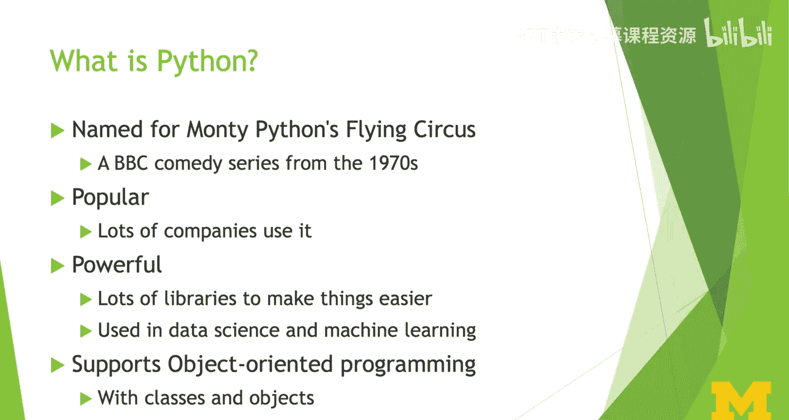
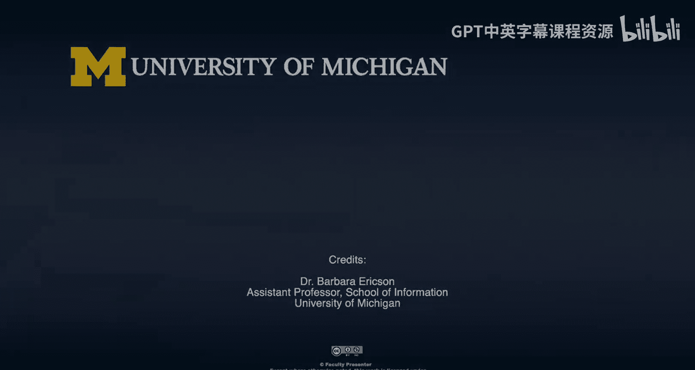

# 03：Python是什么 🐍




在本节课中，我们将要学习Python编程语言的基本概念，了解它的起源、特点以及为什么它在当今编程世界中如此流行。

## 概述

大家好，我是Barbar Erickson，信息学院的助理教授。我很高兴能带领大家开启学习Python的旅程。那么，Python究竟是什么呢？

## Python的起源与命名

首先，Python并不是一条巨蟒。它的名字来源于20世纪70年代BBC的喜剧系列节目《Monty Python's Flying Circus》（巨蟒剧团之飞翔的马戏团）。如果你还没看过，可以去了解一下。😊

## Python的特点与流行原因

上一节我们了解了Python名字的趣味由来，本节中我们来看看它作为一门编程语言的特点。

Python是一门非常流行的编程语言，许多公司都在使用它。它的流行部分归功于其强大的功能。

以下是Python流行的几个关键原因：
*   **功能强大且库丰富**：拥有大量库，可以简化开发工作。
*   **应用领域广泛**：被广泛应用于数据科学和机器学习等领域。
*   **易于学习**：相比许多其他文本编程语言，Python学起来稍微容易一些。
*   **支持面向对象编程**：这是当今最常见的程序开发方式。这意味着Python支持**类**（对事物的分类）和**对象**（在程序中实际执行工作的实体）。面向对象编程的核心概念可以用一个简单的类定义来理解：
    ```python
    class Dog: # 定义一个“狗”类
        def __init__(self, name):
            self.name = name # 属性：名字

        def bark(self): # 方法：叫
            print(f"{self.name} says: Woof!")
    ```

## 总结



本节课中我们一起学习了Python是什么。我们了解到它是一门以喜剧节目命名的、功能强大且易于学习的编程语言，因其丰富的库和对面向对象编程的支持，在数据科学等多个现代技术领域备受青睐。




现在，让我们开始Python的学习之旅吧。😊