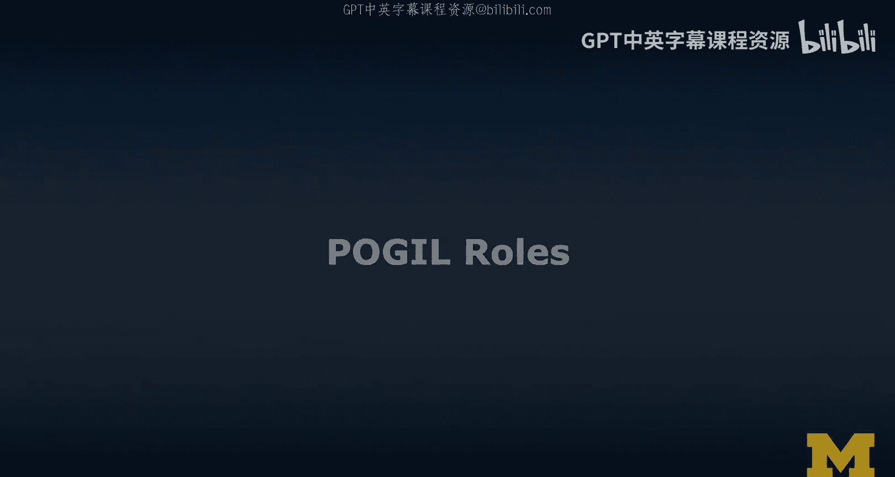
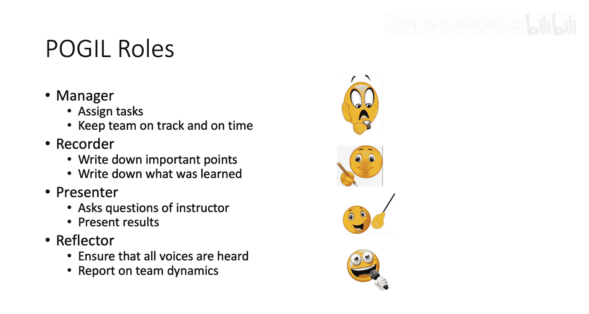
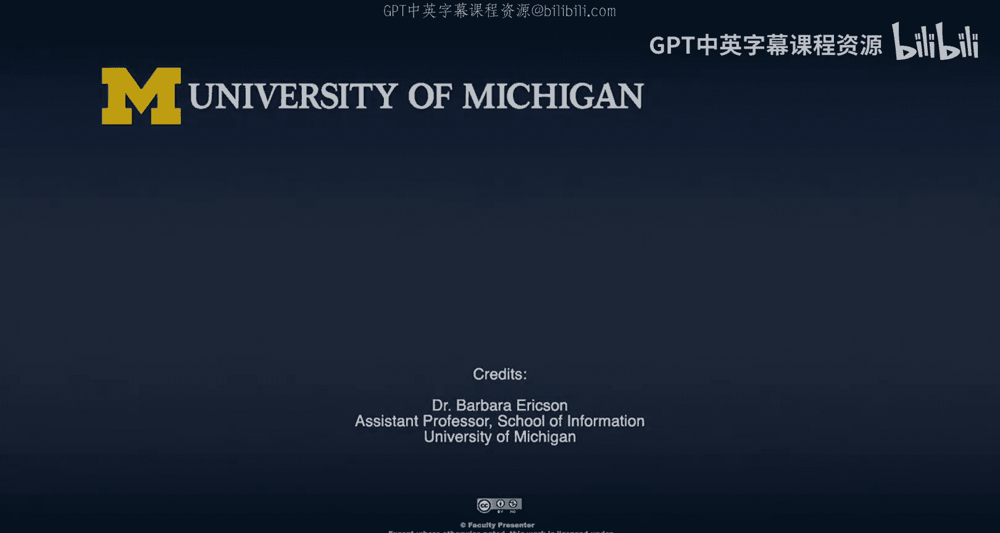

# 创造性编程：05：POGIL角色解析 🧩

在本节课中，我们将学习一种名为POGIL的小组协作方法。我们将重点解析POGIL活动中的四个核心角色，了解每个角色的职责，以便在团队合作中更高效地学习和解决问题。

---

## 什么是POGIL？ 🤔

POGIL是“过程导向的引导式探究学习”的缩写。在这种学习模式中，学生以小组形式合作，但关键在于，小组中的每个成员都被赋予一个明确的、定义好的角色。

上一节我们介绍了POGIL的基本概念，本节中我们来看看这些具体的角色分别是什么，以及它们如何共同推动团队前进。

## POGIL的四个核心角色

在典型的POGIL活动中，通常包含以下四个角色：

以下是四个角色的具体职责：

1.  **管理者**
    *   负责为小组成员分配任务。
    *   帮助确保整个团队按计划、按时完成任务。
    *   如果团队在某个问题上卡住，管理者应鼓励大家继续前进。

2.  **记录员**
    *   负责写下讨论中的要点。
    *   记录团队所学到的知识或达成的结论。

3.  **汇报者**
    *   当活动说明中有不清晰的地方时，负责向指导者（如老师或助教）提问。
    *   负责向全班或指导者呈现小组的最终成果或发现。

4.  **反思者**
    *   确保小组内所有成员的声音都被听到，避免只有一两个人主导讨论。
    *   可以观察并反馈团队的动态，例如团队合作是否顺畅，有哪些方面可以改进。

---

本节课中，我们一起学习了POGIL协作学习法中的四个关键角色：**管理者**、**记录员**、**汇报者**和**反思者**。每个角色都有其独特的职责，共同保障团队探究活动能够有序、高效且包容地进行。理解并实践这些角色，将极大地提升你在团队项目中的协作效率和贡献价值。