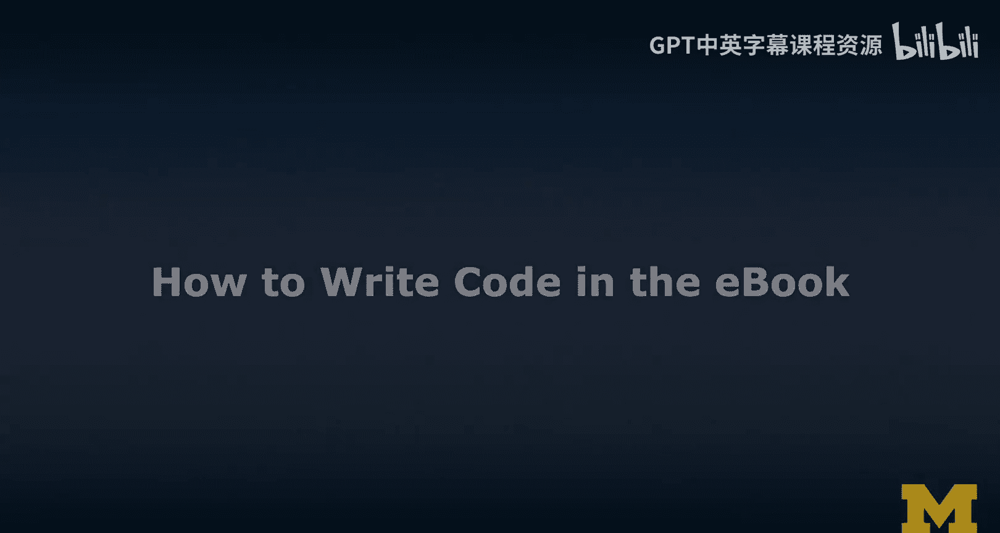
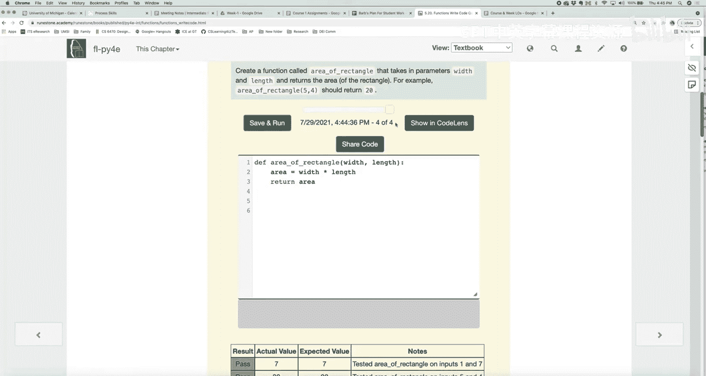

# 创造性编程：p06：电子书中编写代码的方法 📖




在本节课中，我们将学习如何在电子书中直接编写、运行和调试Python代码。我们将了解电子书提供的交互式编程环境，包括编写函数、测试代码、查看历史版本以及使用辅助工具。

---

## 电子书的交互式编程功能

使用电子书的一个优点是，你可以直接在书中编写代码。让我们看看具体如何操作。

以下是一个示例：创建一个名为 `area_of_rectangle` 的函数，它接收宽度和长度作为参数，并返回矩形的面积。例如，`area_of_rectangle(5, 4)` 应返回 `20`，即 `5 * 4` 的结果。

## 编写并测试代码

首先，我们尝试编写函数。初始想法是计算面积，但可能会忘记返回结果。

```python
def area_of_rectangle(width, length):
    area = width * length
```

运行上述代码会发现测试未通过，因为函数没有返回任何值。我们需要添加 `return` 语句。

```python
def area_of_rectangle(width, length):
    area = width * length
    return area
```

现在运行代码，测试用例应该会通过。你可以在代码透镜中查看结果，如果正在团队中工作，还可以与他人分享这段代码。

## 使用辅助工具进行调试

电子书界面右上角有一个铅笔图标，点击它可以打开一个窗口，允许你直接输入并运行Python代码。如果你不确定乘法操作是否正确，可以在此进行测试。

```python
print(5 * 4)
```

测试完成后，可以关闭该窗口。这个工具对于快速验证想法或调试非常有帮助。

## 查看代码历史版本

另一个重要功能是代码历史记录。请确保在使用电子书时已登录账户。登录后，你会看到一个滑块控件，允许你回溯查看代码的不同版本。

通过滑动滑块，你可以看到代码最初的样子、第二次修改后的状态，以及后续的所有更改。这样，你可以轻松追踪代码的演变过程，回顾之前的解决方案。




---


本节课中，我们一起学习了如何在电子书中直接编写和运行Python代码。我们了解了如何创建函数、使用内置工具进行测试和调试，以及如何利用历史记录功能回顾代码的修改过程。这些功能使得学习和编程过程更加直观和高效。