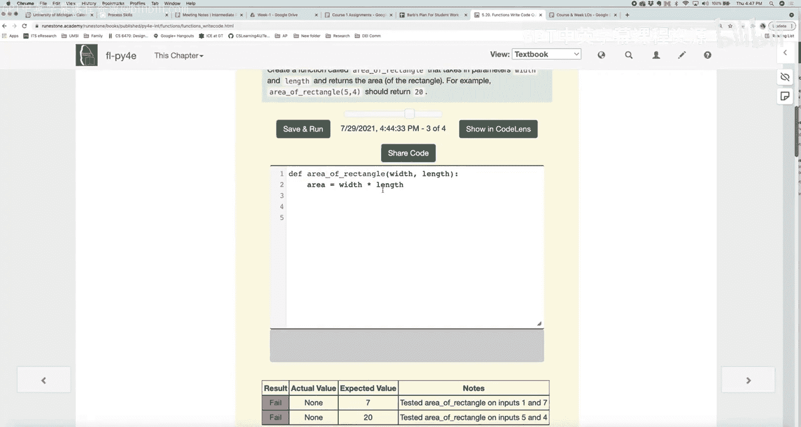

# 07：重载代码历史记录 🔄

在本节课中，我们将学习如何在编程环境中找回之前保存的代码。如果你曾经离开后又返回，可能会发现代码编辑器是空的。但只要你登录过，你的代码其实是被保存下来的。本节将指导你如何通过“加载历史记录”功能恢复你的工作成果。

---

上一节我们介绍了编程环境的基本操作，本节中我们来看看如何管理你的代码历史。

如果你在编程时登录了账户，然后离开了书本或页面，当你再次返回时，可能会惊讶地发现代码编辑器似乎是空的。请不要担心，你的代码实际上已经被自动保存了。关键在于你需要手动加载这些保存的历史记录。

以下是找回代码的具体步骤：

1.  首先，确保你已登录到之前的同一个账户。
2.  在代码编辑器区域附近，寻找一个名为 **`加载历史记录`** 的按钮。
3.  点击这个按钮。
4.  系统将加载你上次运行代码时的所有历史版本。

成功加载后，你将看到上次编写和运行的完整代码。这个功能更强大之处在于，你还可以查看更早的历史版本，追溯整个编程过程的变化。

所以，请记住这个核心要点：**只要你登录了账户，你的所有操作都会被保存。** 但每次重新进入时，务必记得点击 **`加载历史记录`** 按钮来恢复你的工作现场。

---

本节课中我们一起学习了“加载历史记录”功能的重要性与使用方法。我们明白了在登录状态下，代码会被自动保存，而通过点击特定的按钮，我们可以轻松找回任何历史版本的代码，这能有效防止工作丢失并方便进行版本回溯。