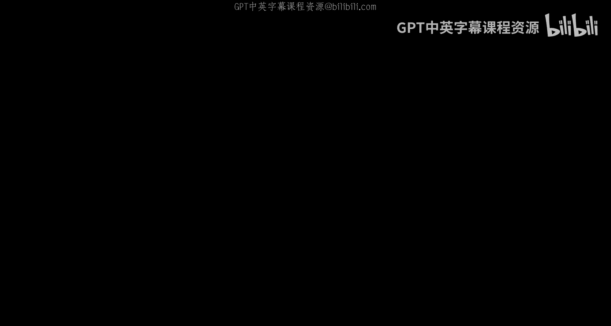
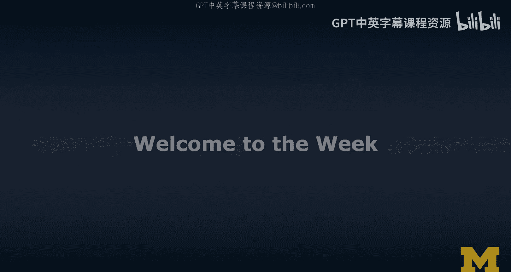
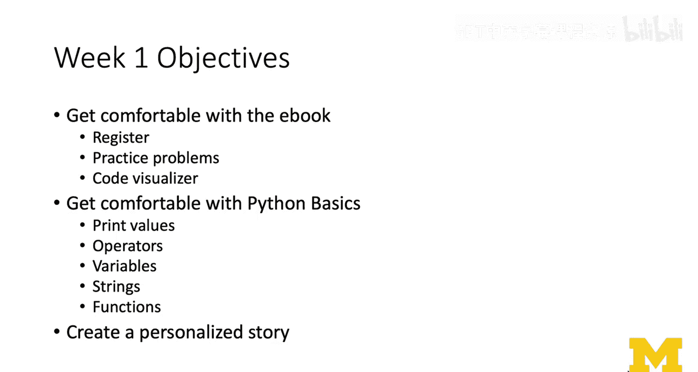
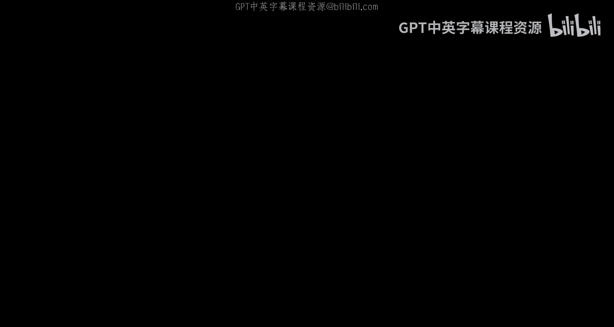
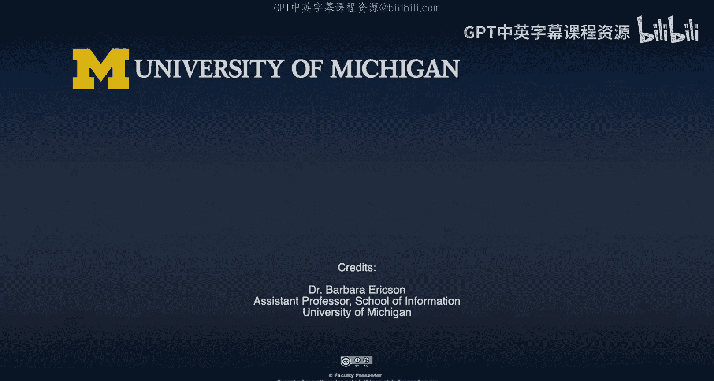

# 08：欢迎进入第一周 🎉





在本节课中，我们将要学习第一周的整体安排，了解本周的学习目标，并熟悉课程所需的核心工具与Python基础知识。

## 概述

本周的目标是让大家熟悉电子书平台，掌握Python编程的基础知识，并运用这些知识创建一个个性化的故事。

## 熟悉电子书平台

首先，你需要注册并使用课程指定的电子书。登录后，你在书中编写的所有代码和答案都会被自动保存。这样，你可以随时回顾自己的学习进度。

接下来，我们将熟悉书中提供的多种练习形式。以下是书中包含的主要练习类型：

*   **填空题**：在代码片段中填入缺失的部分。
*   **拖放题**：通过拖拽代码块来构建正确的程序。
*   **代码排序题**：将打乱的代码行重新排列成正确的顺序。

此外，你还会接触到**代码可视化工具**。这个工具允许你逐行执行代码，直观地观察每一步中变量的变化和程序的执行流程，这对于理解代码逻辑和调试非常有帮助。

## 学习Python基础

上一节我们介绍了学习工具，本节中我们来看看本周要学习的核心Python知识。这些是构建更复杂程序的基础。

你将学习以下核心概念：

*   **打印输出**：使用 `print()` 函数在屏幕上显示信息。
    ```python
    print("Hello, World!")
    ```
*   **数学运算符**：进行基本的数学计算，如加（`+`）、减（`-`）、乘（`*`）、除（`/`）。
    ```python
    result = 5 + 3 * 2  # result 的值为 11
    ```
*   **变量**：创建变量来存储数据，以便在程序中重复使用。
    ```python
    my_name = "Alex"
    age = 25
    ```
*   **字符串**：创建和处理由字符组成的文本序列。
    ```python
    greeting = "Welcome to Creative Coding!"
    ```
*   **字符串切片**：从字符串中获取一部分内容（子串）。
    ```python
    word = "Python"
    sub = word[0:2]  # sub 的值为 "Py"
    ```
*   **自定义函数**：创建你自己的函数来封装可重复使用的代码块。
    ```python
    def say_hello(name):
        print(f"Hello, {name}!")
    ```
*   **内置函数**：使用Python语言中已经提供好的常用函数，例如 `len()` 用于获取长度，`input()` 用于获取用户输入。

## 实践项目：创建个性化故事

掌握了以上基础知识后，你将综合运用它们来完成本周的实践项目：**创建一个个性化的故事**。你将编写一个程序，可能通过询问用户的名字、喜好等信息，然后生成一个包含这些信息的独特故事。





## 总结



本节课中我们一起学习了第一周的学习路线。我们明确了本周的两个主要任务：熟悉电子书平台及其各种交互式练习工具，以及学习Python编程的基础语法，包括打印、运算、变量、字符串和函数。最后，我们将运用这些知识完成一个有趣的编程项目。学习过程中请大胆尝试，不必害怕犯错，因为**调试和解决问题是学习编程的重要环节**。祝你学习愉快！😊