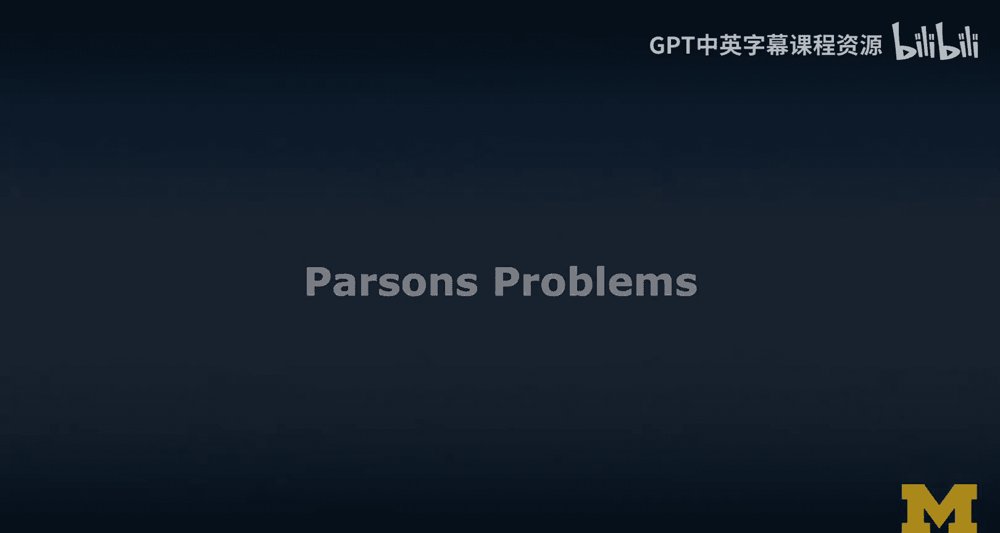
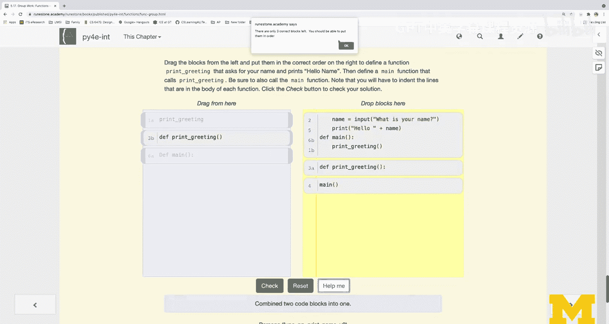
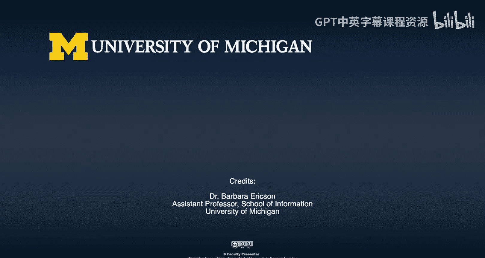

# 创造性编程：P09：混合代码帕森斯问题 🧩

在本节课中，我们将学习一种名为“帕森斯问题”或“混合代码问题”的编程练习方法。这种方法旨在通过将正确的代码打乱成块，让你通过拖拽排序来构建解决方案，从而降低编程学习的难度。

---

## 什么是帕森斯问题？ 🤔

帕森斯问题是一种编程练习形式。我们为你提供解决某个问题所需的全部正确代码，但会将这些代码分解成多个块并打乱顺序。你的任务是将左侧的代码块拖拽到右侧，并按正确的逻辑顺序排列，从而构建出完整的解决方案。

## 如何使用帕森斯问题界面？ 🖱️

以下是使用帕森斯问题界面的基本步骤：

1.  查看左侧被打乱的代码块。
2.  将你认为正确的代码块拖拽到右侧的工作区。
3.  注意，有时会存在成对的代码块（例如“1A”和“1B”），其中一个是正确的，另一个是错误的。你只需选择其中一个放入你的解决方案。
4.  排列好所有代码块后，点击“检查”按钮验证你的方案。

## 遇到困难怎么办？求助按钮来帮忙！ 🆘

如果你在解题时遇到困难，界面底部提供了一个“求助”按钮。当你提交了至少三个错误的解决方案后，就可以点击这个按钮寻求帮助。

求助功能主要通过两种方式简化问题：
*   **移除干扰项**：它会将解决方案中不需要的错误代码块移回左侧并变为灰色。
*   **合并代码块**：它会将两个本应在一起的代码块合并成一个。

系统会持续提供帮助，直到你的问题被简化到只剩下三个代码块。此时，它会提示你应该能够独立完成排序了。

## 让我们来看一个实例 👀

这是一个帕森斯问题的界面。左侧是混合的代码块，其中包含一些正确和错误配对的选项。

我首先选择一系列我认为正确的代码块拖到右侧，并记得在成对选项中只选一个。当我构建出一个完整的方案后，我点击“检查”按钮。

如果顺序有误，系统会高亮显示错误。我可以尝试调整顺序并再次检查。在提交了三次错误答案后，系统提示我可以使用“求助”按钮。

点击“求助”按钮后，首先一个错误的代码块被移除并动画式地回到了左侧。有趣的是，它甚至与正确的代码块成对出现，这本身就是一个提示：“嘿，应该用旁边这个才对！”。

我可以选择那个正确的代码块。如果还有其他错误代码块，继续点击“求助”按钮也会将它们移除。

之后，求助功能开始合并代码块：一个块移动并与另一个合并，重新绘制成一个新块。每次点击“求助”，它都会继续合并块，直到最终只剩下三个代码块。这时，系统会鼓励我：“你应该能自己排列好这三个块了。”

---

## 总结 📝

本节课我们一起学习了帕森斯问题（混合代码问题）这种编程练习方法。我们了解了它的基本形式：通过拖拽排序打乱的代码块来构建解决方案。更重要的是，我们掌握了如何使用“求助”功能在遇到困难时简化问题，例如移除干扰项或合并代码块。请记住，当你被这类问题卡住时，善用“求助”按钮是推进学习的好方法。