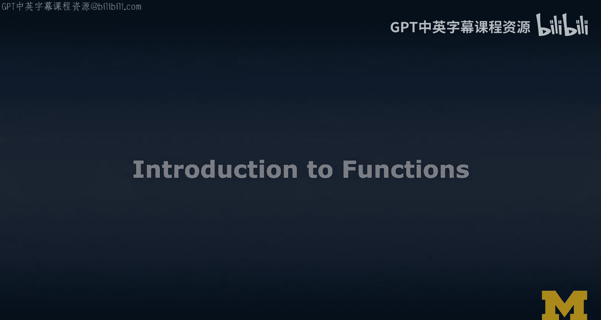
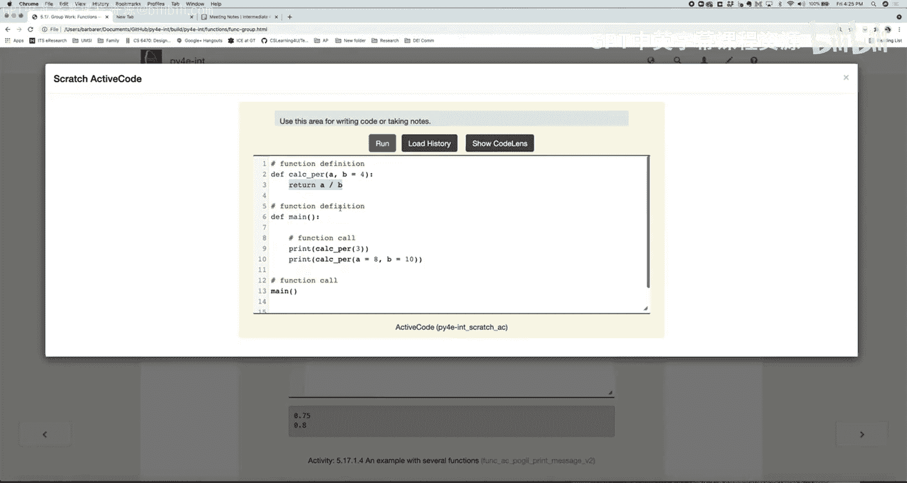

# 10：函数入门指南 🧩




在本节课中，我们将学习Python中函数的基础知识。函数是命名一组语句的方式，当你调用该函数时，这些语句就会被执行。我们将通过一个示例来了解函数的定义、调用以及参数传递。

## 函数定义与结构

上一节我们了解了函数的基本概念，本节中我们来看看函数的具体结构。一个函数定义包含几个关键部分。

以下是一个包含两个函数定义的示例：

```python
def calc_per(a, b=4):
    # 函数体语句
    result = (a + b) * 2
    return result

def main():
    # 函数体语句
    val1 = calc_per(3)
    val2 = calc_per(a=8, b=10)
    print(val1, val2)

# 调用main函数
main()
```

*   **函数头**：定义的第一行，以冒号结束。例如 `def calc_per(a, b=4):`。
*   **函数名**：跟在 `def` 关键字之后、参数列表之前的部分。`def` 关键字表明这是一个函数定义。
*   **参数列表**：括号内的一组名称，用于接收传递给函数的值。可以为其指定默认值，如 `b=4`。

## 函数调用与参数传递

理解了如何定义函数后，我们来看看如何调用它们。调用函数意味着执行其内部的语句。

以下是函数调用的方式：

*   使用函数名，后跟参数列表。例如 `calc_per(3)`。
*   当调用带有默认参数的函数时，可以只提供部分参数。例如 `calc_per(3)` 中，`b` 将使用默认值 `4`。
*   也可以通过命名参数的方式明确指定每个参数的值。例如 `calc_per(a=8, b=10)`。

在Python中，调用函数本身也是一个表达式。注意，函数可以不接收任何参数，也可以使用 `return` 关键字返回一个值。函数也可以不返回任何内容，例如示例中的 `main` 函数。



## 总结


本节课中我们一起学习了Python函数的基础知识。我们了解了如何定义函数，包括函数头、函数名和参数列表的写法。我们也探讨了如何调用函数，以及如何通过位置或命名的方式传递参数，包括使用默认参数。最后，我们知道了函数可以选择是否通过 `return` 语句返回一个值。掌握函数是组织代码和实现复用的关键一步。