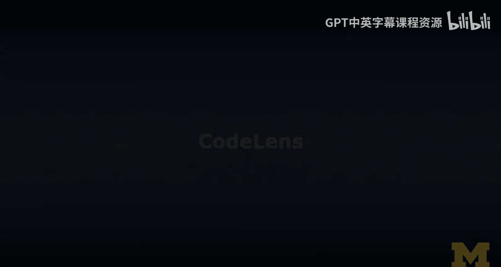
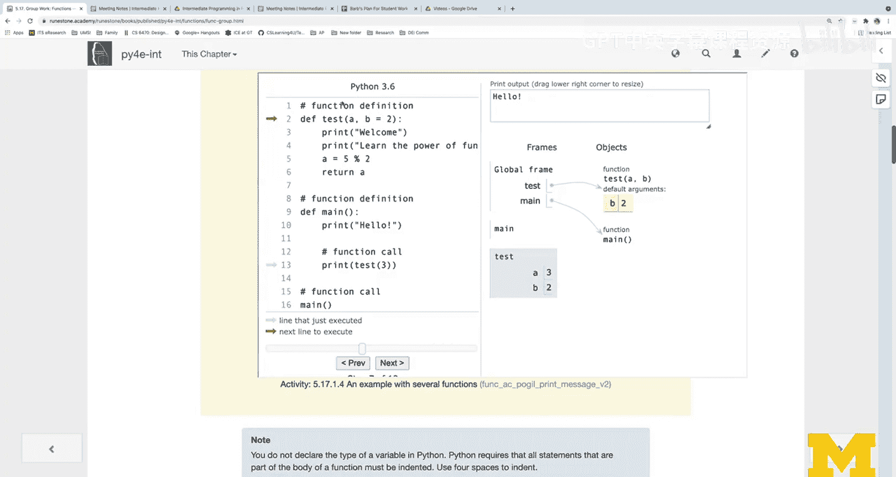
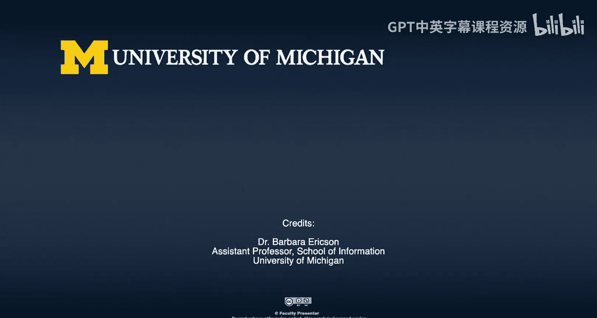

# 11：CodeLens代码可视化 🧐




在本节课中，我们将学习一个名为CodeLens的强大工具，它可以帮助我们可视化代码的执行过程，从而更好地理解程序内部发生了什么。

## 概述

理解代码的执行流程是编程学习中的关键一步。有时，仅仅阅读代码可能不足以让我们清楚地知道变量如何变化、函数如何被调用。为了解决这个问题，我们可以使用一种名为CodeLens的代码可视化工具。它本质上是一个集成在电子书中的Python Tutor版本，允许我们逐步执行代码，并清晰地看到每一步的执行结果和变量状态。

## CodeLens是什么？

上一节我们提到了理解代码的重要性，本节中我们来看看具体的工具。CodeLens是一个代码可视化功能。当你点击电子书中许多活动代码旁的CodeLens按钮时，就会在代码下方打开一个可视化界面。这个界面会逐步展示代码的执行过程，并显示每个变量的当前值，就像给代码的执行过程拍了一张张“快照”。

## 如何使用CodeLens？

让我们通过一个具体的例子来了解如何使用CodeLens。假设我们有以下一段简单的代码：

```python
# 这是一个测试函数
def test(a, b=2):
    return a * b

def main():
    print("hello")
    result = test(3)
    print(result)

main()
```

当我们点击这段代码旁的“Show Code Lens”按钮后，可视化工具会出现在代码下方。

## 逐步执行示例

以下是使用CodeLens逐步执行上述代码时，我们会观察到的关键步骤：

1.  **准备执行**：工具打开后，一条红线会指示即将执行的代码行。它会自动跳过注释行，因为计算机不执行注释。

2.  **定义函数**：点击“Next”按钮，工具会执行第2行，定义 `test` 函数。然后再次点击，它会跳到下一个定义，即定义 `main` 函数。

3.  **调用函数**：定义完函数后，红线会指向第16行 `main()` 这个函数调用。点击“Next”，我们将进入 `main` 函数内部开始执行。

4.  **执行主函数**：
    *   首先执行 `print("hello")`，我们会在输出区域看到打印出的“hello”。
    *   接着，要执行 `result = test(3)`，这意味着我们需要调用 `test` 函数。

5.  **进入test函数**：当调用 `test(3)` 时，工具会跳转到 `test` 函数。此时，我们可以清晰地看到参数 `a` 的值是3。同时，由于函数定义中为参数 `b` 设置了默认值 `b=2`，所以即使调用时只传了一个参数，`b` 的值也被自动赋为2。



通过这个逐步过程，我们就能直观地看到 `test(3)` 是如何计算出结果6，并最终被打印出来的。

## 总结




本节课我们一起学习了CodeLens代码可视化工具。它是一个极其有用的调试和理解工具，允许你像放电影一样一步步查看代码的执行过程，并实时观察每个变量的值。当你对某段代码的运行逻辑感到困惑时，不妨打开CodeLens，让它带你清晰地走一遍代码的旅程。