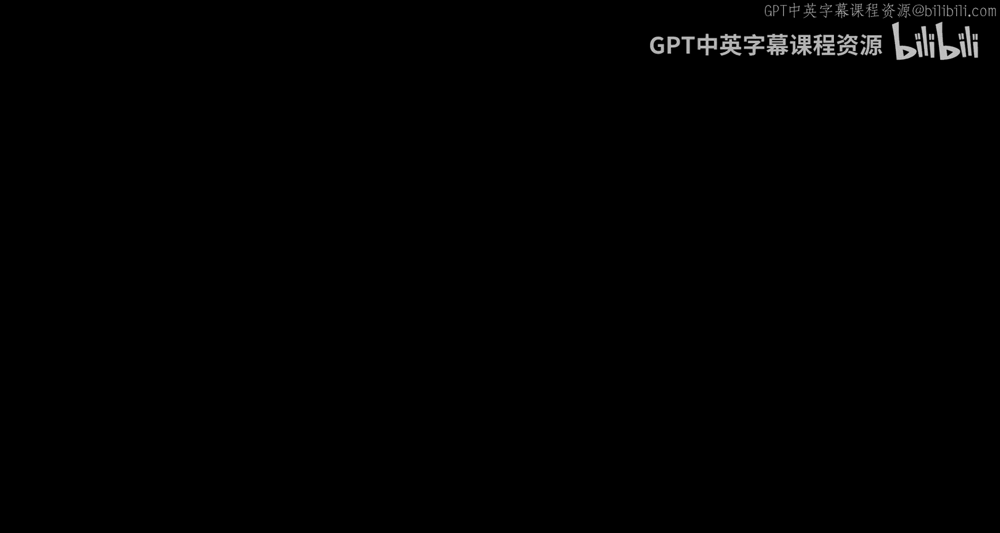
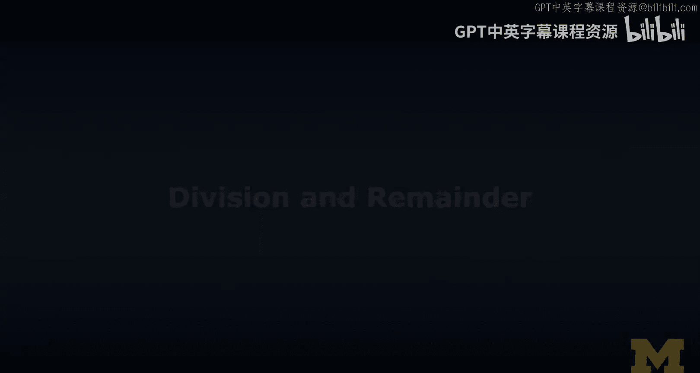
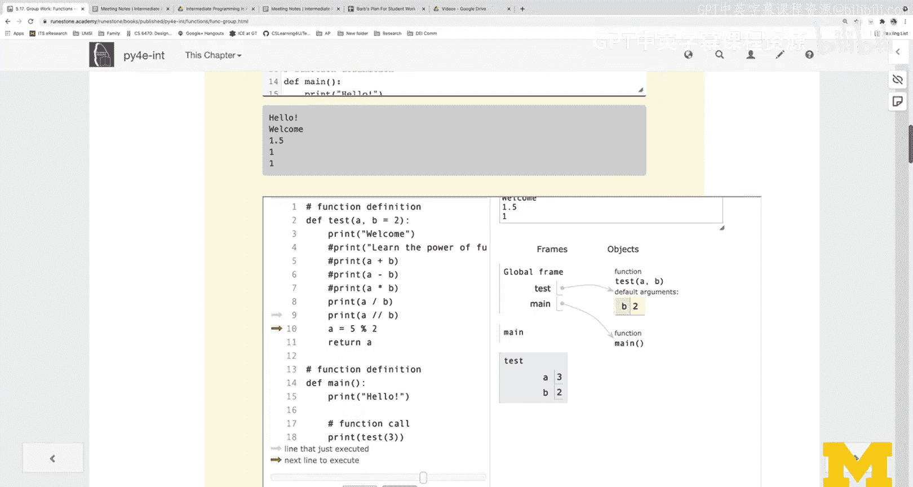
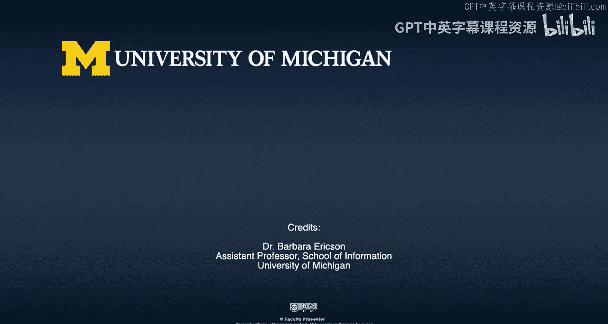

# 创造性编程：P12：整除、浮除与取模运算





## 📘 概述
在本节课中，我们将学习Python中三种基本的除法运算：浮点除法、整数除法和取模运算。理解这些运算的区别对于编写正确的程序至关重要。

## 🔍 代码示例分析
我们将通过一个具体的代码示例来逐步分析这三种运算的行为。首先，我们定义一个函数并执行它。

```python
def test(a, b=2):
    print("Welcome!")
    print(a / b)   # 浮点除法
    print(a // b)  # 整数除法
    print(a % b)   # 取模运算

def main():
    print("Hello")
    test(5)

main()
```

## 🧮 三种除法运算详解
以下是三种除法运算的核心概念和区别。

### 1. 浮点除法（Single Slash `/`）
浮点除法使用单个斜杠 `/`。它执行标准的除法运算，结果总是一个浮点数（即小数），即使两个数可以整除。

**公式**：`result = a / b`

在上面的例子中，当 `a = 5`，`b = 2` 时：
```python
print(5 / 2)  # 输出：2.5
```
运算 `5 / 2` 的结果是 `2.5`。

### 2. 整数除法（Double Slash `//`）
整数除法使用双斜杠 `//`。它执行除法运算，但会丢弃结果的小数部分（即向下取整），只返回整数商。

**公式**：`result = a // b` （商向下取整）

在上面的例子中：
```python
print(5 // 2)  # 输出：2
```
运算 `5 // 2` 的结果是 `2`。`2 * 2 = 4`，余数 `1` 被丢弃。

### 3. 取模运算（Percent Sign `%`）
取模运算使用百分号 `%`。它不返回商，而是返回两个数相除后的余数。

**公式**：`remainder = a % b`

在上面的例子中：
```python
print(5 % 2)  # 输出：1
```
运算 `5 % 2` 的结果是 `1`。因为 `2` 乘以 `2` 等于 `4`，`5` 减去 `4` 余 `1`。

## 💡 编程中的应用场景
理解这些运算的区别在编程中非常实用。以下是它们的一些常见用途：



*   **判断奇偶性**：使用取模运算 `%` 可以轻松判断一个数是奇数还是偶数。如果一个数 `n % 2` 的结果是 `0`，那么它是偶数；如果是 `1`，那么它是奇数。
*   **循环与分组**：取模运算常用于创建循环模式或将项目分组。例如，在列表中每隔N个元素执行一次操作。
*   **数据分割**：整数除法可以用于将总数分割成等份，例如计算一箱能装多少件物品。

## 📝 总结
本节课我们一起学习了Python中三种关键的算术运算：
1.  **浮点除法 `/`**：执行标准除法，结果总是浮点数。
2.  **整数除法 `//`**：执行除法并丢弃小数部分，只返回整数商。
3.  **取模运算 `%`**：返回两个数相除后的余数。



记住：单斜杠是浮除，双斜杠是整除，百分号是求余。掌握这些运算将帮助你更有效地处理数值计算和逻辑判断。