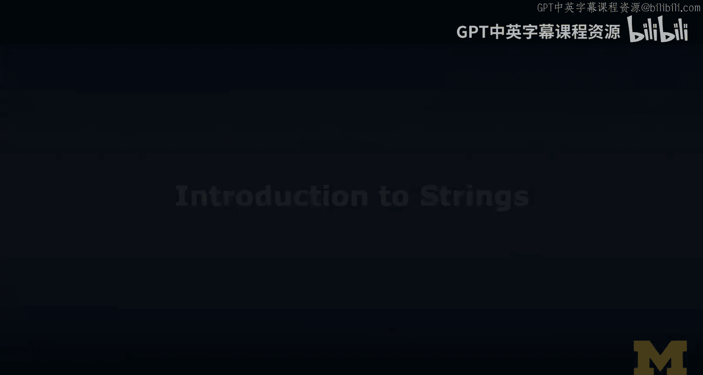
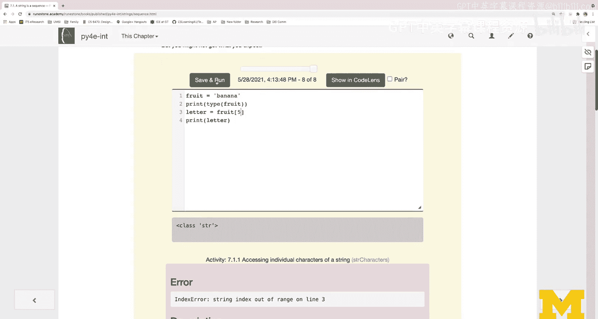

# 密歇根大学《创造性编程》：13：字符串综合解析


## 概述



在本节课中，我们将要学习Python中字符串的基本概念和操作。字符串是编程中处理文本数据的基础，理解其工作原理对于后续的编程学习至关重要。

---

## 字符串基础

计算机可以处理多种不同类型的数据，它们当然可以处理数字，也可以处理字符或字符串。字符串就是一个字符序列，并且在Python或大多数编程语言中，会保持这些字符的顺序。在Python中，你可以用成对的单引号、双引号，甚至三引号来包裹字符串。

请看以下代码。你认为当我打印它时会发生什么？

```python
fruit = 'banana'
```

这里，单引号包裹着字符串“banana”。接下来，我将打印这个变量`fruit`的类型。

```python
print(type(fruit))
```

然后，我将执行`letter = fruit[1]`，并打印这个`letter`变量。

```python
letter = fruit[1]
print(letter)
```

你认为会打印出哪个字母？这段代码首先会打印出`<class 'str'>`，其中“str”代表字符串。然后打印出的字母是“a”。

这是因为字符串的索引从0开始，而不是1。所以在这个字符串“banana”中，索引1对应的字符是“a”。

如果我将索引改为0并重新运行，现在会看到字母“B”。

```python
letter = fruit[0]
print(letter)  # 输出：B
```

那么，如果我尝试索引6会发生什么？因为这个字符串有6个字符。

```python
letter = fruit[6]  # 这将导致错误
```

实际上，这样做会导致“索引超出范围”的问题，因为最后一个有效的索引是5，即字符串长度减1。

---

## 字符串索引规则

上一节我们介绍了字符串的基本访问，本节中我们来看看字符串索引的具体规则。



记住，在处理字符串时，字符串的第一个元素位于索引0，最后一个元素位于索引`字符串长度 - 1`。

以下是关于字符串索引需要记住的几个关键点：

*   索引从0开始计数。
*   最后一个字符的索引是 `len(字符串) - 1`。
*   尝试访问不存在的索引（如本例中的索引6）会导致 `IndexError`。

---


## 总结


本节课中我们一起学习了Python字符串的基础知识。我们了解到字符串是字符的有序序列，可以使用单引号、双引号或三引号定义。最重要的是，我们掌握了字符串的索引机制，即索引从0开始，访问元素时必须确保索引值在有效范围内（0 到 长度-1）。理解这些概念是进行更复杂文本处理的第一步。