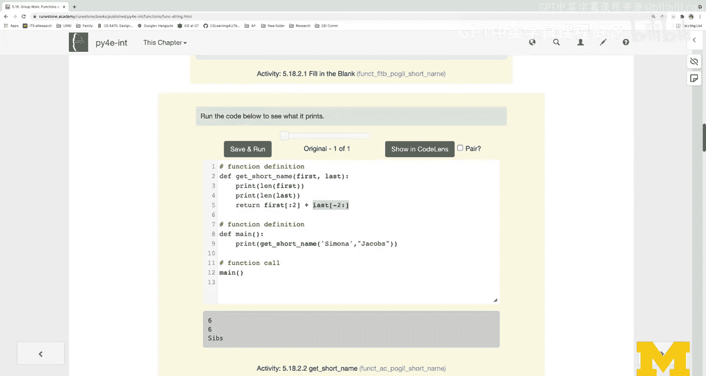
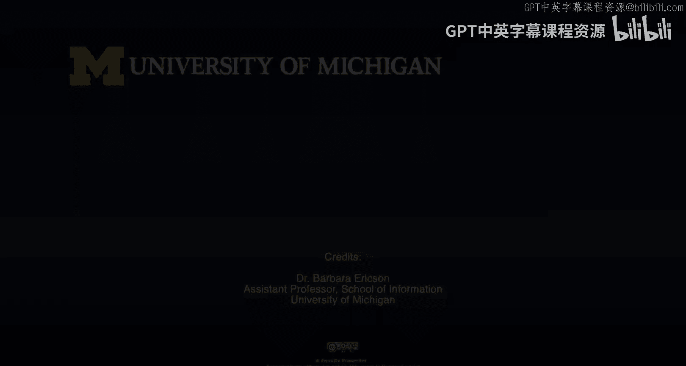
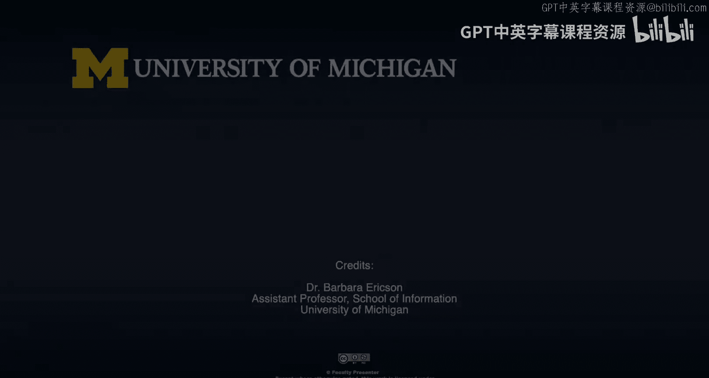

# 创造性编程：14：字符串切片技术 🧩


在本节课中，我们将要学习Python中一个非常实用的技术——字符串切片。通过切片，我们可以轻松地从一个字符串中获取指定的部分，而无需修改原始字符串。

## 概述

字符串切片允许我们获取字符串的特定部分或子串。在Python中，这被称为“切片”。请记住，切片操作不会改变原始字符串，它总是返回一个新的字符串。

## 切片基础

上一节我们介绍了切片的基本概念，本节中我们来看看切片的具体语法和用法。

切片的基本语法是 `string[start:end]`。其中：
*   `start` 是切片开始的索引（包含该索引处的字符）。
*   `end` 是切片结束的索引（**不包含**该索引处的字符）。

如果省略 `start`，则默认从索引0开始。如果省略 `end`，则默认到字符串末尾。

以下是几个关键点：
*   字符串索引从0开始。
*   切片 `[0:2]` 会获取索引0和1的字符，即前两个字符。
*   可以使用负数索引从字符串末尾开始计数，例如 `-1` 表示最后一个字符。
*   切片 `[-2:]` 会获取从倒数第二个字符开始到字符串末尾的所有字符。

## 代码示例解析

让我们通过一个具体的代码示例来理解切片是如何工作的。

```python
def get_short_name(first, last):
    return first[0:2] + last[-2:]

def main():
    first_name = "Christopher"
    last_name = "Columbus"
    short_name = get_short_name(first_name, last_name)
    print(short_name)  # 输出会是什么？

if __name__ == "__main__":
    main()
```

在这段代码中，`get_short_name` 函数接收名和姓，然后通过切片组合成一个短名称。

*   `first[0:2]` 获取 `first` 字符串的前两个字符（索引0和1）。对于 `"Christopher"`，结果是 `"Ch"`。
*   `last[-2:]` 获取 `last` 字符串的最后两个字符。对于 `"Columbus"`，结果是 `"us"`。
*   最后，将这两个切片结果用 `+` 运算符连接起来，得到 `"Ch" + "us" = "Chus"`。

因此，运行这段代码将打印出：**Chus**。





## 总结



本节课中我们一起学习了Python的字符串切片技术。我们了解到切片操作 `string[start:end]` 可以高效地提取字符串的子串，并且它总是返回一个新的字符串，不会修改原字符串。通过使用正数索引和负数索引，我们可以灵活地从字符串的开头或末尾进行切片。这是一个在数据处理和字符串操作中非常基础且强大的工具。