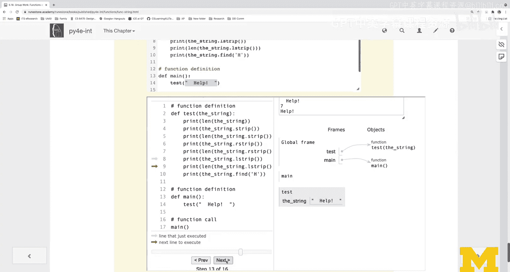

# 创造性编程：P15：字符清理方法 🧹


在本节课中，我们将学习Python中用于清理字符串的`strip`方法。这些方法能帮助我们移除字符串开头或结尾处不需要的字符，例如多余的空格、制表符或换行符。

## 概述

处理字符串时，我们经常会遇到字符串前后带有额外空格或其他空白字符的情况。这些多余字符会影响字符串比较、显示或进一步处理。Python提供了`strip()`、`rstrip()`和`lstrip()`三个方法来处理这类问题。本节我们将通过实例详细讲解它们的功能与区别。

## 核心方法解析

以下是三种字符串清理方法的基本说明：

*   **`strip()`**: 移除字符串**开头和结尾**的所有空白字符（包括空格、换行符`\n`、制表符`\t`等）。
*   **`rstrip()`**: 仅移除字符串**结尾（右侧）** 的空白字符。
*   **`lstrip()`**: 仅移除字符串**开头（左侧）** 的空白字符。

## 代码示例与逐步分析

为了直观地理解这些方法，我们通过一个具体的代码示例来逐步分析。假设我们有一个字符串 `"  help!  "`，其前后各有两个空格。

```python
def test(input_string):
    print(f"原始字符串长度: {len(input_string)}")
    print(f"原始字符串: '{input_string}'")

    stripped = input_string.strip()
    print(f"\n应用 strip() 后: '{stripped}'")
    print(f"strip() 后长度: {len(stripped)}")

    r_stripped = input_string.rstrip()
    print(f"\n应用 rstrip() 后: '{r_stripped}'")
    print(f"rstrip() 后长度: {len(r_stripped)}")

    l_stripped = input_string.lstrip()
    print(f"\n应用 lstrip() 后: '{l_stripped}'")
    print(f"lstrip() 后长度: {len(l_stripped)}")

def main():
    my_string = "  help!  "
    test(my_string)

if __name__ == "__main__":
    main()
```

现在，让我们模拟代码执行过程，观察每一步的变化：

1.  首先，定义`test`函数和`main`函数，然后调用`main()`。
2.  在`main`函数中，变量`my_string`被赋值为 `"  help!  "`（注意前后的空格）。
3.  调用`test`函数，并将`my_string`作为参数传入。
4.  在`test`函数内部，首先打印原始字符串及其长度。原始字符串 `"  help!  "` 的长度是 **9**（2个前空格 + 5个字符`help!` + 2个后空格）。
5.  接着，对字符串应用`strip()`方法。该方法会移除字符串**开头和结尾**的所有空白字符。因此，结果变为 `"help!"`，其长度变为 **5**。
6.  然后，对原始字符串应用`rstrip()`方法。该方法仅移除字符串**结尾（右侧）** 的空白字符。因此，结果变为 `"  help!"`，保留了开头的两个空格，其长度为 **7**。
7.  最后，对原始字符串应用`lstrip()`方法。该方法仅移除字符串**开头（左侧）** 的空白字符。因此，结果变为 `"help!  "`，保留了结尾的两个空格，其长度同样为 **7**。

## 总结




本节课我们一起学习了Python中用于清理字符串边缘空白字符的三个方法。`strip()`方法最为常用，它能一次性清理字符串两端的空白。而`rstrip()`和`lstrip()`则提供了更精细的控制，分别用于单独清理字符串右侧或左侧的空白。掌握这些方法能让你在处理用户输入、文件读取或数据清洗时，更高效地确保字符串数据的整洁性。