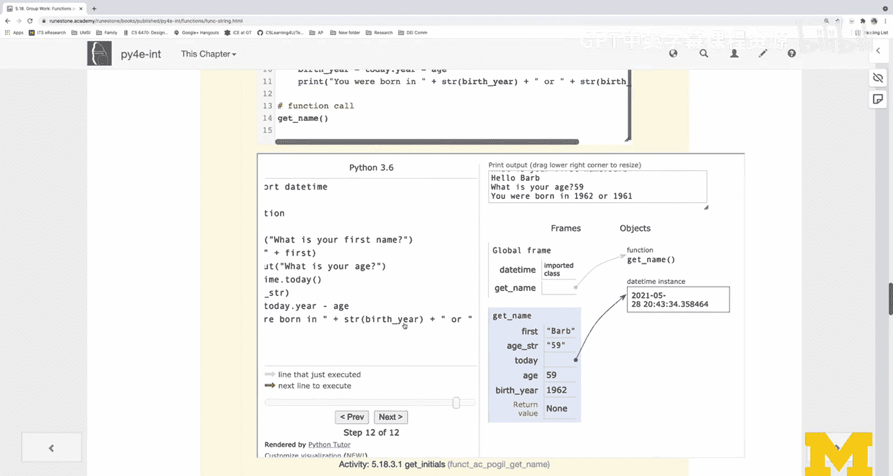
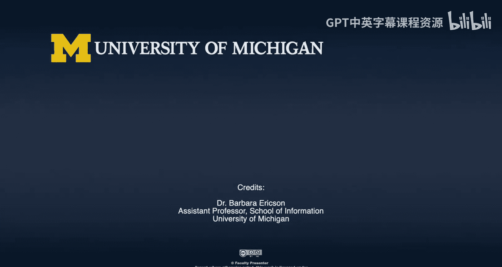

# 16：类型转换实践 🧮


在本节课中，我们将要学习编程中一个非常基础且重要的概念：**类型转换**。计算机会以不同的方式存储不同类型的数据，例如数字和字符。为了让程序正确运行，我们有时需要将数据从一种类型转换为另一种类型。

## 数据类型与转换的必要性

正如我们之前讨论过的，计算机中有不同类型的数据，它们以不同的方式被表示。例如，数字在计算机内部以一种方式存储，而像字母A、B、C这样的字符则以另一种方式存储。计算机需要明确知道我们正在处理的是字符串还是数字。

当我们将字符串拼接在一起时，比如在打印变量值时，必须牢记一个原则：**不能将两种不同类型的值直接组合在一起**。如果我有一个字符串，想加上一个数字，就必须先将数字转换为字符串。反之，如果我想对字符串进行数学计算，也必须先将它转换为数字。

## 代码示例解析

让我们通过一个具体的代码示例来理解这个过程。以下是示例代码的逐步解析：

```python
import datetime

def get_name():
    print("Hey input, what's your first name?")
    first_name = input()
    print("Hello " + first_name)
    print("What's your age?")
    age = input()
    print("What's today's date?")
    today = datetime.datetime.now()
    age_int = int(age)
    birth_year = today.year - age_int
    print("You were born in either " + str(birth_year) + " or " + str(birth_year - 1))
```

以下是代码执行流程的详细步骤：

1.  **获取姓名**：程序首先打印提示，要求用户输入名字。用户输入（例如“Barb”）后，程序会拼接字符串并问候用户。
2.  **获取年龄**：接着，程序询问用户的年龄。用户输入（例如“59”）后，这个值会被存储在变量 `age` 中。**请注意，此时 `age` 是一个字符串**，因为它来自 `input()` 函数。
3.  **类型转换与计算**：程序获取当前日期。为了计算出生年份，它需要将字符串 `age` 转换为整数。这是通过 `int(age)` 函数完成的。转换后，`age_int` 的值是整数 `59`。
4.  **执行计算**：程序用当前年份减去整数年龄，得到出生年份（例如1962）。
5.  **结果输出**：最后，程序需要将计算出的整数年份（`birth_year`）与字符串拼接起来输出。因此，它再次使用 `str(birth_year)` 将整数转换回字符串。

## 核心要点总结

本节课中我们一起学习了类型转换的核心概念和实践方法。记住以下两个关键点：

*   **输入默认为字符串**：使用 `input()` 函数获取的任何用户输入，初始类型都是字符串。
*   **转换函数**：
    *   要将字符串转换为整数以进行数学计算，请使用 `int()` 函数。
    *   要将数字（或其他类型）转换为字符串以进行拼接或输出，请使用 `str()` 函数。






理解并正确应用类型转换，是确保程序逻辑正确、避免常见错误的基础。