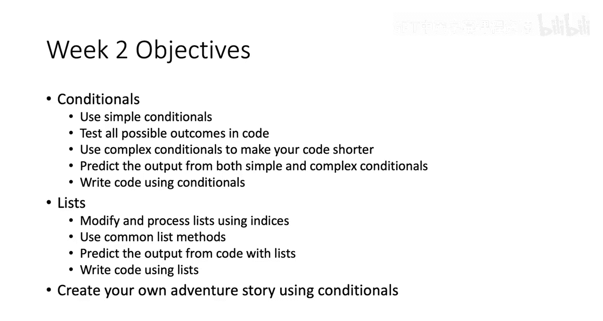

# 创造性编程：第二周：条件语句与列表入门 🚀


在本节课中，我们将要学习第二周的核心内容，重点掌握**条件语句**和**列表**这两个编程基础概念。通过它们，你可以让程序根据不同的情况做出决策，并有序地管理多个数据项。


## 条件语句：让程序学会选择 🤔

上一节我们介绍了本周的学习目标，本节中我们来看看**条件语句**。条件语句允许你根据某个条件是**真**还是**假**来决定是否执行特定的代码块。其核心逻辑可以用一个简单的公式来描述：

**如果 `条件` 为真，则执行 `代码块`。**

在Python中，最基本的条件语句使用 `if` 关键字。以下是其基本结构：

```python
if 条件:
    # 条件为真时执行的代码
```

你将通过条件语句完成以下学习任务：

*   **使用简单的条件语句**：掌握 `if` 语句的基本用法。
*   **测试代码中的所有可能结果**：确保程序在各种情况下都能正确运行。
*   **使用复杂的条件语句**：学习 `elif` 和 `else` 来缩短代码，处理多种情况。
*   **预测条件语句的输出**：在运行代码前，推断程序会输出什么结果。
*   **结合条件语句与列表编写代码**：将决策逻辑应用到数据集合中。

## 列表：有序的数据集合 📋

学会了如何做决策，我们还需要一种结构来有效地存储和管理数据。这就是**列表**。列表可以按顺序存放多个项目（元素）。

在Python中，列表用方括号 `[]` 表示，元素之间用逗号分隔。例如，一个存储水果的列表可以这样定义：

```python
fruits = [“苹果”, “香蕉”, “橙子”]
```

你将通过列表完成以下学习任务：

*   **使用索引修改和处理列表**：学习如何通过位置（索引）访问和更改列表中的元素。索引从0开始。
*   **使用常见的列表方法**：例如，使用 `append()` 在列表末尾添加元素，或使用 `pop()` 移除元素。
*   **预测包含列表的代码输出**：理解列表操作如何改变数据，并预测最终结果。
*   **编写使用列表的代码**：在实际编程任务中应用列表。

## 本周任务预告 🎯



在本周结束时，你的作业将是**使用条件语句创建一个属于你自己的文字冒险故事**。你将运用所学的条件判断，为玩家设计不同的故事分支和结局。


---


本节课中我们一起学习了第二周的两个核心主题：**条件语句**和**列表**。你了解了条件语句如何让程序根据条件执行不同代码，也认识了列表作为有序集合的基本用法。掌握这些是构建更复杂、更智能程序的重要一步。