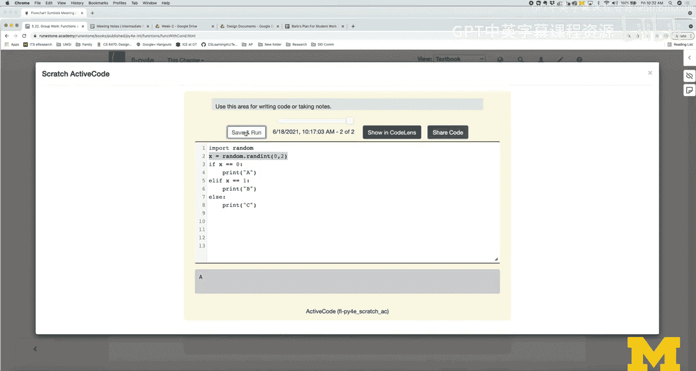

# 18：条件语句解析 🧠


在本节课中，我们将要学习编程中一个非常强大的概念：**条件语句**。它允许程序根据特定条件是否为真，来决定执行哪一部分代码。我们将通过一个简单的例子来理解其工作原理，并学习如何在Python中实现它。

---

## 从顺序执行到条件执行

之前我们接触的代码大多是**顺序执行**的，即一行接一行地运行。而条件语句赋予了程序**选择性执行**的能力，即只有当某个条件为真（或为假）时，才执行特定的代码块。

为了理解这个概念，让我们设想一个场景：有三个人想出去吃饭，但无法决定去哪家餐厅，因为他们各自有最喜欢的三个不同餐厅。如何随机地为他们做出选择呢？

---

## 一个决策流程图

我们可以编写一个Python程序来解决这个问题。思路是：随机生成一个0到2之间的整数（对应三个选项），然后根据这个数字决定餐厅。

在分析代码执行路径时，我们常用**流程图**来可视化。在流程图中，我们用**菱形**来表示条件判断。

以下是上述餐厅选择问题的流程图逻辑：
1.  生成一个随机数 `x`（0, 1, 2）。
2.  检查条件 `x == 0` 是否为真。
    *   如果为真，选择餐厅 A。
3.  如果为假，则检查下一个条件 `x == 1` 是否为真。
    *   如果为真，选择餐厅 B。
4.  如果以上条件均为假，则默认选择餐厅 C。

---

## 在Python中实现条件语句

现在，让我们将上述逻辑转化为实际的Python代码。首先，我们需要导入 `random` 模块来生成随机数。

以下是实现代码：

```python
import random

# 生成一个0到2之间（包含0和2）的随机整数
x = random.randint(0, 2)

# 根据x的值决定输出
if x == 0:
    print("A")
elif x == 1:
    print("B")
else:
    print("C")
```

**代码解析：**
*   `import random`: 导入随机数模块。
*   `x = random.randint(0, 2)`: 生成一个随机整数并赋值给变量 `x`，其值可能是0、1或2。
*   `if x == 0:`: 第一个条件判断。如果 `x` 等于0，则执行下方缩进的代码块，打印“A”。
*   `elif x == 1:`: `elif` 是“否则如果”的缩写。如果第一个条件不满足（即 `x` 不是0），则检查这个条件。如果 `x` 等于1，则打印“B”。
*   `else:`: 如果以上所有条件都不满足，则执行 `else` 下方的代码块，打印“C”。

运行这段程序，每次的输出可能会是“A”、“B”或“C”，实现了随机选择的效果。

---



## 总结


本节课中我们一起学习了**条件语句**。我们了解到，通过使用 `if`、`elif` 和 `else` 关键字，程序可以根据不同的条件做出决策，从而执行不同的代码路径。这是让程序变得“智能”和灵活的基础工具之一。从简单的餐厅选择到复杂的游戏逻辑，条件语句都是构建程序决策能力的核心。