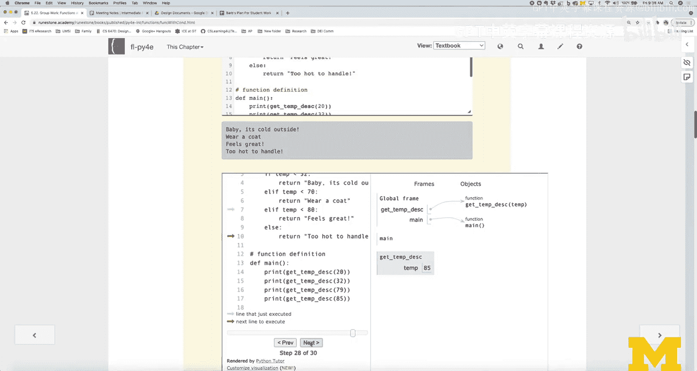

# 创造性编程：19：全条件测试实践 🧪


在本节课中，我们将学习如何对条件语句进行全面的测试。我们将通过一个具体的例子，了解如何确保测试覆盖条件语句的每一个可能分支，并学习使用代码调试工具来观察程序的执行流程。

## 概述

条件语句是编程中控制程序流程的重要结构。为了确保代码在各种情况下都能正确运行，测试每一个条件分支至关重要。本节将通过一个温度判断函数的例子，演示如何进行全面的条件测试。

## 条件分支测试

上一节我们介绍了条件语句的基本概念，本节中我们来看看如何系统地测试一个包含多个分支的条件语句。

以下是一个根据温度给出建议的函数示例：

```python
def temperature_advice(temp):
    if temp < 32:
        return "baby it's cold outside"
    elif temp < 70:
        return "wear a coat"
    elif temp < 80:
        return "feels great"
    else:
        return "too hot to handle"
```

这个函数包含四个可能的分支。为了全面测试，我们需要为每个分支提供相应的输入值。

以下是测试每个分支所需的输入值列表：

*   **分支一 (`temp < 32`)**：输入 `20`，预期输出 `"baby it's cold outside"`。
*   **分支二 (`temp < 70`)**：输入 `32`，预期输出 `"wear a coat"`。
*   **分支三 (`temp < 80`)**：输入 `79`，预期输出 `"feels great"`。
*   **分支四 (`else`)**：输入 `85`，预期输出 `"too hot to handle"`。

特别需要注意的是，测试边界条件（例如刚好等于或略高于/低于临界值的数字）非常重要，这有助于发现潜在的错误。

## 使用代码调试工具

除了编写测试用例，我们还可以利用代码调试工具（如代码透镜）来逐步执行程序，直观地观察每个条件分支是如何被评估和执行的。

以下是使用调试工具观察程序执行流程的步骤：

1.  首先，工具会定义 `temperature_advice` 函数和 `main` 函数。
2.  调用 `main` 函数后，程序开始执行。
3.  当调用 `temperature_advice(20)` 时，调试器进入函数内部。它检查条件 `temp < 32`，结果为真，因此返回 `"baby it's cold outside"`，随后该结果被打印出来。
4.  接着调用 `temperature_advice(32)`。条件 `temp < 32` 为假，于是检查下一个条件 `temp < 70`，结果为真，因此返回 `"wear a coat"` 并打印。
5.  调用 `temperature_advice(79)` 时，前两个条件均为假，检查第三个条件 `temp < 80` 为真，返回 `"feels great"` 并打印。
6.  最后调用 `temperature_advice(85)`，所有 `if` 和 `elif` 条件均为假，程序执行最后的 `else` 分支，返回 `"too hot to handle"` 并打印。

通过这种方式，你可以清晰地看到程序在每个测试用例下的执行路径，确保所有逻辑都按预期工作。

## 总结




本节课中我们一起学习了如何对条件语句进行全面的测试。关键点包括：为条件语句的每一个可能分支设计测试用例，特别注意测试边界条件，以及利用代码调试工具逐步跟踪程序的执行过程，以验证每个分支的逻辑是否正确。记住，充分的测试是编写健壮、可靠代码的重要环节。