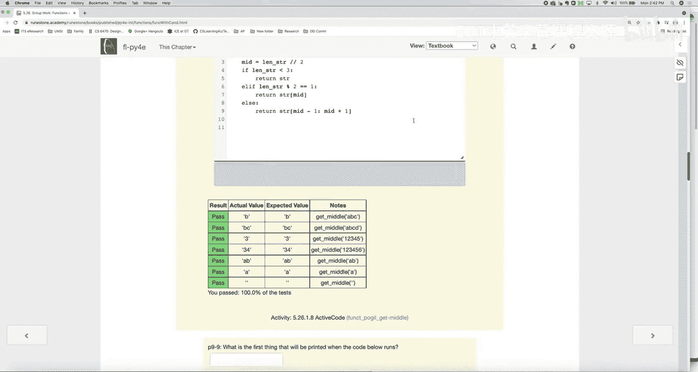

# 创造性编程：20：编写get_middle函数 🧮


在本节课中，我们将学习如何编写一个名为 `get_middle` 的函数。这个函数的核心任务是接收一个字符串，并根据其长度返回中间的字符。我们将通过分析字符串的长度和奇偶性，来设计相应的逻辑。

## 概述

`get_middle` 函数的目标是：给定一个字符串 `s`，返回其“中间”的字符。具体规则如下：
*   如果字符串长度小于3，则直接返回原字符串。
*   如果字符串长度为奇数，则返回正中间的一个字符。
*   如果字符串长度为偶数，则返回中间的两个字符。

例如，`get_middle(“ABC”)` 应返回 `”B”`，而 `get_middle(“ABCD”)` 应返回 `”BC”`。

## 实现步骤

首先，我们需要获取输入字符串的长度，这是后续所有判断的基础。

以下是实现 `get_middle` 函数的具体步骤：

**第一步：获取字符串长度**
我们使用Python内置的 `len()` 函数来获取字符串的长度，并将其存储在一个变量中。
```python
length_str = len(s)
```

**第二步：计算中间索引**
我们需要找到字符串的“中间”位置。由于字符串索引必须是整数，我们使用整数除法 `//` 来计算。
```python
mid = length_str // 2
```

**第三步：根据条件返回结果**
现在，我们可以根据字符串的长度和奇偶性，使用条件语句来决定返回什么。

*   **条件一：长度小于3**
    如果字符串长度小于3，直接返回原字符串。
    ```python
    if length_str < 3:
        return s
    ```

*   **条件二：长度为奇数**
    如何判断一个数是奇数？我们可以使用取模运算符 `%`。如果一个数除以2的余数为1，那么它就是奇数。
    ```python
    elif length_str % 2 == 1:
        return s[mid]
    ```

*   **条件三：长度为偶数**
    如果长度是偶数，我们需要返回中间的两个字符。对于长度为4的字符串 `”ABCD”`，`mid` 的值是2（索引为0,1,2,3）。我们需要的两个字符是索引1和2（即 `”BC”`）。因此，我们使用字符串切片 `s[mid-1:mid+1]` 来获取它们。
    ```python
    else:
        return s[mid-1:mid+1]
    ```

## 完整代码示例

将以上步骤组合起来，就得到了 `get_middle` 函数的完整实现。

```python
def get_middle(s):
    length_str = len(s)
    mid = length_str // 2

    if length_str < 3:
        return s
    elif length_str % 2 == 1:
        return s[mid]
    else:
        return s[mid-1:mid+1]
```

## 总结




本节课我们一起学习了如何编写 `get_middle` 函数。我们掌握了几个关键点：使用 `len()` 获取长度，使用 `//` 进行整数除法以计算中间索引，使用 `%` 判断奇偶性，以及根据不同的条件使用返回语句或字符串切片来得到最终结果。这个练习很好地融合了字符串操作和条件逻辑的应用。