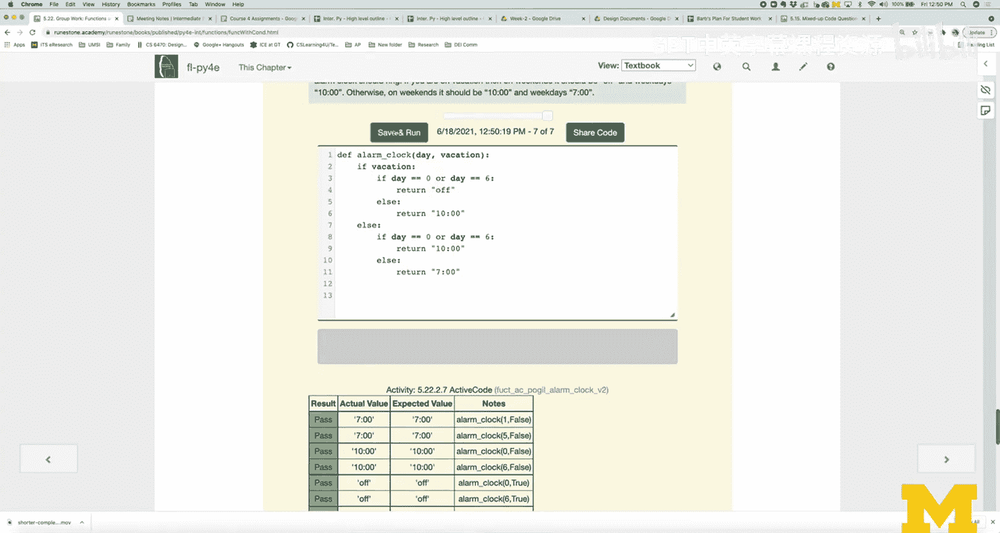

# 21：实现闹钟功能代码 🕐


在本节课中，我们将学习如何实现一个简单的闹钟功能。这个功能会根据给定的星期几（用数字表示）以及你是否在度假，来决定闹钟应该设置为“关闭”、“10点”还是“7点”响起。

## 概述

我们将编写一个函数，它接收三个参数：`day`（星期几，0代表周日，6代表周六），`vacation`（是否在度假，布尔值）。根据规则，我们需要返回对应的闹钟设置。规则如下：
*   如果你在度假且是周末，闹钟应为“关闭”。
*   如果你在度假且是工作日，闹钟应为“10点”。
*   如果你不在度假且是周末，闹钟应为“10点”。
*   如果你不在度假且是工作日，闹钟应为“7点”。

上一节我们介绍了问题背景，本节中我们来看看具体的代码实现。

## 方法一：使用列表判断周末

首先，我们可以创建一个列表来定义哪些天是周末。然后使用Python的`in`操作符来判断给定的`day`是否在周末列表中。

以下是使用此方法的代码实现：

```python
def alarm_clock(day, vacation):
    # 定义周末列表，0代表周日，6代表周六
    weekend = [0, 6]

    if vacation:
        # 如果在度假
        if day in weekend:
            return "off"
        else:
            return "10:00"
    else:
        # 如果不在度假
        if day in weekend:
            return "10:00"
        else:
            return "7:00"
```

运行这段代码，它将通过所有测试用例，证明其正确性。

## 方法二：使用逻辑运算符判断周末

除了使用列表，我们也可以直接使用逻辑运算符来检查`day`是否为周末（即等于0或6）。

以下是使用此方法的代码实现：

```python
def alarm_clock(day, vacation):
    if vacation:
        # 如果在度假
        if day == 0 or day == 6:  # 检查是否为周日或周六
            return "off"
        else:
            return "10:00"
    else:
        # 如果不在度假
        if day == 0 or day == 6:  # 检查是否为周日或周六
            return "10:00"
        else:
            return "7:00"
```



同样，运行这段代码也能通过所有测试。这为我们提供了至少两种解决闹钟问题的方法。

## 总结


本节课中我们一起学习了如何实现一个基础的闹钟逻辑函数。我们探讨了两种方法：第一种利用**列表**和`in`操作符来判断日期属性；第二种直接使用**逻辑比较**（`==`和`or`）。两种方法都有效，你可以根据个人偏好或具体场景选择使用。核心在于理解问题规则，并将其清晰地转化为条件判断语句。