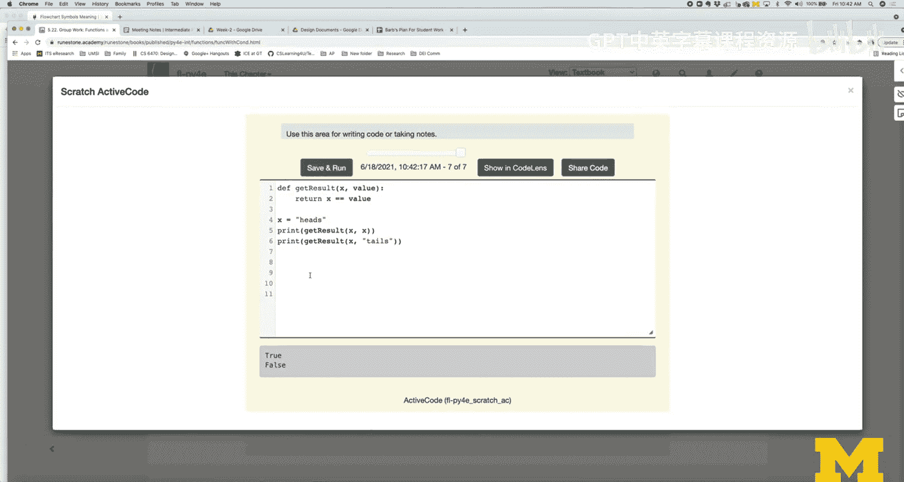

# 创造性编程：22：布尔表达式返回值技巧 🎯


在本节课中，我们将学习一个简化代码的技巧：如何直接返回布尔表达式的结果，从而避免冗长的 `if-else` 条件判断。

## 概述

我们经常会遇到只有两种可能结果的条件判断。例如，抛一枚硬币，结果要么是正面，要么是反面。在编程中，我们可能会编写一个函数来检查某个变量是否等于特定值，如果相等则返回 `True`，否则返回 `False`。本节课将介绍一种更简洁的写法。

## 初始代码示例

让我们先看一段代码。这里有一个名为 `get_result` 的函数，它接收一个变量 `x` 和一个值，然后检查 `x` 是否等于该值。如果相等，函数返回 `True`；否则返回 `False`。

```python
def get_result(x, value):
    if x == value:
        return True
    else:
        return False

x = "heads"
print(get_result(x, "heads"))  # 应输出 True
print(get_result(x, "tails"))  # 应输出 False
```

运行这段代码，我们首先会得到 `True`，然后是 `False`。注意，函数内部的 `x` 和外部的 `x` 虽然同名，但在 Python 中属于不同的命名空间，因此可以重复使用变量名。

## 简化技巧

上一节我们介绍了使用 `if-else` 语句进行条件判断的常规方法。本节中我们来看看如何简化它。

仔细观察，我们的逻辑是：如果测试条件为真，则返回 `True`；否则返回 `False`。实际上，我们可以直接返回这个测试条件本身的结果。

以下是简化后的代码：

```python
def get_result(x, value):
    return x == value

x = "heads"
print(get_result(x, "heads"))  # 输出 True
print(get_result(x, "tails"))  # 输出 False
```

通过直接返回表达式 `x == value`，我们删除了三行代码，但得到了完全相同的结果。表达式 `x == value` 本身就会计算出一个布尔值（`True` 或 `False`）。

## 核心要点总结

本节课中我们一起学习了布尔表达式的返回值技巧。




*   当你发现自己的代码模式是“如果某条件为真，则返回 `True`，否则返回 `False`”时，你可以直接返回该条件表达式本身。
*   这个技巧能让你的代码更简短、更清晰。
*   其核心公式是：用 **`return <condition>`** 替代 **`if <condition>: return True else: return False`**。


记住这个技巧，它是在处理简单布尔逻辑时让代码更优雅的有效方法。