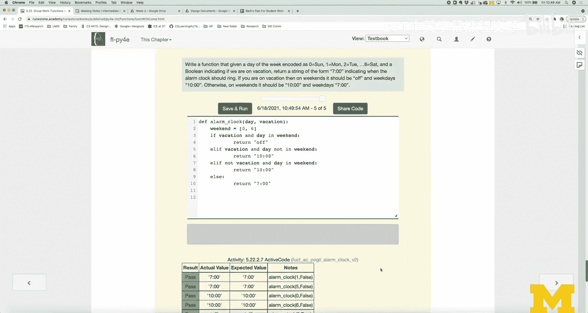

# 创造性编程：23：复杂条件语句应用 🧩


在本节课中，我们将学习如何使用复杂的条件语句来简化代码。通过将嵌套的 `if` 语句合并为单个复杂的布尔表达式，我们可以使代码更简洁、更易读。

---

## 概述

编写代码时，我们经常会遇到需要检查多个条件的情况。一种常见的做法是使用嵌套的 `if` 语句，但这可能导致代码冗长且难以维护。本节将介绍如何利用逻辑运算符（`and`、`or`、`not`）创建复杂的条件语句，从而简化嵌套结构。

## 从嵌套条件到复杂条件

上一节我们介绍了嵌套 `if` 语句的基本用法。本节中，我们来看看如何将它们转换为更简洁的复杂条件语句。

当你发现自己在编写嵌套的 `if` 语句（即一个 `if` 语句内部包含另一个 `if` 语句）时，可以考虑使用逻辑运算符将它们合并。逻辑运算符 `and`、`or` 和 `not` 可以组合布尔表达式，形成复杂的条件。

以下是一个使用闹钟程序的示例。原始代码使用了嵌套条件：

```python
if vacation:
    if day in weekend:
        return "off"
    else:
        return "10:00"
else:
    if day in weekend:
        return "10:00"
    else:
        return "7:00"
```

我们可以将其重写为使用复杂条件语句的形式：

```python
if vacation and day in weekend:
    return "off"
elif vacation and day not in weekend:
    return "10:00"
elif not vacation and day in weekend:
    return "10:00"
else:
    return "7:00"
```

运行修改后的代码，结果与原始版本相同，但代码行数更少，结构更清晰。

## 关于代码可读性的注意事项

虽然复杂条件语句可以使代码更短，但人们常常在处理它们时遇到困难。更短的代码并不总是更好，因为它可能更难理解。因此，在追求简洁的同时，也应确保代码易于他人阅读和维护。

---




## 总结


本节课中我们一起学习了如何应用复杂的条件语句来简化嵌套的 `if` 结构。通过使用逻辑运算符 `and`、`or` 和 `not`，我们可以将多个条件合并为单个表达式，从而使代码更加简洁。记住，在优化代码长度时，始终要权衡可读性和维护性。