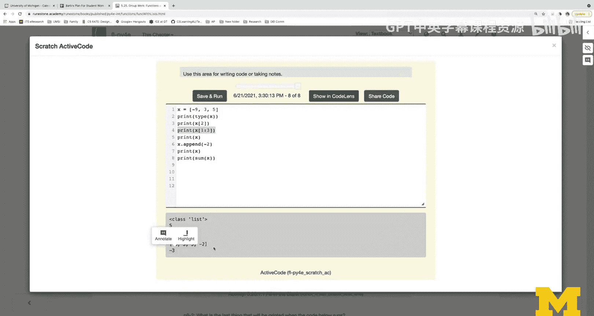

# 创造性编程：P24：列表综合解析


在本节课中，我们将要学习Python中一个非常重要的数据结构——列表。我们将了解列表的基本概念、如何创建和操作列表，以及如何使用列表来组织和处理数据。

## 列表的基本概念

上一节我们介绍了数据组织的基本思想，本节中我们来看看Python中实现这一思想的具体工具——列表。

列表是一种按顺序存储项目的数据结构。这类似于一个生日愿望清单，你可以在清单上添加你感兴趣的物品，也可以移除物品。你可以询问清单上的第一项是什么，第二项是什么。总之，列表的核心概念是**按顺序保存项目**。

## 在Python中创建和访问列表

了解了列表的概念后，我们来看看在Python中如何具体使用列表。

在Python中，我们使用方括号 `[]` 来创建一个列表，并用逗号分隔其中的值。例如，创建一个数字列表：

```python
x = [3, 4, 5, 6]
print(type(x))
```

与字符串类似，我们可以使用方括号和索引来获取列表中特定位置的值。索引从0开始计数。

```python
print(x[2])  # 获取索引为2的元素，即第三个元素
```

我们还可以使用切片操作符来获取列表的一个子集。切片语法为 `[start:end]`，它包含起始索引，但不包含结束索引。

```python
print(x[1:3])  # 获取从索引1到索引3（不包含3）的子列表
```

## 列表的操作与方法

列表在Python中是一种被称为“列表类”的对象。这个类内置了许多方法，可以对列表进行各种操作。

以下是列表的一些常用操作：

*   **添加元素**：使用 `append()` 方法可以在列表的末尾添加一个新元素。
*   **获取长度**：使用内置函数 `len()` 可以获取列表中元素的数量。
*   **计算总和**：如果列表中的元素都是数字，可以使用内置函数 `sum()` 计算所有元素的总和。

让我们通过代码来演示这些操作：

```python
x = [3, 4, 5, 6]
print(x)          # 打印原始列表

x.append(7)       # 在列表末尾添加数字7
print(x)          # 打印添加元素后的列表

print(len(x))     # 打印列表的长度
print(sum(x))     # 打印列表中所有数字的总和
```

运行这段代码，你会看到：
1.  原始列表是 `[3, 4, 5, 6]`。
2.  使用 `append(7)` 后，列表变为 `[3, 4, 5, 6, 7]`。
3.  `len(x)` 返回 `5`，因为列表中有5个元素。
4.  `sum(x)` 返回 `25`，即 `3+4+5+6+7` 的结果。

需要特别注意的是，切片操作（如 `x[1:3]`）会返回列表的一个**副本**，而不会修改原始列表。



## 总结


本节课中我们一起学习了Python列表的基础知识。我们了解到列表是一种有序的数据集合，使用方括号创建。我们学会了如何通过索引访问元素、使用切片获取子列表，以及如何使用 `append()`、`len()` 和 `sum()` 等方法来修改和查询列表。列表是Python编程中组织数据的核心工具之一，熟练掌握它对于后续的学习至关重要。